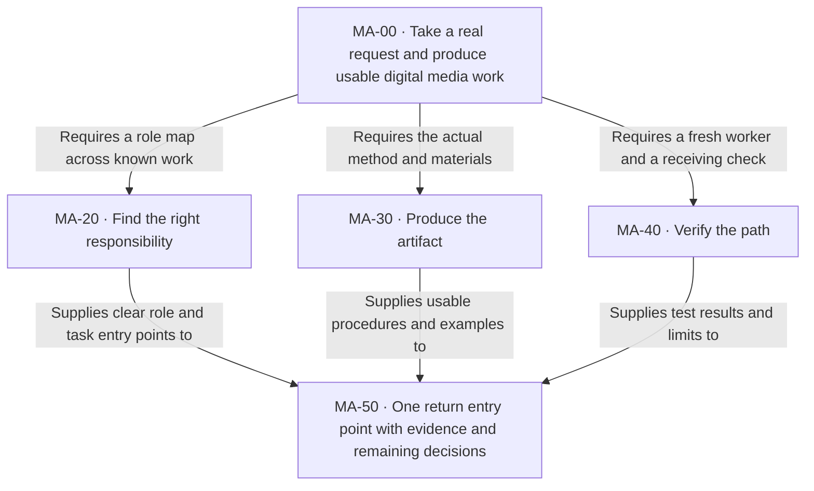
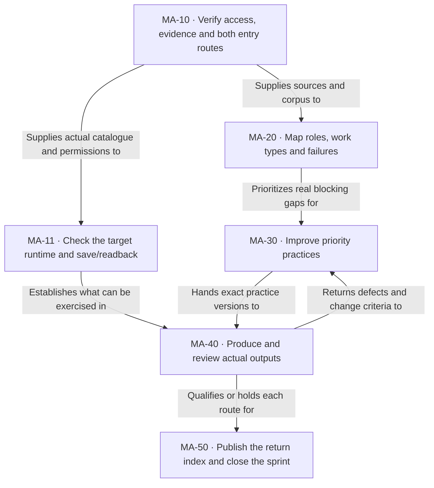
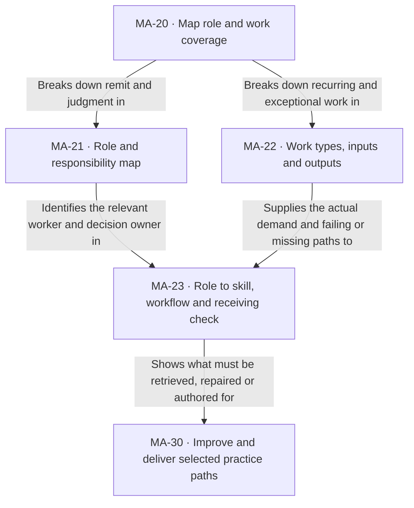
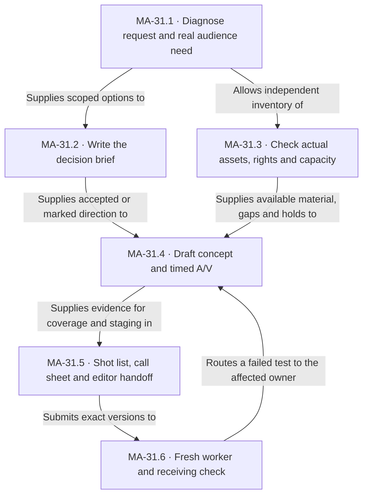
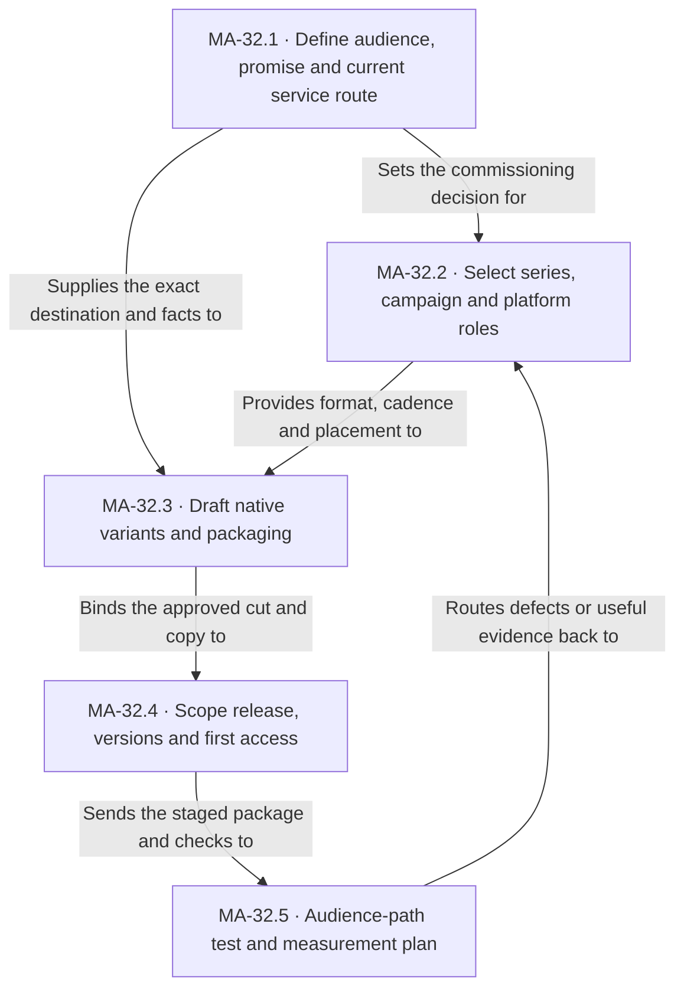
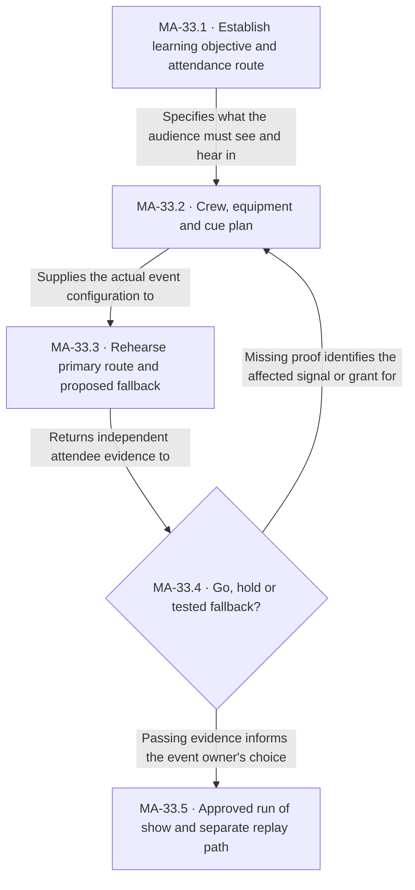
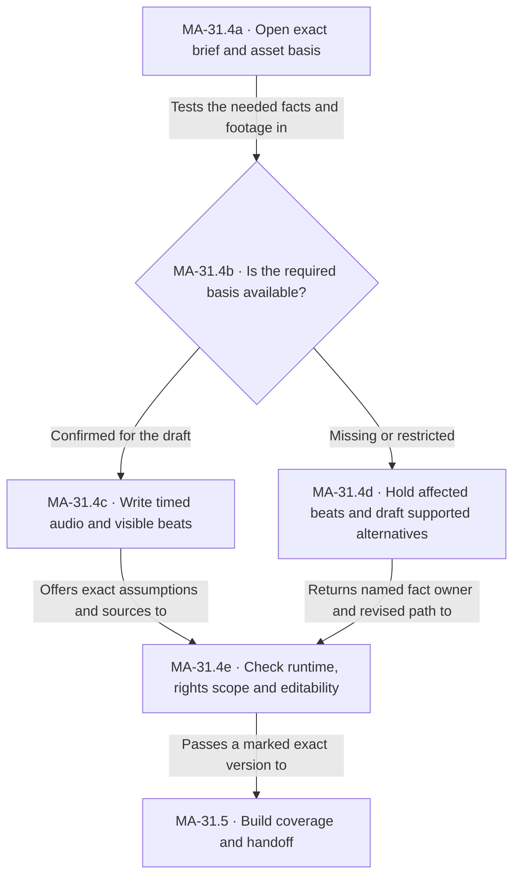
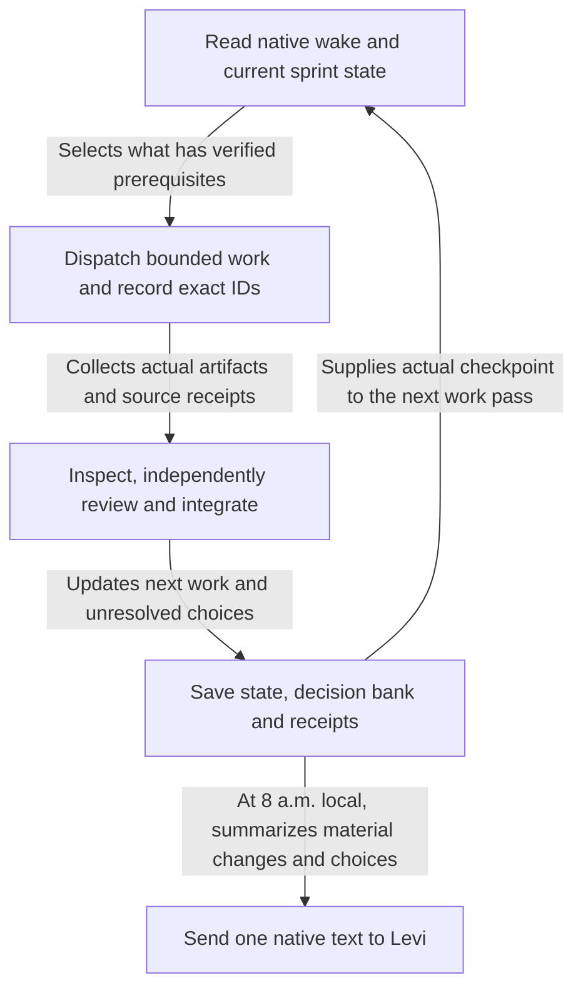

# Media Agency six-day commission for Mugen

**November 17–22, 2026 · America/Edmonton · MA-SPRINT-01**

Mugen coordinates this sprint. Its outcome is a Media Agency an LLM can enter with a real request, find the right role and complete procedure, and produce the digital work a human can use. Physical capture, live operation, interviews, workplace commitments, clearances and publication stay with authorized people. Use the six days to complete the role and work coverage map and qualify the highest-value end-to-end paths. Mark the exact work each path can support and the evidence still needed for other work.

[Current sprint state and decision bank](https://drive.google.com/file/d/1i8rBhCecot6KeFoYHQrjhSRw7C0fjf7X/view?usp=drivesdk) · [Crucible rule for representing work](https://drive.google.com/file/d/12g3049KjSEQfE0b9gbd0_82oywi0vUWK/view) · [Media Agency knowledge base](https://drive.google.com/drive/folders/17acyOTKOaWbj5-830-51cbEE_RW_vWwE) · [Media Agency project entry](https://drive.google.com/drive/folders/1aLm9q4U0tD097b5FK0O3lTrtTDLWcapH) · [Skills and Workflows index](https://drive.google.com/file/d/1MZLjp12rhXYT5o5XktIm_7Vn0xlemfjl/view) · [Past verification](https://drive.google.com/file/d/1wk8GQjT-5pEoBaOAvYnR5PUYuXzNAqgT/view)

## Level 0 · Return outcomes and evidence

Each lower view expands a named node from its parent. Use the same ID in the plan, assignment, output and test. Read the first graph to understand the intended result. Descend only far enough to resolve the work or decision at hand.

| Outcome | Evidence due by the end of the sprint |
| --- | --- |
| **MA-20 Coverage** | All 12 existing role graphs accounted for, with contributor practices for video, writing, design, motion, live and channel work. Each known work type has a role, judgment, owner boundary, output, and an existing runnable procedure or a named gap. Check the current inventory of 55 practices against evidence. This is coverage of the reviewed domain. |
| **MA-30 Execution** | Priority procedures can be opened directly from the ordinary entry point. The worker has instructions, required knowledge, a template or example, realistic tool and source requirements, and a receiving check. Reuse verified existing practices before authoring new material. |
| **MA-40 Qualification** | Try the highest-value paths below using fresh workers. Require actual output files or content. Compare to prewritten acceptance criteria and changed-input variants. Report separately what was demonstrated in an exercise, what a receiver accepted on real work, and what remains tool- or authority-dependent. |
| **MA-50 Return** | A single starting link, a list of usable paths with exact versions and tests, the current coverage map, and the decision bank. Make the first useful assignment easy to start in ten seconds. |

## Level 1 · Sprint dependencies and parallel work

Run up to two independent workstreams with one integrating coordinator and an independent reviewer for each consequential result. Use one owner per artifact and one writer for the sprint state. A workstream can research role and process gaps while another tests an already reachable procedure. Start a dependent edit only when its controlling evidence is ready. If Mugen lacks a verified dispatch route, advance one bounded unit within its own capabilities and record the difference.

| Day | Work to move | Day-end receiving check |
| --- | --- | --- |
| **Tue Nov 17** | MA-10/11 verify access and native controls. Compare both Media Agency entries and current authoritative sources. Start MA-20 inventory. | A new worker can retrieve the current catalogue, identify the actual environment and save/read back a scratch result. Coverage includes exact versions and access gaps. |
| **Wed Nov 18** | MA-20 complete role, work type and output mapping. Select work paths by real rework, repeat use and missing deliverables. Begin MA-30 in parallel. | Every existing role is mapped to the work it does, outputs it owes, decisions it owns or routes, and the procedure or gap for each priority assignment. |
| **Thu Nov 19** | MA-30 retrieve strong procedures and evidence. Fill gaps on the chosen paths. Build or improve read/write routes, templates, edges and branches. | A worker can discover each selected procedure from a real intake without a private skill link. The needed tool and input routes are explicit. |
| **Fri Nov 20** | MA-40 start fresh-worker exercises. Use normal and adverse variants. Return reviewed artifacts, not summaries of how they would be made. | Independent review records pass, changes requested, or block for the exact version. Gaps have owners and a scoped fix. |
| **Sat Nov 21** | MA-30/40 repair, retest and integrate. Verify normal pickup and receiving across the selected paths. | A second worker can open the exact output, tell what it permits, and use it for the next intended action. Unexercised operations are identified. |
| **Sun Nov 22** | MA-50 finish the return package, reconcile open decisions and disable sprint wakes at the agreed end. | Retrieve the return entry point, verify links and evidence, and record any unfinished or unqualified scope. Save final output after the work pass without sending a second text. |

### Frontier review · acceptance additions for this sprint

Use the [frontier review and master graph](https://drive.google.com/file/d/1mjvItx9c-9vMSLN0nqjxIckww7Oy77QG/view?usp=drivesdk) to connect role and skill coverage to assignment inputs, actual runs, independent checks and recipient acceptance. Industry survey findings are background. Judge this sprint on exact artifacts and observed use.

| Day | Required additional evidence |
| --- | --- |
| Nov 17 | Verify what the intended runtime can retrieve and save, then record both entry paths and controlling versions. Save the last verified state and the next eligible action. |
| Nov 18 | Write fixed acceptance criteria before work starts. Specify hard checks for claims, versions, permissions and unauthorized effects separately from domain craft and recipient usability. Keep the grading key with the reviewer. |
| Nov 19 | Assemble the first composed path from existing procedures: OP-01 for intake, MW-04 for A/V, MP-10 for cut and caption QC, and CH-04 for scoped release and receiving. Use the versioned assignment card. Add a method only if a specific required operation remains missing. |
| Nov 20 | Have a fresh worker produce the actual artifacts. Run a changed-cut case and a wording-only correction. Timing changes recheck affected captions and copies. A copy-only change rechecks wording, destination and affected recipients, while valid timing evidence remains attached to its exact cut. |
| Nov 21 | Repeat one priority case and interrupt another after a saved checkpoint. Verify resumption without a duplicate or unverified action. Where work genuinely forks, compare one worker with a coordinator and specialist using the same fixture and grade without revealing the setup. |
| Nov 22 | Record tested versions and outcomes, exact limitations, observed correction effort if available, and a known-good route. Separate desk acceptance from actual authorized use. Move a passing draft into a reversible internal sample only when the real recipient and authority are confirmed. |

If capacity tightens, preserve the complete first path and its changed-input and restart checks. Map the remaining role coverage and bank unfinished qualification. Keep routine notes in the existing sprint state and one morning text. No production actions are authorized by the benchmark review.

## Level 2 · Deepen the role and practice work

MA-21 through MA-23 expand into per-role graphs and Markdown. A role specifies decisions, responsibilities, parts of the work, collaborators, and authority. A practice supplies genuine know-how, operations and judgment. A task specifies current inputs, the result and its receiving check. Use structured records where a worker or program needs exact identifiers, dependency joins or validation. Keep links and canonical content aligned across views.

MA-30 and MA-40 focus on three priority routes. Use authorized real inputs when available, or clearly labeled fixtures. Choose exact outputs and alternate paths in advance. Preserve the first two routes if capacity requires a reduced scope and record what remains.

| Route | Produced artifact bundle | Change case |
| --- | --- | --- |
| **MA-31 Request → recorded production** | Skim-first brief and decision, concept or timed A/V script, shot list or call sheet, and editor-ready receiving note. | Programme fact or footage is missing. Identify nondependent drafting and the exact scope held. |
| **MA-32 Campaign and YouTube operation** | Audience/series recommendation, native copy variants, exact version and exposure ledger, release preflight and measurement decision. | Cut changes after captions or a link handoff. Identify stale dependencies and distinguish first outside use, public launch and follow-up. |
| **MA-33 Live event preparation** | Run of show, crew and cue ownership, technical rehearsal and attendee checks, fallback conditions and scoped replay route. | A platform or audience-side test is missing. Produce usable rehearsal preparation and keep the unproven route held. |

## Level 3 · Expand one downstream assignment

This is the MA-31 branch. Use it as a model to expand MA-32, MA-33 or another selected route when the branch affects the outcome.

| Work ID | Minimum input and output | Owner and acceptance |
| --- | --- | --- |
| MA-31.1/2 | Current request and source facts → one-page decision brief with audience action, strategic or service tie, deadline, scope and holds | Marketing or project coordinator. Intended decision owner can select a route. |
| MA-31.3 | Exact asset pointers and actual availability → manifest of confirmed and held assets, rights, feasible alternatives and capacity | Production specialist or producer. A worker can trace the alternative to available material. |
| MA-31.4 | Exact brief and asset basis → editable Section / Audio / Video draft with timing, planned versus existing shots, and source notes | Writer or production specialist. Reviewer can see and verify the message and cues. |
| MA-31.5 | Controlling script and crew/site facts → executable shot list or call sheet with workback, dependencies and receiving responsibilities | Producer. A crew member or editor can state what to do first and what fallback applies. |
| MA-31.6 | Exact output and hidden-answer criteria kept by reviewer → normal and changed-input receipts | Independent reviewer. Record source use, time and unsupported claims where actually observed. Report scope of acceptance. |

### MA-32 · Expand campaign and channel operations

The campaign lead accepts the audience/series recommendation. The channel owner verifies the exact version, captions, exposure order and destination. The authorized operator owns live publication. A changed cut reopens timing-dependent captions and recipient reconciliation. A failed destination holds the affected promise while independent copy and design trials can proceed.

### MA-33 · Expand live production preparation

The producer owns the digital preparation and cue dependencies. A representative attendee checks access and whether they can follow the demonstration. The event owner decides the route. Treat a recording proposed as a stand-in and the later replay as separate uses with their own authority and receiving checks.

## Level 4 · Define how one leaf actually runs

MA-31.4 opens the existing A/V procedure (MW-04) from Skills and Workflows. The writer takes the scoped brief, audience, target duration and asset manifest. The leaf hands one versioned script and its evidence to production and its reviewer.

The reviewer must trace every consequential claim or quoted beat, distinguish proposed from available shots, and see where runtime needs rehearsal. If removing unconfirmed footage would break the story, the draft gives a viable alternative or identifies the controlling creative decision. The output remains in its authorized draft state until the relevant people accept it.

### Expansion rule

Create a child graph when it changes how a worker acts, decides, or verifies. Every child names its parent ID and the parent output it supports. Every actionable leaf has a trigger, controlling inputs, owner, tool and authority, exact return, receiver, exception and acceptance. Link to the full reusable practice rather than reauthoring it in the graph. Record a deliberate stop when more detail would depend on the actual assignment. A machine record is useful when a system must join, validate or route those IDs.

## Mugen's operating loop and one morning text

**Configure from Mugen's native environment.** Before enabling, retrieve this guide and state. Read both Media Agency entries and the linked catalogue. Confirm a harmless allowed save/readback and the real native text route. Use native work wakes or continuation. Two suggested work checkpoints are 9 a.m. and 3 p.m., with continued delegated work between them when verified. Fall back to the supported work cadence and reconcile after interruption. Schedule the one daily text separately at **8 a.m. Calgary time Tuesday, November 17 through Sunday, November 22**, six occurrences. Confirm the target is Mugen, next wake, delivery route and end. If the same wake must do both duties, report the latest saved state first, then start bounded work without sending another text. The first text can report setup and the day's work. If a route is missing, save the blocker and verify any fallback before relying on it. A successful dry run proves that dry run. Record the first unattended work and text receipts separately.

**Text format, about 100 words.** What moved and is verified. What is next. At most two decisions from the bank that materially affect the sprint, with the recommended answer and what continues if there is no reply. Include one link to the state. If a reply can wait, leave the question in the bank. Send one text per date and avoid duplicate delivery when a prior send is uncertain. Keep routine alerts and worker updates in the state. No reply means proceed with reversible authorized work, hold consequential choices, and continue independent tasks.

**Authority.** New draft and reviewed sprint artifacts can be prepared in the authorized Media Agency workspace. Keep Asana read-only. Use approved summaries and references for restricted evidence. Stage material changes and preserve both existing entry paths and source histories. Avoid tool installation, repo pushes, publication, outreach, appointments, employer writes and new commitments unless separately authorized. Mugen verifies actual worker identity and delivery before claiming dispatch. Save the final return index and open decisions even if the Sunday text has already gone out.
