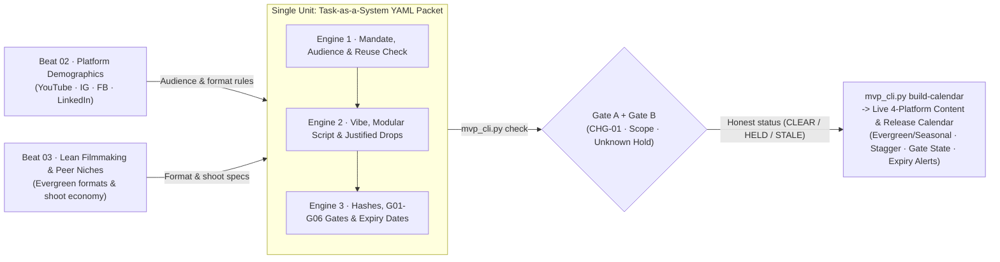

# Beat 01 · Convergence Architecture: Task-as-a-System + Live Content Calendar

> **Companion Machine Spec:** [01_convergence_architecture.yaml](./01_convergence_architecture.yaml) · **Portable Handoff:** [cpl_handoff_portable.yaml](./cpl_handoff_portable.yaml) · **5 Pilot Maps:** [cpl_pilot_maps.md](./cpl_pilot_maps.md)

## 1. How Every Task Operates as a Self-Contained System

Instead of juggling separate strategy docs, script folders, Asana comments, Teams feedback, and a drifting Content Calendar spreadsheet, **every live project or episode is one compact `task-system/v1` YAML packet** carrying three co-equal engines:

1. **Engine 1 — Strategic & Gap Intelligence:** Connects the task to CPL's 5 official 2027–2030 mandates (`Collections, Experiences, Expertise, Spaces, Technology`), your proposed editorial lens (`Grow / Books & Reading / Community`), real platform demographics (Beat 02), lean craft/peer niches (Beat 03), and an explicit **check of existing CPL assets/spaces before shooting anything new**.
2. **Engine 2 — Modular Creative & Production Economy:** Holds the actual creative heart — **vibe, tone, story hook, format recipe, economical in-house shoot plan (`16:9 + 9:16` framing)**, and **only the platform derivatives that genuinely serve each platform's audience** (*"Capture once where it serves the story; adapt only where it serves the audience"*).
3. **Engine 3 — Custody & 6-Gate Handoff Spine:** Automatically binds source file hashes, `CHG-01` timing-coupled staleness (`cut v1 -> v2` invalidates captions/excerpts while keeping cleared stills valid), `G01`–`G06` gate status (defaulting to `UNKNOWN` rather than guessing approval), off-Asana Teams references, and Levi's separated `intervention_log`.

## 2. How the Content Calendar Emerges Automatically (Zero Second Tracker)

## 3. What Was Intentionally Cut (Passing the Tired-Tuesday Test)
- **Cut:** Mandatory manual calendar spreadsheets (calendar is compiled automatically from task packets).
- **Cut:** Forced 4-platform output for every video (only audience-justified drops are scheduled).
- **Cut:** Manual file hashing (handled automatically by `mvp_cli.py` in Beat 04).
- **Cut:** Unnecessary ceremony when no dependency or external handoff is at stake.
