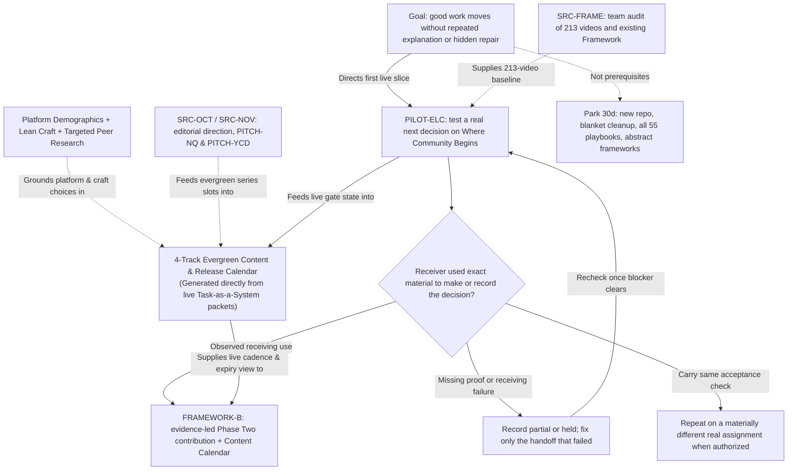
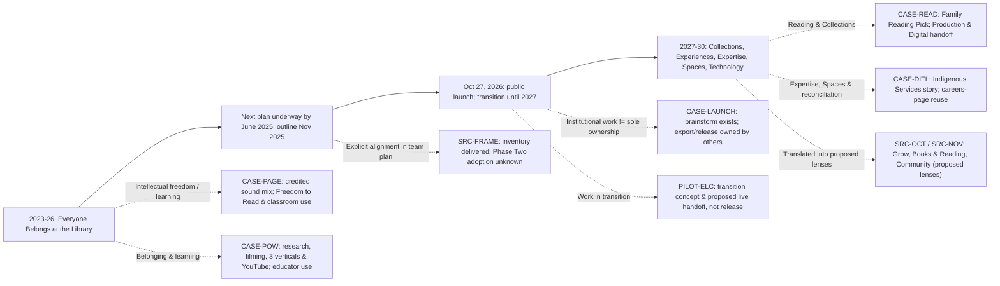
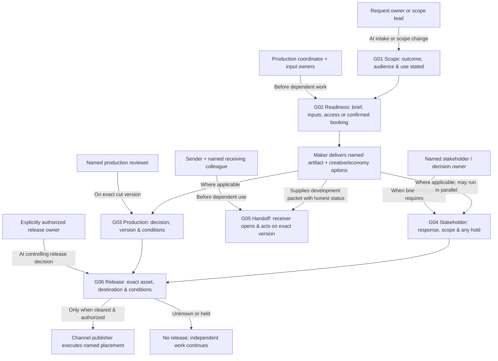
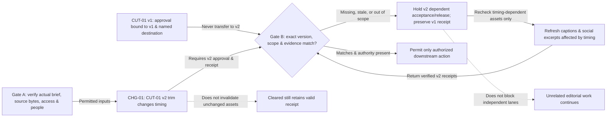

# Crucible × CPL: Reconciled Handoff, Pilot & Calendar Maps (`v1.1`)

> **2026-11-22 · Editable Mermaid source · Planning reference, not an approved workflow or dispatch.**  
> Companion YAML: [cpl_handoff_portable.yaml](./cpl_handoff_portable.yaml) · Convergence Spec: [01_convergence_architecture.yaml](./01_convergence_architecture.yaml)  
> Dotted arrows (`-.->`) show evidence or optional inputs; solid arrows (`-->`) show proposed sequence, prerequisite, or transfer. Zero coworker names or internal Asana links appear here. No Asana changes.

---

## 1. Priority Sequence, Content Calendar Feed & What Not to Build



---

## 2. Strategy, Work & Strength of Evidence



---

## 3. Who Sets & Clears Each Observed Gate (`G01`–`G06`)

*Recovered from sampled records — not a formal CPL policy or mandatory serial checklist. Development receipt never grants release permission.*



---

## 4. `PILOT-ELC` (*Where Community Begins*): First Live Receiving Test

*Reconciled fix: Participant `C` is the **Authorized local assistant / coordinator** (not blocked on unverified remote runtime routing).*

```mermaid
sequenceDiagram
    participant L as Levi / Scope Owner
    participant C as Authorized Local Assistant / Coordinator
    participant R as Named Receiving Colleague
    participant D as Applicable Reviewer / Decision Owner
    Note over L,D: Proposed PILOT-ELC only. No outreach, booking, or publication authorized by this map.
    L->>C: Ordinary request + authoritative ELC context
    C->>C: ELC-01 / G01-G02: verify governing concept, need, exact receiver & permitted route
    alt Required authority, source, or receiver missing
        C-->>L: Report exact blocker, what closes it, and independent work still open
    else Current records & authority confirmed
        C->>C: ELC-02: assemble one versioned packet (creative/economy options + exact status)
        opt Review required for intended development use
            C->>D: ELC-03 / G03-G04: request scoped decision through normal process
            D-->>C: Record exact decision, conditions, or hold (no inferred clearance)
        end
        C->>R: ELC-04 / G05: share only within existing permitted handoff
        alt Receiver acts without separate reconstruction
            R-->>C: Record actual next decision & artifact version used
            C-->>L: ELC-05: return receiving proof + separated effort/intervention log
        else Receiver needs clarification or cannot act
            R-->>C: Identify missing input or explanation needed
            C-->>L: ELC-05: record partial/held; zero claim of release
        end
    end
```

---

## 5. `CHG-01` Mechanical Check: What a Changed Cut Must and Must Not Stop


