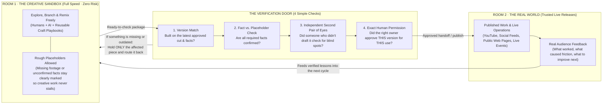
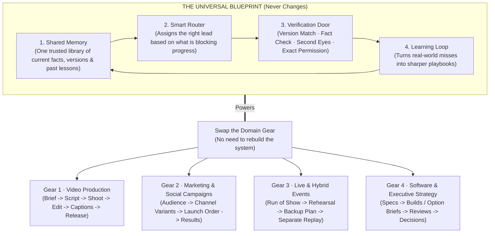
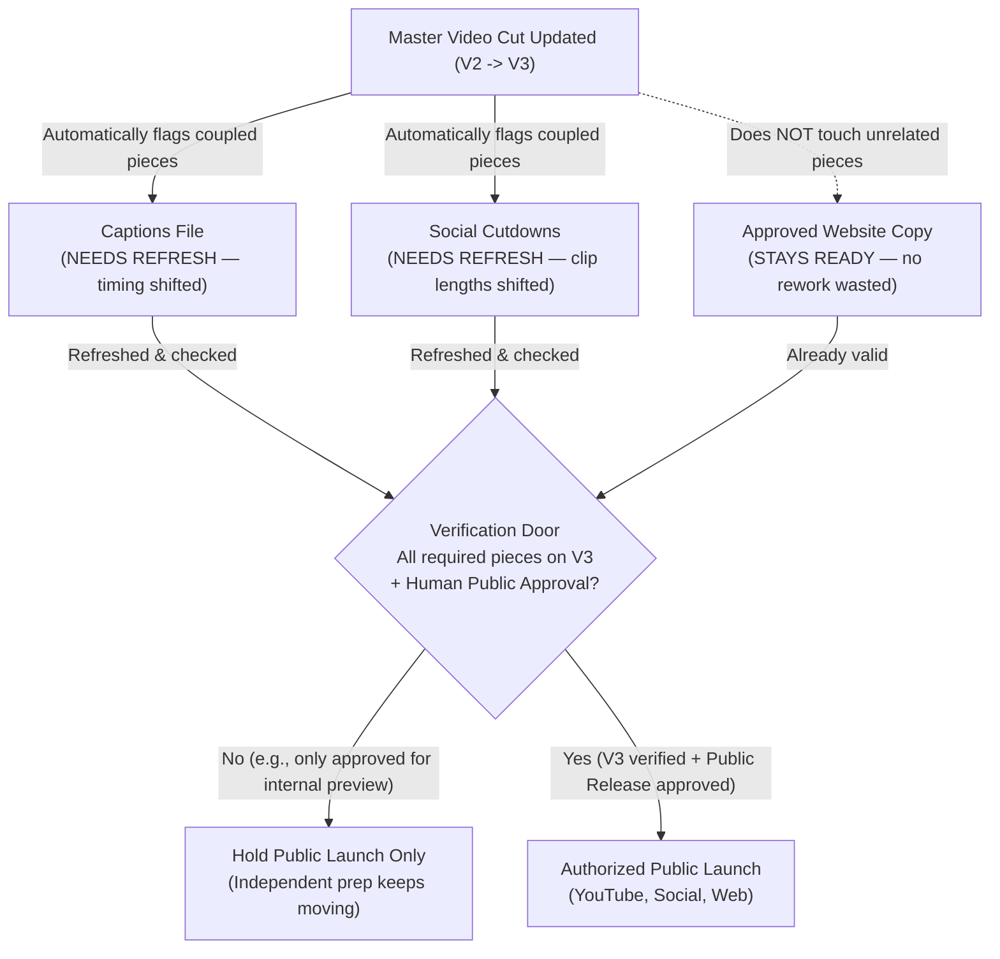

# Universal Production Blueprint (v2) — Visual Architecture & Plain-Language Guide

> **Purpose:** Supplementary Mermaid diagrams and plain-language component reference paired with the **Canva System Architecture Deck** so any speaker, producer, strategist, or collaborator — with zero software or testing background — can see how the entire system works, how its parts connect, and how to validate it before writing new code.
>
> **Canva Deck Link:** [The Universal Production Blueprint (Canva Deck)](https://canva.link/adetkcchtplz5zf) (`design_id`: `DAHbn2Fm68s`)  
> **LLM Instruction Spec (YAML):** [system_blueprint_v2.yaml](./system_blueprint_v2.yaml)  
> **Home:** `Crucible Domain / Project / Inner Gravity`  
> **Status:** Pre-build visual validation artifact (`Mode 4` — no kernel code written until this map is validated).

---

## 1. The Core Problem in Plain English

Every team that mixes human creativity with AI hits the same wall:
- **Move too fast without guardrails:** Rough drafts, AI suggestions, and last-minute edits leak straight into live work — causing wrong versions, missing captions, unverified facts, or broken public links.
- **Add too many approvals:** Every brainstorm and draft stalls waiting for sign-off — creativity dies, and the leader turns into a full-time traffic cop.

**The solution is not choosing between speed and safety.** It is separating **where you explore** from **what touches the real world**, with one narrow, reliable check-in door between them.

---

## 2. Diagram 1 — The Two-Room Architecture (How Speed and Safety Coexist)

**Why this works for non-technical teams:**
- Inside **Room 1 (The Creative Sandbox)**, you and AI can generate 5 competing concepts, remix scripts, and test angles at 100 mph — because nothing in Room 1 can accidentally publish, overwrite a live page, or email a partner.
- Nothing enters **Room 2 (The Real World)** just because an AI or a checklist says "Done." It has to pass the **4 checks at the Verification Door**.

---

## 3. Diagram 2 — One Blueprint, Multiple Gears (How Any Domain Plugs In)

The underlying engine never changes. Instead of building a brand-new system for every kind of work, you swap the **Domain Gear** (the specific playbooks, checks, and human decision-makers for that field):

---

## 4. Diagram 3 — Real-World Walkthrough: What Happens When One Piece Changes?

Imagine a **Video + Social Campaign** is almost ready to launch, and a producer trims **4 seconds** from the master video cut:

**The studio payoff:**
- You never redo unaffected work (the approved website copy stays green).
- You never accidentally publish old captions on a new cut.
- A partner clicking an **internal preview link** can never be mistaken for **permission to publish to the public**.

---

## 5. Plain-Language Component Map (For Speakers & Collaborators)

| Plain-Language Name | What It Actually Does | What Breaks Without It | Existing Home in Crucible Domain |
| :--- | :--- | :--- | :--- |
| **Shared Memory** | Keeps one trusted home for current facts, exact versions, and lessons from past projects (including what *didn't* help). | Teams argue over which file is "final" and repeat last month's mistakes. | `README.md`, `Project_Register.md`, `Knowledge_Register.md`, `Repository Archaeology/` |
| **Smart Router** | Looks at a new request and puts the right lead in charge — Marketing leads when the audience/destination is unclear; Production leads when crew/edit capacity is the bottleneck. | Projects start shooting videos when the real problem was a broken webpage. | `Project/Work Operating System/`, `Knowledge/Media Agency/Media_Work_Routing.md` |
| **Creative Sandbox** | Safe workspace where humans and AI brainstorm, branch, remix, and draft freely with zero risk of touching live public channels. | Either people move too slowly out of fear, or rough drafts leak into public channels. | Isolated workspaces / draft folders / speculative sessions |
| **Reusable Craft Playbooks** | 55 ready-to-use step-by-step procedures (briefs, A/V scripts, call sheets, social variants, live run-of-show, caption checks) that can be mixed and matched on demand. | Every new project starts from a blank page and forgets key steps. | `Knowledge/Media Agency/Skills and Workflows/` + `A01`–`A08` cognitive methods |
| **Verification Door** | The 4-step checkpoint before anything goes live: Version Match, Fact vs. Placeholder Check, Independent Second Eyes, and Exact Human Permission. | Old versions, unconfirmed claims, or missing prerequisites slip quietly into public releases. | `.agents/plugins/inner-gravity/` (`check_artifact.py`, `ig-evidence-review`, `hook_v4.py`) |
| **Human Keys (Authority)** | Keeps real-world commitments — camera capture, talent consent, budget, policy calls, and hitting "Publish" — strictly in human hands. | AI oversteps authority or treats a draft review as permission to launch. | Scoped human approval rules across `WOS` and `Media Agency` |
| **Learning Loop** | Captures what actually happened after release (did the audience understand it? did the handoff work?) and upgrades only the playbook steps that measurably improve results. | The system gets bloated with rules that sound smart but don't actually help. | `ig-improve`, `Media_Agency_Verification_Record.md` |

---

## 6. Canva Deck Slide-by-Slide Speaker Guide

1. **Slide 1 — The Universal Production Blueprint:** Introduce the goal — moving at full creative speed with AI while keeping real-world releases trustworthy.
2. **Slide 2 — The Core Problem (Speed vs. Trust):** Contrast the two broken extremes (chaos vs. approval paralysis) that every creative and institutional team knows firsthand.
3. **Slide 3 — The Breakthrough (Two Separate Rooms):** Walk through **Room 1 (Creative Sandbox)**, **The Verification Door**, and **Room 2 (Real World)**.
4. **Slide 4 — Inside the Verification Door (4 Checks):** Explain Version Match, Fact vs. Placeholder, Independent Second Eyes, and Exact Human Permission in plain everyday terms.
5. **Slide 5 — One Blueprint, Multiple Gears:** Show how the exact same system powers Video Production, Marketing & Social Campaigns, Live Events, and Software/Strategy simply by swapping the Domain Gear.
6. **Slide 6 — How the Components Connect:** Trace the closed loop from Shared Memory -> Smart Router -> Reusable Playbooks -> Verification Door -> Human Keys -> Real Feedback.
7. **Slide 7 — Real-World Example (When One Piece Changes):** Walk through the 4-second video trim scenario to show selective refresh without panic or wasted rework.
8. **Slide 8 — Validation Gate (Before We Build Anything Else):** Explain the 3-step viability test — align on this visual map, consolidate to one clean source of truth, and run **one real project** end-to-end.
