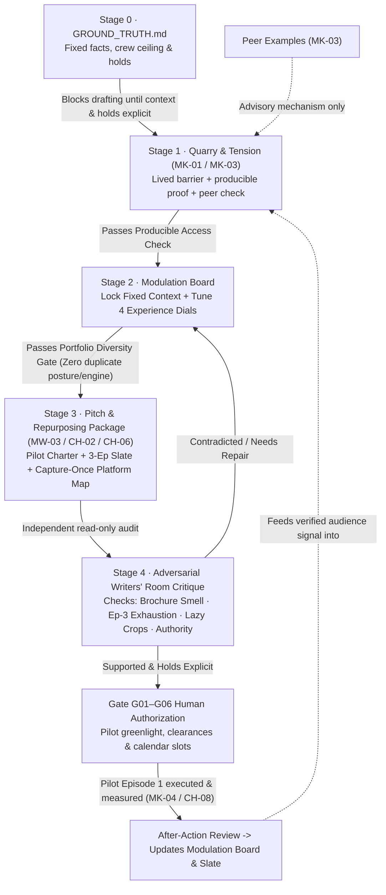

# Stage 2 · The Writers' Room Modulation Board (`Context × Experience`)

> **Core Problem Solved:** Most institutional channels look "samey" because they confuse **holding the facts steady** with **telling every story in the same voice.** This board turns "context-specific yet experience-modulated storytelling" into a repeatable mechanical filter.

---

## 1. The Architectural Split: Fixed Context vs. Modulated Experience

Every episode packet locks **two separate layers** before scripting (`MW-04`) begins:

### Layer A · Fixed Context (Never Modulated by Story Craft)
1. **Verified Fact Basis:** Confirmed service eligibility, dates, card/branch conditions, and programme limits (`CD-01`, `MK-02`).
2. **Strategic Fit Sentence:** Exact tie to `Collections`, `Experiences`, `Expertise`, `Spaces`, or `Technology` (`2027–2030` Strategic Plan) framed around patron benefit—never slogan padding.
3. **Working Destination:** Exact `calgarylibrary.ca` or catalogue URL checked before promise copy is written (`CH-06`).
4. **Authority & Custody (`G01`–`G06`):** Named decision owner, talent/location/cultural consent, music license expiry, and read-only Asana hygiene.
5. **Production Ceiling:** Lean 1–2 person in-house crew ceiling (`GROUND_TRUTH.md`).

### Layer B · The 4 Experience Modulation Dials (Deliberately Tuned Per Series)

| Dial | What It Tunes | Spectrum Options Used in the Writers' Room |
| :--- | :--- | :--- |
| **1. Viewer Relationship Posture** | *Who the library is to the viewer across 10 episodes* | `Sparring Tastemaker` · `Curious Neighbor` · `Quiet Witness` · `Side-by-Side Solver` · `Backstage Insider` |
| **2. Narrative Engine & Episode Variable** | *What `Because -> But -> Therefore` friction repeats every episode* | `Constraint -> 3-Card Diagnostic -> Surprising Pick` · `Real Need -> Skepticism/Barrier -> Live Resource Proof` · `Raw Material -> Process Friction -> Finished Moment` · `Search Error -> Live Fix -> Working Path` · `Invisible Object -> Bottleneck -> System Reveal` |
| **3. Sensory / Camera Grammar (`av-craft`)** | *Optical proximity, sound bed, cut pace & subtraction* | `Tight 35mm table dialogue + crisp page snaps` · `Handheld follow + open-room discovery` · `Locked tripod + 2-second nat-sound pockets + minimal VO` · `Tight over-the-shoulder screen/hands + zero fluff` · `Tracking physical motion + physical bridges` |
| **4. Capture-Once Platform Role (`CH-06`)** | *Where the story lives long vs. where it fragments or skips* | Assign **1 distinct job** per justified platform (Long-form = trust/depth; Shorts = single visual turn; LinkedIn = civic craft; FB/Web/Newsletter = action route) + **explicit SKIP rules** |

---

## 2. Worked Modulation Proof: Same CPL Fact, Three Contrasting Experiences

To prove the Writers' Room can hold **one exact CPL context** steady while modulating how it feels, here is one shared reality—**a patron can book free creative/recording gear or studio tools with a CPL card (`Technology` + `Spaces`, exact branch/gear scope `[HOLD-04]`)**—tuned across three different postures:

| Fixed Context | Experience 1 · **Curious Neighbor** (`S2`) | Experience 2 · **Quiet Witness** (`S3`) | Experience 3 · **Side-by-Side Solver** (`S4`) |
| :--- | :--- | :--- | :--- |
| **Same Underlying Reality:** Free library audio/maker gear solves creative barriers (`HOLD-04` exact branch/booking facts confirmed before release). | **Opening 5 Seconds:** Host drops a clunky phone-recorded voice memo next to a studio condenser mic: *"Can I record a real demo with zero gear of my own in 45 minutes?"* | **Opening 5 Seconds:** Macro shot (`35mm` close presence) of copper XLR pins clicking into a preamp. Two seconds of pure room tone (`[NAT SOUND POCKET]`). No host monologue. | **Opening 5 Seconds:** Over-the-shoulder view of an error/confused patron search screen. Voice begins mid-solution: *"Three steps to go from library card to booked mic time."* |
| **Voice & Subtraction:** | Energetic back-and-forth with staff specialist; voice drops out when first raw playback lands. | Minimalist—50% fewer spoken words; visual steps carry causality while hands work. | Right-branching mouth-shape syntax; zero jokes, zero tour detours. |
| **Relationship Outcome:** | *"I didn't know I could try that here—now I want to see what weird thing they test next."* | *"This room calms my nervous system down and makes me want to build something with my hands."* | *"That solved my exact headache in 3 minutes—I trust this channel when I'm stuck."* |
| **Platform Split:** | YT Long + 1 narrative-turn Short + IG Reel (`discover`) | YT Long + 30s sensory ambient Short + FB local space invite (`belong`) | YT Searchable Video + direct `calgarylibrary.ca` page embed (**SKIP** IG/FB hype feed unless campaign-linked) |

---

## 3. Five-Series Portfolio Diversity Matrix & Gate Check

**Portfolio Diversity Gate:** No two series may share the same **Viewer Relationship Posture**, **Viewer Tension**, or **Episode Engine**. Every series must map to a different primary relationship bond.

| Series ID & Working Title | Core Tension (`01_quarry`) | Official Mandate + Internal Lens | Dial 1 · Relationship Posture | Dial 2 · Narrative Engine (`B -> B -> T`) & Variable | Dial 3 · `av-craft` Camera & Sound Signature | Dial 4 · Primary Discovery & Relationship Loop |
| :--- | :--- | :--- | :--- | :--- | :--- | :--- |
| **S1 · The Next Question** *(Upgraded `PITCH-NQ`)* | **T1** · Choice Paralysis | `Collections` + `Experiences` (`Books & Reading`) | **Trusted Tastemaker / Sparring Partner** | *Viewer brings a hyper-specific mood/constraint -> Staff narrows via 3 sharp diagnostic questions -> Lands on 2–3 unexpected catalogue picks.* (**Variable:** Audience mood/constraint) | `35mm` seated table axis; sharp cutaways to book covers/open pages (`5-shot coverage`); playful crisp dialogue + page-flip nat sound. | **Discovery:** Browse/Suggested + Shorts hook. **Relationship:** Viewers drop hyper-specific reading constraints in comments; next episode answers selected comments by name/handle. |
| **S2 · You Can Do That Here?** *(Upgraded `PITCH-YCD`)* | **T2** · Hidden Free Capability | `Technology` + `Spaces` + `Expertise` (`Grow`) | **Curious Neighbor / Co-Discoverer** | *Everyday creative or practical challenge -> Host hits assumption ("this costs $$$") -> Specialist unlocks free CPL gear/space to pull it off live.* (**Variable:** Real-world challenge + CPL tool) | Handheld follow + `OTS` discovery angles; real-time "does it actually work?" test; ambient room energy before polished payoff. | **Discovery:** High-curiosity Shorts + IG Reels + Search. **Relationship:** Viewers pitch *"Can the library actually help me do X?"* challenges; builds shareable civic surprise. |
| **S3 · Rooms That Make Things** | **T3** · Third-Place & Tactile Hunger | `Spaces` + `Experiences` (`Community`) | **Quiet Observational Witness** | *Empty table / raw material -> Tactile process tension (a snag, an alignment fix, a pause) -> Shared finished object inside a living branch room.* (**Variable:** Branch maker/craft room + physical medium) | Locked `90°` tabletop & `28"` low-angle craft frames; `85mm` candid patron/maker hands (`[HOLD-04]` consent); rich `[NAT SOUND POCKET]` beds; low narration. | **Discovery:** Calm browse/session-time feed + local FB community shares. **Relationship:** Parasocial sanctuary; viewers feel emotional belonging and show up in-branch. |
| **S4 · Ask a Specialist in 180 Seconds** | **T4** · High-Intent Digital Dead-Ends | `Expertise` + `Technology` (`Grow`) | **Calm Side-by-Side Solver** | *Exact confusing library/digital step -> Where people usually get stuck -> Clear 3-move physical/screen walkthrough that works immediately.* (**Variable:** One concrete patron/educator task) | Clean tripod + high-legibility screen capture or overhead hands; zero intro bumper; tight `180s` pacing; voice-off screen pauses (`1.5s`). | **Discovery:** YouTube Search + Google/Web embeds on `calgarylibrary.ca` + Educator email. **Relationship:** High-trust utility; channel becomes the reliable "manual" people bookmark. |
| **S5 · Inside the Stack** | **T5** · Invisible Civic Trust & Curiosity | `Collections` + `Spaces` + `Expertise` (`Community`) | **Backstage Insider** | *A single returned item, weird request, or invisible 21-branch task enters -> Hits an unexpected logistical constraint -> Reveals the human + mechanical craft holding the city system together.* (**Variable:** Hidden system node / branch journey) | Continuous physical bridges (handing bin -> conveyor -> scanner -> truck -> shelf); rhythmic movement; grounded human staff interviews at work stations. | **Discovery:** YouTube Browse + LinkedIn civic craft story + Shorts cliffhanger. **Relationship:** Civic pride & "insider belonging"; viewers vote on which invisible library corner to open next. |

---

## 4. The Repeatable 5-Stage Writers' Room Process

Any new series spark, campaign video, or quarterly slate enters through this exact closed-loop workflow (`K-GRAPH-01` notation: `-->` blocking gate, `-.->` advisory input):

### Stage Gate Summary (What Makes It Run Without Re-Inventing the Room)

| Stage | Trigger | Required Input | Mandatory Output | Stop / Reject Rule |
| :--- | :--- | :--- | :--- | :--- |
| **0 · Ground Truth** | New series or seasonal slate ask | Strategic plan, local evidence, crew ceiling | `GROUND_TRUTH.md` with explicit `[UNKNOWN]` holds | **Reject** if crew ceiling or decision owner is unnamed. |
| **1 · Quarry** | Approved/assumed Stage 0 intake | Audience friction, public/catalogue URLs, physical assets | `01_quarry_and_audience.md` | **Reject** ideas built on strategic slogans rather than a lived viewer dilemma. |
| **2 · Modulation** | Distinct viewer tension identified | Quarry table + 4 Modulation Dials | `02_modulation_board.md` | **Reject** if posture or engine duplicates an existing series slot. |
| **3 · Pitch & Map** | Passed Diversity Gate | Locked Fixed Context + 4 tuned Dials | `03_five_series_pitch.md` (`MW-03` + `CH-02` + `CH-06`) | **Reject** platform drops that lack a native job or verified destination. |
| **4 · Critique** | Draft pitch packet complete | Separate read-only auditor + controlling sources | `04_pitch_review.md` | **Hold** any claim asserting unverified analytics, approvals, or clearances. |
