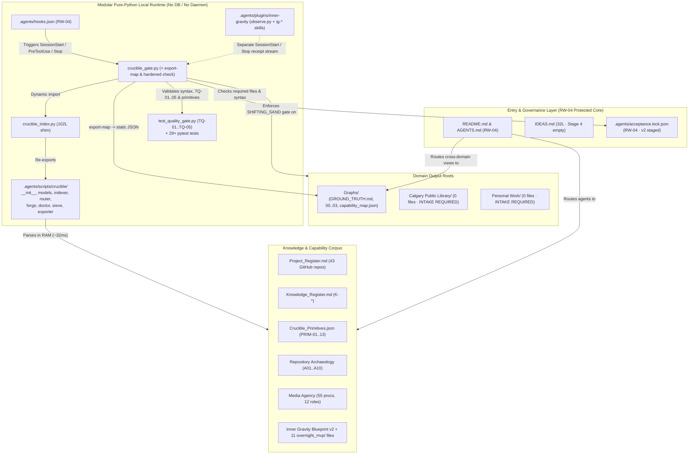

# 00 — Crucible Domain System Atlas & Neon Handoff

**WOS Graph Types:** `Capability inventory` & `Execution and provenance trace` (`P-WOS` / `K-WOS-01` / `K-SIDECAR-01`)  
**Handoff Provenance:** Initial atlas prepared at `85b6943` / `ce33a38` (`2026-11-23`); reconciled after `de90370` modular package split and Wave 2 runtime/doc hardening (`[P-CRUCIBLE-MODULAR]`).

> **Why this file exists:** Crucible Domain holds 43 triaged GitHub repos, 55 Media Agency procedures, 12 roles, 10 archaeology exhibits (`A01`–`A10`), 13 atomic primitives (`PRIM-01`–`PRIM-13`), 28 skills, and historical CPL/production references—but agents repeatedly burn turns searching across `README.md`, `AGENTS.md`, `Project/`, `Knowledge/`, and `.agents/`. Start here for O(1) file-to-purpose lookup, or read `Graphs/capability_map.json` (generated by `crucible_gate.py export-map`) for zero-exec JSON routing.

---

## 1. O(1) File-to-Purpose Map (Stop Searching, Jump Directly)

| Subsystem | Exact Path | What It Actually Does | Observed Size / State |
| --- | --- | --- | --- |
| **Root Entry** | [`README.md`](../README.md) | Human/agent hub overview & work-representation rules | 53L · Live |
| **Workspace Rules** | [`AGENTS.md`](../AGENTS.md) | Workspace constitution, 7-graph rule, Asana read-only boundary | 26L · Protected (`RW-04`) |
| **WIP Ledger** | [`IDEAS.md`](../IDEAS.md) | Stage 1–4 idea & slice ledger (parsed by `operator_router.py`) | 32L · `Stage 4` empty |
| **Project Register** | [`Project/Project_Register.md`](../Project/Project_Register.md) | Top-level projects (`P-WOS`, `P-CRUCIBLE`) + 43-repo GitHub inventory | 100L · Updated `2026-11-23` |
| **Knowledge Register** | [`Knowledge/Knowledge_Register.md`](../Knowledge/Knowledge_Register.md) | Evidence-bound findings (`K-WOS-*`, `K-STORY-01`, `K-ARCH-*`) | 32L · Live |
| **Atomic Primitives** | [`Knowledge/Crucible_Primitives.json`](../Knowledge/Crucible_Primitives.json) · [`Crucible_Primitives.md`](../Knowledge/Crucible_Primitives.md) | 13 extracted primitives (`PRIM-01..13`) across 6 families | 254L JSON · Validated by `doctor` & `check` |
| **Archaeology** | [`Knowledge/Repository Archaeology/00-Exhibit_Index.md`](../Knowledge/Repository%20Archaeology/00-Exhibit_Index.md) | 10 melted historical systems (`A01`–`A10`) | 71L · Index + 10 exhibits |
| **Media Agency** | [`Knowledge/Media Agency/Media_Work_Routing.md`](../Knowledge/Media%20Agency/Media_Work_Routing.md) · [`Skills/README.md`](../Knowledge/Media%20Agency/Skills%20and%20Workflows/README.md) | 55 procedures + 12 roles routing table | Single-source live |
| **WOS Standard** | [`Project/Work Operating System/Work_Operating_System_Graph_Catalog.md`](../Project/Work%20Operating%20System/Work_Operating_System_Graph_Catalog.md) | Canonical 7-graph specification (`P-WOS`) | 63L · Live |
| **Harness Self-Model** | [`Project/Inner Gravity/README.md`](../Project/Inner%20Gravity/README.md) · [`05_Session_4188f88a_Causal_Trace_and_Gaps.md`](../Project/Inner%20Gravity/05_Session_4188f88a_Causal_Trace_and_Gaps.md) | Harness entry point, `4188f88a` causal trace, and observatory (`collect_observatory.py`) | 109L + 124L · Live |
| **Blueprint & Historical CPL** | [`system_blueprint_v2.yaml`](../Project/Inner%20Gravity/system_blueprint_v2.yaml) · [`System_Blueprint_v2_Visual_Guide.md`](../Project/Inner%20Gravity/System_Blueprint_v2_Visual_Guide.md) · [`cpl_pilot_maps.md`](../Project/Inner%20Gravity/overnight_mvp/cpl_pilot_maps.md) | Universal Production Blueprint v2 contract + 11 historical CPL/production reference files in `Project/Inner Gravity/overnight_mvp/` (incl. `01_convergence_architecture.*`, `cpl_handoff_portable.yaml`, `run_state.yaml`, 6 `hours/*.yaml`) | 163L + 134L + 11 `overnight_mvp/` files |
| **Install Pack & Lock v2** | [`README_SUPERSEDED.md`](../Project/Inner%20Gravity/install_pack/README_SUPERSEDED.md) · [`acceptance.lock.json.v2`](../Project/Inner%20Gravity/install_pack/acceptance.lock.json.v2) · [`apply_v2_lock.ps1`](../Project/Inner%20Gravity/install_pack/apply_v2_lock.ps1) | Marks Nov 15/22 staging files superseded at root; stages optional `RW-04` v2 lockfile update | Staged optional operator apply |
| **Gate Runner** | [`.agents/scripts/crucible_gate.py`](../.agents/scripts/crucible_gate.py) | `session-start`, `pre-tool`, `stop`, `check`, `verify`, `route`, `forge`, `doctor`, `melt-diff`, `melt-scan`, `export-map` | 736L+ · Live |
| **Modular Index Package** | [`.agents/scripts/crucible/__init__.py`](../.agents/scripts/crucible/__init__.py) · [`crucible_index.py`](../.agents/scripts/crucible_index.py) | Modular package (`models.py` 553L, `indexer.py` 545L, `router.py` 178L, `forge.py` 403L, `doctor.py` 433L, `sieve.py` 489L, plus `exporter.py`) behind thin 102L `crucible_index.py` shim | Modularized (`de90370`+) · Shim 102L |
| **Test & Quality Gates** | [`.agents/scripts/test_quality_gate.py`](../.agents/scripts/test_quality_gate.py) · [`test_crucible_gate.py`](../.agents/scripts/tests/test_crucible_gate.py) · [`test_crucible_index.py`](../.agents/scripts/tests/test_crucible_index.py) | Mechanical AST test quality gate (`TQ-01..TQ-05`) + 29+ pytest tests across gate & RAM index | 317L gate · 29+ tests |
| **Capability Map (JSON)** | `Graphs/capability_map.json` (via `crucible_gate.py export-map`) | Deterministic static JSON inventory of all indexed IDs, paths, kinds, and summaries | Generated by `exporter.py` |
| **Hooks & RW-04 Boundary** | [`.agents/hooks.json`](../.agents/hooks.json) · [`.agents/acceptance.lock.json`](../.agents/acceptance.lock.json) | Workspace hooks (`SessionStart`, `PreToolUse`, `Stop`) + Stop lockfile; global `hook_v4.py` `RW-04` protects `AGENTS.md`, `GEMINI.md`, `.agents/hooks.json`, `.agents/acceptance.lock.json` | 31L + 20L · `RW-04` Protected |
| **Graphs & Domain Outputs** | [`GROUND_TRUTH.md`](./GROUND_TRUTH.md) · [`01`](./01_System_Topology_and_Runtime.md) · [`02`](./02_Coupling_and_Reachability_Audit.md) · [`03`](./03_Neon_Refactoring_Plan.md) | `Graphs/` cross-domain atlas (`GROUND_TRUTH.md`, `00..03`, `capability_map.json`); `Calgary Public Library/` & `Personal Work/` remain empty (`SHIFTING_SAND` gated) | CPL=0, Personal=0, Graphs=5+ |

---

## 2. Whole-System Capability Atlas (`P-CRUCIBLE`)

---

## 3. Observed Evolution & Verification Checkpoints (`2026-11-23`)

1. **Baseline (`85b6943` / `ce33a38`):** `python ".agents/scripts/crucible_gate.py" doctor` -> `16 PASS | 0 WARN | 0 FAIL` (`142 capabilities in 31.87ms`); `Graphs/` initialized with `GROUND_TRUTH.md` and `00..03`.
2. **Wave 1 Modular Split (`de90370`):** Refactored the 2,552L `crucible_index.py` monolith into `.agents/scripts/crucible/` (`__init__.py` 20L, `models.py` 553L, `indexer.py` 545L, `router.py` 178L, `forge.py` 403L, `doctor.py` 433L, `sieve.py` 489L) behind a 102L `crucible_index.py` shim (`29 passed` pytest, `16 PASS | 0 WARN | 0 FAIL` doctor, `crucible_gate.py check` PASS).
3. **Wave 2 Runtime, Reachability & Hygiene (`[P-CRUCIBLE-MODULAR]`):**
   - Added `crucible/exporter.py` + `crucible_gate.py export-map` -> `Graphs/capability_map.json`, plus `.py` syntax and `Crucible_Primitives.json` validation inside `cmd_check`.
   - Indexed `CRUCIBLE-ATLAS`, `CRUCIBLE-AUDIT`, `IG-OBS`, and `CPL-PILOT-MAPS` in `CORE_ENTRY_DOCS`, added `Graphs/` link checks to `CANONICAL_LOCAL_FIRST_FILES`, and added portable `doctor` `[INFO]` reporting when `~/.gemini/config` is absent.
   - Marked legacy Nov 15/22 staging files in `Project/Inner Gravity/install_pack/` superseded via [`README_SUPERSEDED.md`](../Project/Inner%20Gravity/install_pack/README_SUPERSEDED.md), staged [`acceptance.lock.json.v2`](../Project/Inner%20Gravity/install_pack/acceptance.lock.json.v2) + [`apply_v2_lock.ps1`](../Project/Inner%20Gravity/install_pack/apply_v2_lock.ps1) respecting the `RW-04` boundary, reconciled [`IDEAS.md`](../IDEAS.md) and [`Project/Inner Gravity/README.md`](../Project/Inner%20Gravity/README.md), and reconciled [`02_Coupling_and_Reachability_Audit.md`](./02_Coupling_and_Reachability_Audit.md) and [`03_Neon_Refactoring_Plan.md`](./03_Neon_Refactoring_Plan.md).
