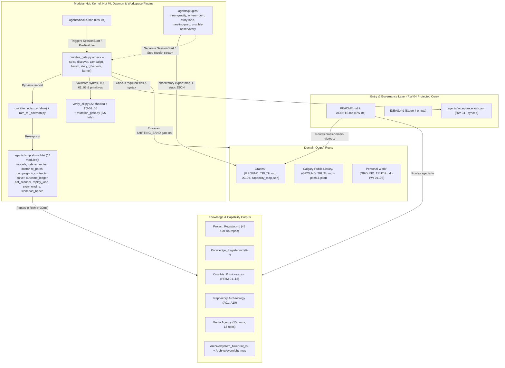

# 00 — Crucible Domain System Atlas & Neon Handoff

**WOS Graph Types:** `Capability inventory` & `Execution and provenance trace` (`P-WOS` / `K-WOS-01` / `K-SIDECAR-01`)  
**Handoff Provenance:** Initial atlas prepared at `85b6943` / `ce33a38` (`2026-11-23`); reconciled after `de90370` modular package split and Wave 2 runtime/doc hardening (`[P-CRUCIBLE-MODULAR]`).

> **Why this file exists:** Crucible Domain holds 43 triaged GitHub repos, 55 Media Agency procedures, 12 roles, 10 archaeology exhibits (`A01`–`A10`), 13 atomic primitives (`PRIM-01`–`PRIM-13`), 29 skills, and historical CPL/production references—but agents repeatedly burn turns searching across `README.md`, `AGENTS.md`, `Project/`, `Knowledge/`, and `.agents/`. Start here for O(1) file-to-purpose lookup, or read `Graphs/capability_map.json` (generated via `crucible-observatory` `observatory_deliver(mode="export-map")`) for zero-exec JSON routing.

---

## 1. O(1) File-to-Purpose Map (Stop Searching, Jump Directly)

| Subsystem | Exact Path | What It Actually Does | Observed Size / State |
| --- | --- | --- | --- |
| **Root Entry** | [`README.md`](../README.md) | Human/agent hub overview, routing matrix & work-representation rules | Live |
| **Workspace Rules** | [`AGENTS.md`](../AGENTS.md) | Workspace constitution, 7-graph rule, Asana read-only boundary | Protected (`RW-04`) |
| **WIP Ledger** | [`IDEAS.md`](../IDEAS.md) | Stage 1–4 idea & slice scratchpad | `Stage 4` empty · Live |
| **Project Register** | [`Project/Project_Register.md`](../Project/Project_Register.md) | Top-level projects (`P-WOS`, `P-CRUCIBLE`) + 43-repo GitHub inventory | Updated `2026-11-24` |
| **Knowledge Register** | [`Knowledge/Knowledge_Register.md`](../Knowledge/Knowledge_Register.md) | Evidence-bound findings (`K-WOS-*`, `K-STORY-01`, `K-TEST-01`, `K-MCP-01`, `K-ARCH-*`) | Live |
| **Atomic Primitives** | [`Knowledge/Crucible_Primitives.json`](../Knowledge/Crucible_Primitives.json) · [`Crucible_Primitives.md`](../Knowledge/Crucible_Primitives.md) | 13 extracted primitives (`PRIM-01..13`) across 6 families | 254L JSON · Validated by `doctor` & `check` |
| **Archaeology** | [`Knowledge/Repository Archaeology/00-Exhibit_Index.md`](../Knowledge/Repository%20Archaeology/00-Exhibit_Index.md) | 10 melted historical systems (`A01`–`A10`) | 71L · Index + 10 exhibits |
| **Media Agency** | [`Knowledge/Media Agency/Media_Work_Routing.md`](../Knowledge/Media%20Agency/Media_Work_Routing.md) · [`Skills/README.md`](../Knowledge/Media%20Agency/Skills%20and%20Workflows/README.md) | 55 procedures + 12 roles routing table | Single-source live |
| **WOS Standard** | [`Project/Work Operating System/Work_Operating_System_Graph_Catalog.md`](../Project/Work%20Operating%20System/Work_Operating_System_Graph_Catalog.md) | Canonical 7-graph specification (`P-WOS`) | 63L · Live |
| **Harness Self-Model** | [`Project/Inner Gravity/README.md`](../Project/Inner%20Gravity/README.md) · [`05_Session_4188f88a_Causal_Trace_and_Gaps.md`](../Project/Inner%20Gravity/05_Session_4188f88a_Causal_Trace_and_Gaps.md) | Harness entry point, `4188f88a` causal trace, and observatory (`collect_observatory.py`) | 109L + 124L · Live |
| **Blueprint & Historical CPL** | [`system_blueprint_v2.yaml`](../Archive/system_blueprint_v2/system_blueprint_v2.yaml) · [`System_Blueprint_v2_Visual_Guide.md`](../Archive/system_blueprint_v2/System_Blueprint_v2_Visual_Guide.md) · [`cpl_pilot_maps.md`](../Archive/overnight_mvp/cpl_pilot_maps.md) | Universal Production Blueprint v2 contract + 11 historical CPL/production reference files archived in `Archive/overnight_mvp/` and `Archive/system_blueprint_v2/` | 163L + 134L + 11 `overnight_mvp/` files |
| **Gate Runner** | [`.agents/scripts/crucible_gate.py`](../.agents/scripts/crucible_gate.py) | Hot-path Hub gate & CLI: `session-start`, `pre-tool`, `check --strict`, `pre-commit`, `route`, `doctor`, `campaign`, `bench`, `ast-scan`, `discover`, `story`, `g5-check`, `ml-*`, `kernel` | Live (`a3b9f4a`+) |
| **Modular Hub Kernel (14 modules)** | [`.agents/scripts/crucible/__init__.py`](../.agents/scripts/crucible/__init__.py) · [`crucible_index.py`](../.agents/scripts/crucible_index.py) | RAM kernel (`__init__.py`, `models.py`, `indexer.py`, `router.py`, `doctor.py`, `tx_patch.py`, `campaign_ir.py`, `contracts.py`, `solver.py`, `outcome_ledger.py`, `ast_scanner.py`, `replay_loop.py`, `story_engine.py`, `workload_bench.py`) + `crucible_kernel.py`, `ram_ml_engine.py`, `ram_ml_daemon.py`, `verify_all.py`, `mutation_gate.py` with `CAPABILITY_PRECEDENCE` | Live (`a3b9f4a`+) |
| **Workspace Plugins & MCP Spokes** | [`.agents/plugins/`](../.agents/plugins/) | Active plugins: `inner-gravity` (harness observation + `ig-*` skills), `writers-room` (3-tool editorial MCP spoke), `crucible-observatory` (3-tool offline forge/sieve/ledger/export MCP spoke), `story-lane` (3-tool saved-transcript clip selection/extraction MCP spoke + `story_engine` bridge), `meeting-prep` (3-tool walk-in readiness, cold-start shield & Causal Objection DAG MCP spoke) | Live (`a3b9f4a`+) |
| **Test & Quality Gates** | [`.agents/scripts/test_quality_gate.py`](../.agents/scripts/test_quality_gate.py) · [`test_crucible_gate.py`](../.agents/scripts/tests/test_crucible_gate.py) · [`test_crucible_index.py`](../.agents/scripts/tests/test_crucible_index.py) | Mechanical AST test quality gate (`TQ-01..TQ-05`), `5/5` mutation kills (`mutation_gate.py`), and 22-check parallel suite (`scripts/verify_all.ps1`) | Live |
| **Capability Map (JSON)** | [`Graphs/capability_map.json`](./capability_map.json) (via `crucible-observatory` `export-map`) | Deterministic static JSON inventory of indexed IDs, paths, kinds, and summaries | Generated |
| **Hooks & RW-04 Boundary** | [`.agents/hooks.json`](../.agents/hooks.json) · [`.agents/acceptance.lock.json`](../.agents/acceptance.lock.json) | Workspace hooks (`SessionStart`, `PreToolUse`) + synced acceptance lockfile; global `sentinel.py` (`scripts/sentinel/`) `RW-04` protects `AGENTS.md`, `GEMINI.md`, `.agents/hooks.json`, `.agents/acceptance.lock.json` | `RW-04` Protected |
| **Graphs & Domain Outputs** | [`GROUND_TRUTH.md`](./GROUND_TRUTH.md) · [`01`](./01_System_Topology_and_Runtime.md) · [`02`](./02_Coupling_and_Reachability_Audit.md) · [`03`](./03_Neon_Refactoring_Plan.md) · [`04`](./04_InRAM_ML_and_Control_Plane_Architecture.md) | `Graphs/` cross-domain atlas (`GROUND_TRUTH.md`, `00..04`, `capability_map.json`); `Calgary Public Library/` (23 files) & `Personal Work/` (4 files: `GROUND_TRUTH.md`, `CS_Loop_Weakness_Audit.md`, `CS_Opportunity_Map.md`, `CS_Process_Validity_Scorecard.md`) grounded | Live |

---

## 2. Whole-System Capability Atlas (`P-CRUCIBLE`)

---

## 3. Observed Evolution & Verification Checkpoints (`2026-11-23..24`)

1. **Baseline (`85b6943` / `ce33a38`):** `python ".agents/scripts/crucible_gate.py" doctor` -> `16 PASS | 0 WARN | 0 FAIL` (`142 capabilities in 31.87ms`); `Graphs/` initialized with `GROUND_TRUTH.md` and `00..03`.
2. **Wave 1 Modular Split (`de90370`):** Refactored the 2,552L `crucible_index.py` monolith into `.agents/scripts/crucible/` (`__init__.py` 20L, `models.py` 553L, `indexer.py` 545L, `router.py` 178L, `forge.py` 403L, `doctor.py` 433L, `sieve.py` 489L) behind a 102L `crucible_index.py` shim (`29 passed` pytest, `16 PASS | 0 WARN | 0 FAIL` doctor, `crucible_gate.py check` PASS).
3. **Wave 2 Runtime, Reachability & Hygiene (`[P-CRUCIBLE-MODULAR]`):**
   - Added `crucible/exporter.py` + `crucible_gate.py export-map` -> `Graphs/capability_map.json`, plus `.py` syntax and `Crucible_Primitives.json` validation inside `cmd_check`.
   - Indexed `CRUCIBLE-ATLAS`, `CRUCIBLE-AUDIT`, `IG-OBS`, and `CPL-PILOT-MAPS` in `CORE_ENTRY_DOCS`, added `Graphs/` link checks to `CANONICAL_LOCAL_FIRST_FILES`, and added portable `doctor` `[INFO]` reporting when `~/.gemini/config` is absent.
   - Reconciled [`IDEAS.md`](../IDEAS.md), [`Project/Inner Gravity/README.md`](../Project/Inner%20Gravity/README.md), [`02_Coupling_and_Reachability_Audit.md`](./02_Coupling_and_Reachability_Audit.md), and [`03_Neon_Refactoring_Plan.md`](./03_Neon_Refactoring_Plan.md); retired `install_pack/` staging fossils and synced [`.agents/acceptance.lock.json`](../.agents/acceptance.lock.json).
4. **Waves 1–4.5 Platform Evolution (`a3b9f4a`, `2026-11-24`):**
   - Added `tx_patch.py`, `campaign_ir.py`, `contracts.py`, `solver.py`, `outcome_ledger.py`, `ast_scanner.py`, `replay_loop.py`, `story_engine.py`, `crucible_kernel.py`, `ram_ml_engine.py`, `ram_ml_daemon.py`, `verify_all.py`, and `mutation_gate.py`, and moved offline `forge`/`sieve`/`exporter` into `crucible-observatory`.
   - Verified `22/22` parallel `verify_all.ps1` checks, `5/5` `mutation_gate.py` kills, `23 PASS | 0 WARN | 0 FAIL` `doctor` (with `CD-W19` zero hardcoded plugin paths), and `10/10` G5 improvements in [`.agents/g5_outcomes.json`](../.agents/g5_outcomes.json).
