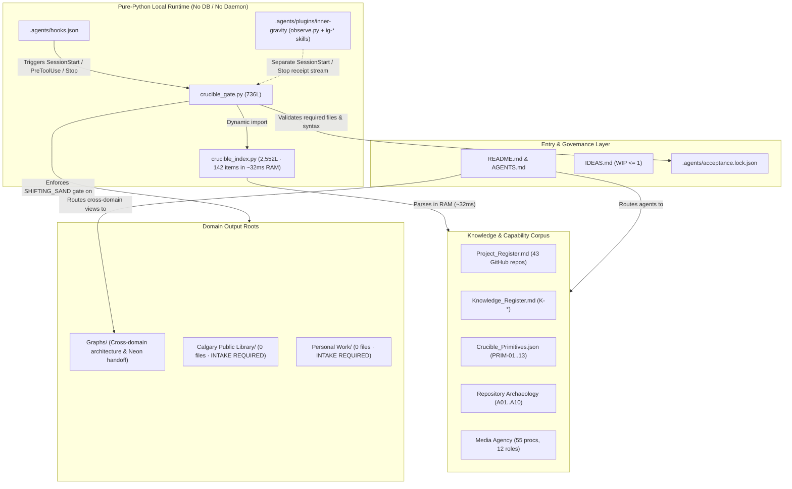

# 00 — Crucible Domain System Atlas & Neon Handoff

**WOS Graph Types:** `Capability inventory` & `Execution and provenance trace` (`P-WOS` / `K-WOS-01` / `K-SIDECAR-01`)  
**Handoff Provenance:** Prepared by **Gemini 4 Hydrogen (Medium)** on `2026-11-23` at commit `85b6943` for **Neon** (next-stage orchestrator / refactoring model).

> **Why this file exists:** Crucible Domain holds 43 triaged GitHub repos, 55 Media Agency procedures, 12 roles, 10 archaeology exhibits (`A01`–`A10`), 13 atomic primitives (`PRIM-01`–`PRIM-13`), and 28 skills—but agents repeatedly burn turns searching across `README.md`, `AGENTS.md`, `Project/`, `Knowledge/`, and `.agents/`. Start here for O(1) file-to-purpose lookup.

---

## 1. O(1) File-to-Purpose Map (Stop Searching, Jump Directly)

| Subsystem | Exact Path | What It Actually Does | Observed Size / State |
| --- | --- | --- | --- |
| **Root Entry** | [`README.md`](../README.md) | Human/agent hub overview & work-representation rules | 53L · Live |
| **Workspace Rules** | [`AGENTS.md`](../AGENTS.md) | Workspace constitution, 7-graph rule, Asana read-only boundary | 32L · Live |
| **WIP Ledger** | [`IDEAS.md`](../IDEAS.md) | Stage 1–4 idea & slice ledger (parsed by `operator_router.py`) | 32L · `Stage 4` empty |
| **Project Register** | [`Project/Project_Register.md`](../Project/Project_Register.md) | Top-level projects (`P-WOS`, `P-CRUCIBLE`) + 43-repo GitHub inventory | 100L · Updated `2026-11-23` |
| **Knowledge Register** | [`Knowledge/Knowledge_Register.md`](../Knowledge/Knowledge_Register.md) | Evidence-bound findings (`K-WOS-*`, `K-STORY-01`, `K-ARCH-*`) | 32L · Live |
| **Atomic Primitives** | [`Knowledge/Crucible_Primitives.json`](../Knowledge/Crucible_Primitives.json) | 13 extracted primitives (`PRIM-01..13`) across 6 families | Validated by `doctor` |
| **Archaeology** | [`Knowledge/Repository Archaeology/00-Exhibit_Index.md`](../Knowledge/Repository%20Archaeology/00-Exhibit_Index.md) | 10 melted historical systems (`A01`–`A10`) | Index + 10 exhibits |
| **Media Agency** | [`Knowledge/Media Agency/Media_Work_Routing.md`](../Knowledge/Media%20Agency/Media_Work_Routing.md) | 55 procedures + 12 roles routing table | Single-source live |
| **WOS Standard** | [`Project/Work Operating System/Work_Operating_System_Graph_Catalog.md`](../Project/Work%20Operating%20System/Work_Operating_System_Graph_Catalog.md) | Canonical 7-graph specification (`P-WOS`) | 63L · Live |
| **Harness Self-Model** | [`Project/Inner Gravity/05_Session_4188f88a_Causal_Trace_and_Gaps.md`](../Project/Inner%20Gravity/05_Session_4188f88a_Causal_Trace_and_Gaps.md) | Nov 23 live observatory & `4188f88a` causal trace | 124L · Live |
| **Gate Runner** | [`.agents/scripts/crucible_gate.py`](../.agents/scripts/crucible_gate.py) | `session-start`, `pre-tool`, `stop`, `check`, `verify`, `route`, `forge`, `doctor`, `melt-*` | **736L** · Live |
| **RAM Indexer (Monolith)** | [`.agents/scripts/crucible_index.py`](../.agents/scripts/crucible_index.py) | Indexes 142 capabilities in ~32ms RAM + `route`, `forge`, `doctor`, `melt-*` | **2,552L** · Refactor target |
| **Workspace Hooks** | [`.agents/hooks.json`](../.agents/hooks.json) | Fires `crucible_gate.py` on `SessionStart`, `PreToolUse`, `Stop` | 31L · Active |
| **Acceptance Lock** | [`.agents/acceptance.lock.json`](../.agents/acceptance.lock.json) | Required files (12) + Python syntax checks (2) | 20L · Active |
| **Domain Outputs** | `Calgary Public Library/`, `Personal Work/`, `Graphs/` | Deliverable roots; `Graphs/` initialized `2026-11-23`; CPL & Personal empty | CPL=0, Personal=0, Graphs=5 |

---

## 2. Whole-System Capability Atlas (`P-CRUCIBLE`)

---

## 3. Baseline Verification Snapshot (Observed `2026-11-23` before Neon Handoff)

- `python ".agents/scripts/crucible_gate.py" doctor`: **16 PASS | 0 WARN | 0 FAIL** (`142 capabilities in 31.87ms`).
- `git HEAD`: `85b6943` (clean prior to `Graphs/` creation).
- **Primary Mission for Neon:** Decouple `crucible_index.py` (2,552L), bridge the under-coupled verification/routing seams, and clean up misplaced/stale artifacts without breaking any of the 16 `doctor` checks.
