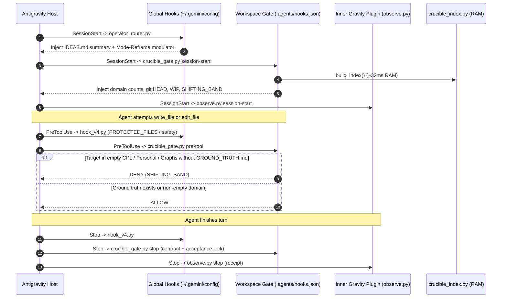
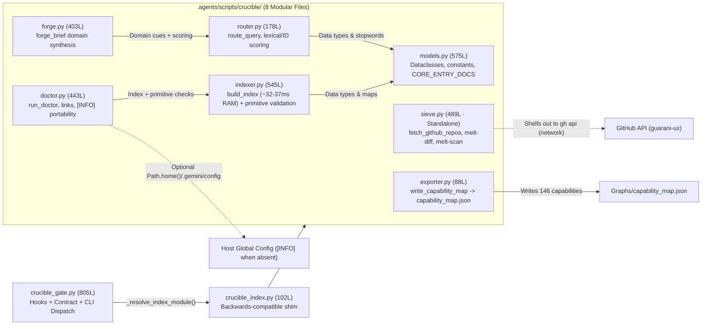

# 01 — System Topology & Runtime Lifecycle

**WOS Graph Types:** `Target system architecture` & `Reference process model` (`P-WOS` / `P-INNER-GRAVITY` / `K-GRAPH-01`)

> Solid arrows (`-->`) represent verified, active runtime paths observed in `.agents/hooks.json`, `crucible_gate.py`, and `doctor` output. Dashed arrows (`-.->`) represent fragile, overlapping, or host-coupled boundaries.

---

## 1. Three-Chain Hook Execution Model (Per-Turn Lifecycle)

Every Antigravity turn inside `C:\crucible-domain` currently triggers **three separate hook configurations**:
1. **Global Config (`~/.gemini/config/hooks.json`):** `operator_router.py` (`SessionStart`, `PreInvocation`) + `hook_v4.py` (`PreToolUse`, `PostToolUse`, `Stop`).
2. **Workspace Gate (`.agents/hooks.json`):** `crucible_gate.py` (`SessionStart`, `PreToolUse`, `Stop`).
3. **Workspace Plugin (`.agents/plugins/inner-gravity/hooks.json`):** `observe.py` (`SessionStart`, `Stop`).

---

## 2. Modular Package Architecture (`crucible/` + Thin Shim)

Following Wave 1 (`de90370`) and Wave 2 (`97a5b61`, `13152ec`), the former 2,552-line `crucible_index.py` monolith is split into focused acyclic modules under [`.agents/scripts/crucible/`](../.agents/scripts/crucible/__init__.py) behind a 102-line backwards-compatible shim at [`crucible_index.py`](../.agents/scripts/crucible_index.py), while [`crucible_gate.py`](../.agents/scripts/crucible_gate.py) (805L) imports it via `_resolve_index_module()`.

### Why this matters for runtime & maintenance
- **Cold-start speed stays ~32–37 ms** because `build_index()` only parses local Markdown and JSON files.
- **Clean boundaries:** Networked GitHub sieving (`sieve.py`), portability-aware diagnostics (`doctor.py`), heuristic synthesis (`forge.py`), and JSON map export (`exporter.py`) are decoupled from core parsing (`indexer.py`).
