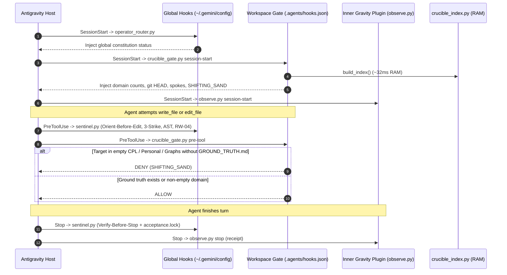
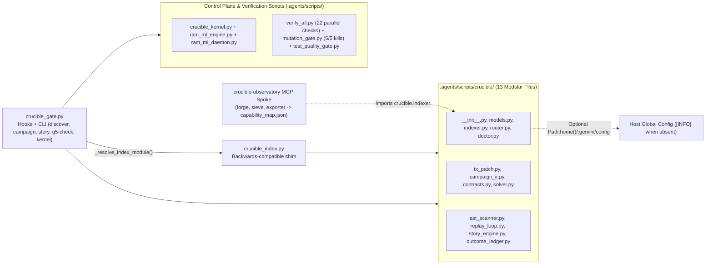

# 01 — System Topology & Runtime Lifecycle

**WOS Graph Types:** `Target system architecture` & `Reference process model` (`P-WOS` / `P-INNER-GRAVITY` / `K-GRAPH-01`)

> Solid arrows (`-->`) represent verified, active runtime paths observed in `.agents/hooks.json`, `crucible_gate.py`, and `doctor` output. Dashed arrows (`-.->`) represent fragile, overlapping, or host-coupled boundaries.

---

## 1. Three-Chain Hook Execution Model (Per-Turn Lifecycle)

Every Antigravity turn inside `C:\crucible-domain` currently triggers **three separate hook configurations**:
1. **Global Config (`~/.gemini/config/hooks.json`):** `operator_router.py` (`SessionStart`, `PreInvocation`) + `sentinel.py` (`PreToolUse`, `PostToolUse`, `Stop`).
2. **Workspace Gate (`.agents/hooks.json`):** `crucible_gate.py` (`SessionStart`, `PreToolUse`).
3. **Workspace Plugin (`.agents/plugins/inner-gravity/hooks.json`):** `observe.py` (`SessionStart`, `Stop`).

---

## 2. Modular Package Architecture (`crucible/` + Control Plane + Spokes)

Following Waves 1–4.5 (`de90370` -> `a3b9f4a`), the former `crucible_index.py` monolith is split into **13 focused modules** under [`.agents/scripts/crucible/`](../.agents/scripts/crucible/__init__.py) behind a backwards-compatible shim at [`crucible_index.py`](../.agents/scripts/crucible_index.py), while [`crucible_gate.py`](../.agents/scripts/crucible_gate.py) serves as the unified CLI/hook control plane. Offline research/mining (`forge`, `sieve`, `exporter`, `ledger`) runs inside the `crucible-observatory` MCP spoke.

### Why this matters for runtime & maintenance
- **Cold-start speed stays ~33–37 ms** because `build_index()` only parses local Markdown and JSON files.
- **Clean separation:** Heavy offline mining (`forge`/`sieve`/`exporter` in `crucible-observatory`) stays out of the hot `<50ms` path while `tx_patch.py`, `campaign_ir.py`, `solver.py`, `ast_scanner.py`, `replay_loop.py`, `story_engine.py`, and `outcome_ledger.py` stay deterministic and 0-LLM inside `.agents/scripts/crucible/`.
