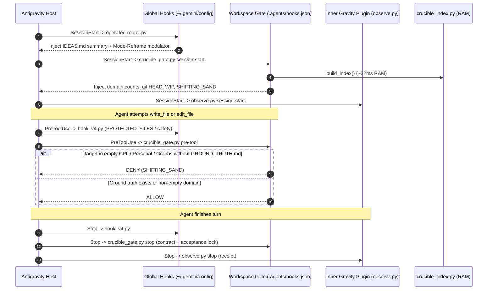
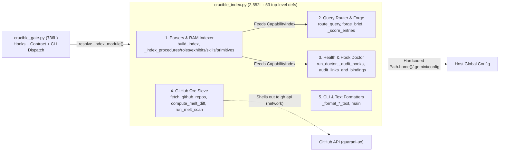

# 01 — System Topology & Runtime Lifecycle

**WOS Graph Types:** `Target system architecture` & `Reference process model` (`P-WOS` / `P-INNER-GRAVITY` / `K-GRAPH-01`)

> Solid arrows (`-->`) represent verified, active runtime paths observed in `.agents/hooks.json`, `crucible_gate.py`, and `doctor` output. Dashed arrows (`-.->`) represent fragile, overlapping, or host-coupled boundaries.

---

## 1. Three-Chain Hook Execution Model (Per-Turn Lifecycle)

Every Antigravity turn inside `C:\crucible-domain` currently triggers **three separate hook configurations**:
1. **Global Config (`~/.gemini/config/hooks.json`):** `operator_router.py` (`SessionStart`, `PreInvocation`) + `hook_v4.py` (`PreToolUse`, `PostToolUse`, `Stop`).
2. **Workspace Gate (`.agents/hooks.json`):** `crucible_gate.py` (`SessionStart`, `PreToolUse`, `Stop`).
3. **Workspace Plugin (`.agents/plugins/inner-gravity/hooks.json`):** `observe.py` (`SessionStart`, `Stop`).

---

## 2. Internal Anatomy of `crucible_index.py` (The 2,552-Line Monolith)

Currently, [`crucible_index.py`](../.agents/scripts/crucible_index.py) houses **five unrelated subsystems** in one file, while [`crucible_gate.py`](../.agents/scripts/crucible_gate.py) dynamically imports it via `_resolve_index_module()`.

### Why this matters for runtime & maintenance
- **Cold-start speed is great (~32 ms)** because `build_index()` only reads local Markdown/JSON files.
- **Cognitive & edit friction is high** because `melt-scan` (networked GitHub API sieving), `doctor` (host-coupled hook auditing), `forge` (heuristics), and `build_index` (core parser) all live in the same 2,552-line file.
