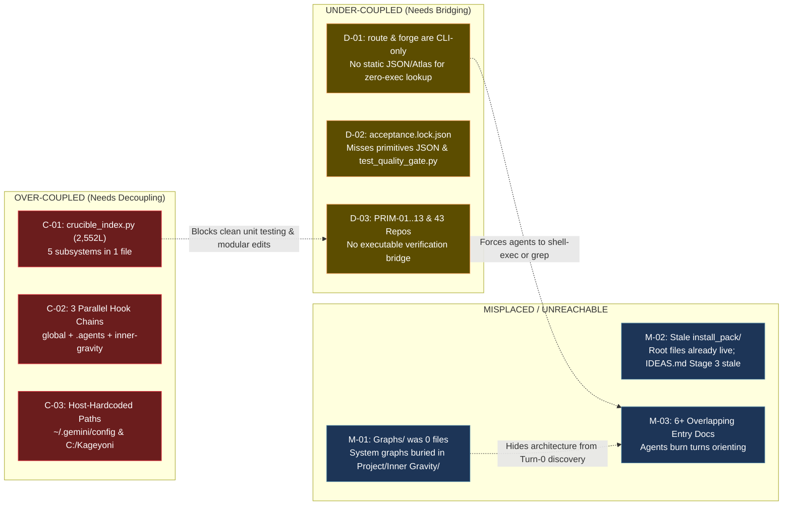

# 02 — Coupling, Reachability & Bottleneck Audit

**WOS Graph Types:** `Outcome map` & `Target system architecture` (delta) (`P-WOS` / `K-WOS-03` / `K-ARCH-03`)

This audit isolates **what is stifling Crucible Domain's capacity** into three concrete failure modes:
1. **Over-Coupled** (things welded together that should be independent)
2. **Under-Coupled** (things disconnected that need an explicit bridge)
3. **Misplaced / Hard-to-Reach** (things in the wrong folder or duplicated across entry points)

---

## 1. Visual Coupling & Bottleneck Map

---

## 2. Detailed Issue Ledger for Neon

| ID | Category | Exact Observed Evidence | Why It Stifles Capacity | Target Fix |
| --- | --- | --- | --- | --- |
| **C-01** | Over-Coupled | `.agents/scripts/crucible_index.py` is 2,552L mixing parsers, `route`/`forge`, `doctor`, `melt-diff`/`melt-scan`, and CLI formatters. | Editing or testing one capability risks breaking unrelated ones; agents must read huge files to change small rules. | Split into a clean `.agents/scripts/crucible/` package (`indexer.py`, `router.py`, `forge.py`, `doctor.py`, `sieve.py`) with `crucible_index.py` as a thin backwards-compatible shim. |
| **C-02** | Over-Coupled | Three separate `hooks.json` files (`~/.gemini/config/hooks.json`, `.agents/hooks.json`, `.agents/plugins/inner-gravity/hooks.json`) fire on `SessionStart` and `Stop`. | Triple-hook latency, overlapping `SessionStart` injections, and risk of silent cwd failures (`4188f88a`). | Document and audit the exact hook contract boundary; keep `crucible_gate.py` as the single workspace authority and avoid duplicate checks. |
| **C-03** | Over-Coupled | `DEFAULT_GLOBAL_CONFIG_DIR = Path.home() / ".gemini" / "config"` in `crucible_index.py` + `C:/Kageyoni/.agents/skills/` in `skills.json`. | Breaks portability when running on a fresh machine, CI, or remote `Moto` session. | Make global-config auditing optional/graceful when `DEFAULT_GLOBAL_CONFIG_DIR` is absent, and surface a `PORTABILITY` notice instead of assuming one workstation layout. |
| **D-01** | Under-Coupled | `route` and `forge` only exist behind `python ".agents/scripts/crucible_gate.py" ...`. | Every cold-start agent must either spawn Python or grep 80+ Markdown files to find where a file or primitive lives. | Emit/maintain a lightweight generated `Graphs/capability_map.json` (or `00_System_Atlas_and_Neon_Handoff.md`) synced by `crucible_gate.py`. |
| **D-02** | Under-Coupled | `.agents/acceptance.lock.json` only checks 12 Markdown files and 2 Python files (`crucible_gate.py`, `crucible_index.py`). | `test_quality_gate.py`, `Project/Inner Gravity/check_sync.py`, and `Crucible_Primitives.json` schema aren't locked by `Stop` gate. | Add `test_quality_gate.py` and `Crucible_Primitives.json` validation to `acceptance.lock.json` / `cmd_verify`. |
| **D-03** | Under-Coupled | `PRIM-01..13` and `The-Canvas` (27 code / 22 tests) are cataloged in `Project_Register.md` without runnable verification links. | Capabilities remain "paper-proven" rather than executable building blocks. | Add a `verify-primitives` or test-receipt field linking each promoted `PRIM-*` to a runnable check. |
| **M-01** | Misplaced | `Graphs/` had 0 files until `2026-11-23`; system graphs lived inside `Project/Inner Gravity/01..05`. | Violated `README.md` ("Use Graphs for views spanning projects or domains") and hid architecture from top-level discovery. | Keep `Graphs/` as the canonical cross-domain atlas (`00`–`03`) and link `Inner Gravity` as the harness-specific deep dive. |
| **M-02** | Misplaced | `Project/Inner Gravity/install_pack/` + `IDEAS.md` Stage 3 still reference staging `AGENTS.md`/`acceptance.lock.json`, which are already live at root. | Confuses new agents into thinking root governance isn't installed yet. | Archive or mark `install_pack/` as `SUPERSEDED (live at root)` and update `IDEAS.md` Stage 3. |
