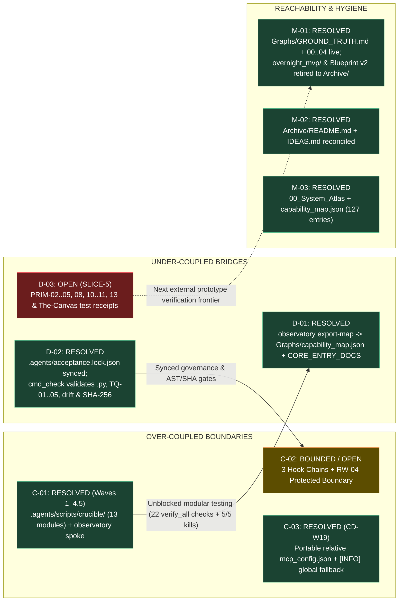

# 02 — Coupling, Reachability & Bottleneck Audit

**WOS Graph Types:** `Outcome map` & `Target system architecture` (delta) (`P-WOS` / `K-WOS-03` / `K-ARCH-03`)

This audit tracks the three architectural failure modes across Crucible Domain and records **which items are resolved vs. still open** through Waves 1–4.5 (`a3b9f4a`):
1. **Over-Coupled** (things welded together that should be independent)
2. **Under-Coupled** (things disconnected that need an explicit bridge)
3. **Misplaced / Hard-to-Reach** (things in the wrong folder or duplicated across entry points)

---

## 1. Visual Coupling & Status Map

---

## 2. Reconciled Issue Ledger (Wave 4.5 State)

| ID | Category | Status | Observed Current Evidence & Remaining Gap | Canonical Paths |
| --- | --- | --- | --- | --- |
| **C-01** | Over-Coupled | **RESOLVED** | `crucible_index.py` split into 13 focused modules under `.agents/scripts/crucible/` (`__init__.py`, `models.py`, `indexer.py`, `router.py`, `doctor.py`, `tx_patch.py`, `campaign_ir.py`, `contracts.py`, `solver.py`, `outcome_ledger.py`, `ast_scanner.py`, `replay_loop.py`, `story_engine.py`) behind the compatibility shim, with `forge`/`sieve`/`exporter` offloaded to `crucible-observatory`; covered by `verify_all.ps1` (22 checks) and `TQ-01..TQ-05`. | [`crucible_index.py`](../.agents/scripts/crucible_index.py) · [`.agents/scripts/crucible/__init__.py`](../.agents/scripts/crucible/__init__.py) |
| **C-02** | Over-Coupled | **BOUNDED (OPEN)** | Three `hooks.json` chains (`~/.gemini/config`, `.agents/`, `.agents/plugins/inner-gravity/`) trigger independently; global `sentinel.py` enforces `RW-04` (`AGENTS.md`, `GEMINI.md`, `.agents/hooks.json`, `.agents/acceptance.lock.json`) while [`crucible_gate.py`](../.agents/scripts/crucible_gate.py) owns workspace `SessionStart` / `PreToolUse` (no workspace `Stop` hook). | [`.agents/hooks.json`](../.agents/hooks.json) · [`01_System_Topology_and_Runtime.md`](./01_System_Topology_and_Runtime.md) |
| **C-03** | Over-Coupled | **RESOLVED (`CD-W19`)** | `doctor` emits non-failing `[INFO]` when `~/.gemini/config` is absent, and `CD-W19` removed all hardcoded drive-letter paths from `.agents/plugins/*/mcp_config.json`. | [`doctor.py`](../.agents/scripts/crucible/doctor.py) · [`05_Session_4188f88a_Causal_Trace_and_Gaps.md`](../Project/Inner%20Gravity/05_Session_4188f88a_Causal_Trace_and_Gaps.md) |
| **D-01** | Under-Coupled | **RESOLVED** | `crucible-observatory` (`export-map`) generates deterministic [`Graphs/capability_map.json`](./capability_map.json) (`127` portable entries), and `CORE_ENTRY_DOCS` indexes `CRUCIBLE-ATLAS`, `CRUCIBLE-AUDIT`, `CRUCIBLE-ML-ARCH`, `CS-ARCH`, `CS-SCORECARD`, `IG-OBS`, and `CPL-PILOT-MAPS` alongside [`00_System_Atlas_and_Neon_Handoff.md`](./00_System_Atlas_and_Neon_Handoff.md). | [`00_System_Atlas_and_Neon_Handoff.md`](./00_System_Atlas_and_Neon_Handoff.md) · [`cpl_pilot_maps.md`](../Archive/overnight_mvp/cpl_pilot_maps.md) |
| **D-02** | Under-Coupled | **RESOLVED** | `cmd_check --strict` syntax-checks `.py` files, runs `TQ-01..TQ-05`, checks plugin/kernel self-model drift and `depends_on_sha256`, and verifies [`.agents/acceptance.lock.json`](../.agents/acceptance.lock.json) (`RW-04` synced; legacy staging fossils retired to `Archive/`). | [`.agents/acceptance.lock.json`](../.agents/acceptance.lock.json) · [`Archive/README.md`](../Archive/README.md) |
| **D-03** | Under-Coupled | **OPEN (`SLICE-5`)** | `PRIM-02..05`, `PRIM-08`, `PRIM-10..11`, `PRIM-13`, and `The-Canvas` (27 code / 22 tests) still lack executed local test receipts linked into `Knowledge_Register.md` and `Crucible_Primitives.json`. | [`Project_Register.md`](../Project/Project_Register.md) · [`Knowledge_Register.md`](../Knowledge/Knowledge_Register.md) |
| **M-01** | Misplaced | **RESOLVED** | `Graphs/` hosts [`GROUND_TRUTH.md`](./GROUND_TRUTH.md) + `00..04` + [`capability_map.json`](./capability_map.json); historical `overnight_mvp/` files and Blueprint v2 specs live read-only under [`Archive/`](../Archive/README.md). | [`GROUND_TRUTH.md`](./GROUND_TRUTH.md) · [`System_Blueprint_v2_Visual_Guide.md`](../Archive/system_blueprint_v2/System_Blueprint_v2_Visual_Guide.md) |
| **M-02** | Misplaced | **RESOLVED** | Legacy Nov 15/22 staging fossils, `overnight_mvp/`, and `MA-SPRINT-01` are archived under [`Archive/README.md`](../Archive/README.md); [`IDEAS.md`](../IDEAS.md) logs Waves 1–4.5 under `## Shipped`; [`Project/Inner Gravity/README.md`](../Project/Inner%20Gravity/README.md) links to `Graphs/00`. | [`Archive/README.md`](../Archive/README.md) · [`IDEAS.md`](../IDEAS.md) |
| **M-03** | Misplaced | **RESOLVED** | [`00_System_Atlas_and_Neon_Handoff.md`](./00_System_Atlas_and_Neon_Handoff.md) + [`capability_map.json`](./capability_map.json) + `SessionStart` provide O(1) Turn-0 lookup across all capabilities and CLI subcommands. | [`00_System_Atlas_and_Neon_Handoff.md`](./00_System_Atlas_and_Neon_Handoff.md) |
