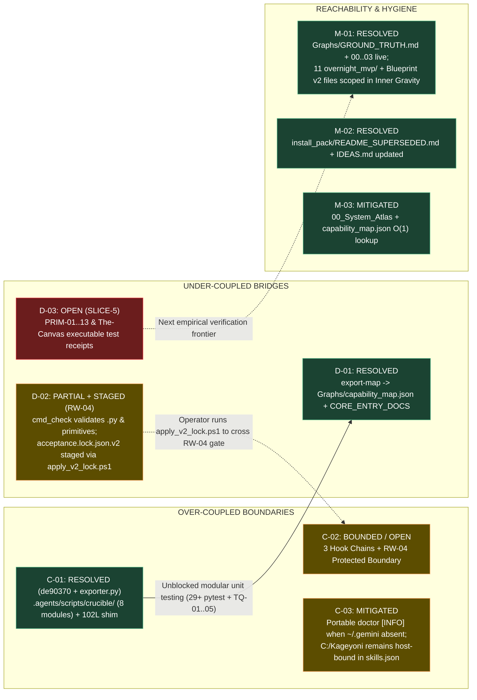

# 02 — Coupling, Reachability & Bottleneck Audit

**WOS Graph Types:** `Outcome map` & `Target system architecture` (delta) (`P-WOS` / `K-WOS-03` / `K-ARCH-03`)

This audit tracks the three architectural failure modes across Crucible Domain and records **which items are resolved vs. still open** after `de90370` and Wave 2:
1. **Over-Coupled** (things welded together that should be independent)
2. **Under-Coupled** (things disconnected that need an explicit bridge)
3. **Misplaced / Hard-to-Reach** (things in the wrong folder or duplicated across entry points)

---

## 1. Visual Coupling & Status Map

---

## 2. Reconciled Issue Ledger (`de90370` + Wave 2 State)

| ID | Category | Status | Observed Current Evidence & Remaining Gap | Canonical Paths |
| --- | --- | --- | --- | --- |
| **C-01** | Over-Coupled | **RESOLVED** | `crucible_index.py` (2,552L) split at `de90370` into `.agents/scripts/crucible/` (`__init__.py`, `models.py`, `indexer.py`, `router.py`, `forge.py`, `doctor.py`, `sieve.py`, plus `exporter.py`) behind a 102L shim; covered by 29+ pytest tests and [`test_quality_gate.py`](../.agents/scripts/test_quality_gate.py) (`TQ-01..TQ-05`). | [`crucible_index.py`](../.agents/scripts/crucible_index.py) · [`.agents/scripts/crucible/__init__.py`](../.agents/scripts/crucible/__init__.py) |
| **C-02** | Over-Coupled | **BOUNDED (OPEN)** | Three `hooks.json` chains (`~/.gemini/config`, `.agents/`, `.agents/plugins/inner-gravity/`) still trigger independently; global `hook_v4.py` enforces the `RW-04` protected-file boundary (`AGENTS.md`, `GEMINI.md`, `.agents/hooks.json`, `.agents/acceptance.lock.json`, `hooks.json`, `hook_v4.py`) while [`crucible_gate.py`](../.agents/scripts/crucible_gate.py) owns workspace `SessionStart` / `PreToolUse` / `Stop`. | [`.agents/hooks.json`](../.agents/hooks.json) · [`01_System_Topology_and_Runtime.md`](./01_System_Topology_and_Runtime.md) |
| **C-03** | Over-Coupled | **MITIGATED** | `doctor` now emits a non-failing `[INFO]` portability notice when `~/.gemini/config` is absent, and `_build_system_map()` handles missing global config; external `C:/Kageyoni/.agents/skills` coupling inside global `skills.json` remains host-specific. | [`doctor.py`](../.agents/scripts/crucible/doctor.py) · [`05_Session_4188f88a_Causal_Trace_and_Gaps.md`](../Project/Inner%20Gravity/05_Session_4188f88a_Causal_Trace_and_Gaps.md) |
| **D-01** | Under-Coupled | **RESOLVED** | `crucible_gate.py export-map` (`crucible/exporter.py`) generates deterministic `Graphs/capability_map.json`, and `CORE_ENTRY_DOCS` indexes `CRUCIBLE-ATLAS`, `CRUCIBLE-AUDIT`, `IG-OBS`, and `CPL-PILOT-MAPS` alongside [`00_System_Atlas_and_Neon_Handoff.md`](./00_System_Atlas_and_Neon_Handoff.md). | [`00_System_Atlas_and_Neon_Handoff.md`](./00_System_Atlas_and_Neon_Handoff.md) · [`cpl_pilot_maps.md`](../Project/Inner%20Gravity/overnight_mvp/cpl_pilot_maps.md) |
| **D-02** | Under-Coupled | **PARTIAL + STAGED** | `cmd_check` now syntax-checks all `.py` files under `.agents/scripts/` and `.agents/scripts/crucible/` and validates [`Crucible_Primitives.json`](../Knowledge/Crucible_Primitives.json). Because `.agents/acceptance.lock.json` is `RW-04` protected, the expanded v2 manifest is staged in [`acceptance.lock.json.v2`](../Project/Inner%20Gravity/install_pack/acceptance.lock.json.v2) with [`apply_v2_lock.ps1`](../Project/Inner%20Gravity/install_pack/apply_v2_lock.ps1) for operator apply. | [`acceptance.lock.json.v2`](../Project/Inner%20Gravity/install_pack/acceptance.lock.json.v2) · [`apply_v2_lock.ps1`](../Project/Inner%20Gravity/install_pack/apply_v2_lock.ps1) |
| **D-03** | Under-Coupled | **OPEN (`SLICE-5`)** | `PRIM-02..05`, `PRIM-08`, `PRIM-10..11`, `PRIM-13`, and `The-Canvas` (27 code / 22 tests) still lack executed local test receipts linked into `Knowledge_Register.md` and `Crucible_Primitives.json`. | [`Project_Register.md`](../Project/Project_Register.md) · [`Knowledge_Register.md`](../Knowledge/Knowledge_Register.md) |
| **M-01** | Misplaced | **RESOLVED** | `Graphs/` now hosts [`GROUND_TRUTH.md`](./GROUND_TRUTH.md) + `00..03` + `capability_map.json`; the 11 historical CPL/production files in `Project/Inner Gravity/overnight_mvp/` plus [`system_blueprint_v2.yaml`](../Project/Inner%20Gravity/system_blueprint_v2.yaml) and [`System_Blueprint_v2_Visual_Guide.md`](../Project/Inner%20Gravity/System_Blueprint_v2_Visual_Guide.md) stay anchored as reference specs inside `Project/Inner Gravity/`. | [`GROUND_TRUTH.md`](./GROUND_TRUTH.md) · [`System_Blueprint_v2_Visual_Guide.md`](../Project/Inner%20Gravity/System_Blueprint_v2_Visual_Guide.md) |
| **M-02** | Misplaced | **RESOLVED** | [`README_SUPERSEDED.md`](../Project/Inner%20Gravity/install_pack/README_SUPERSEDED.md) marks the Nov 15/22 staging files superseded at root; [`IDEAS.md`](../IDEAS.md) closes the stale Stage 3 `[P-INNER-GRAVITY]` bullet and records `[P-CRUCIBLE-MODULAR]` under `## Shipped`; [`Project/Inner Gravity/README.md`](../Project/Inner%20Gravity/README.md) links to `Graphs/00`. | [`README_SUPERSEDED.md`](../Project/Inner%20Gravity/install_pack/README_SUPERSEDED.md) · [`IDEAS.md`](../IDEAS.md) |
| **M-03** | Misplaced | **MITIGATED** | [`00_System_Atlas_and_Neon_Handoff.md`](./00_System_Atlas_and_Neon_Handoff.md) + `Graphs/capability_map.json` consolidate cold-start routing into one human atlas and one machine JSON map. | [`00_System_Atlas_and_Neon_Handoff.md`](./00_System_Atlas_and_Neon_Handoff.md) |
