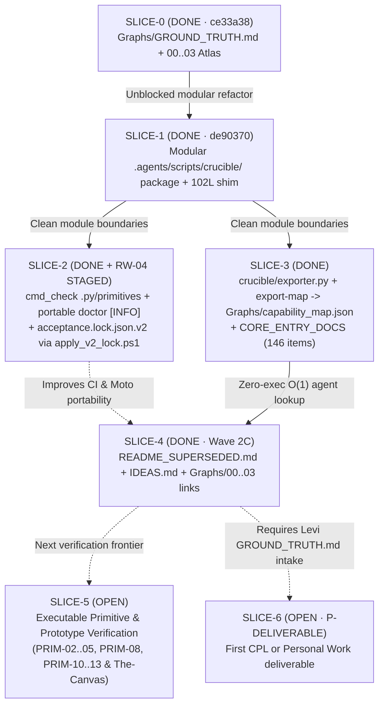

# 03 — Neon Refactoring Plan (Decoupling & Reachability Slices)

**WOS Graph Types:** `Planning decision flow` & `Plan dependency graph` (`P-WOS` / `K-WOS-02` / `K-GRAPH-01`)

> **Execution Status:** Slices `SLICE-0` through `SLICE-4` are **completed or staged** across Wave 1 (`de90370`) and Wave 2 (`[P-CRUCIBLE-MODULAR]`), with the `RW-04`-protected lockfile v2 update staged for operator execution via [`apply_v2_lock.ps1`](../Project/Inner%20Gravity/install_pack/apply_v2_lock.ps1). `SLICE-5` and `SLICE-6` are the open next frontiers. Keep `python ".agents/scripts/crucible_gate.py" doctor` at `0 FAIL` after every slice.

---

## 1. Plan Dependency Graph

---

## 2. Bounded Slice Specifications & Observed Status

### `SLICE-1` — Decouple `crucible_index.py` (2,552L -> Modular Package) · **DONE (`de90370`)**
* **Observed State:** Split `.agents/scripts/crucible_index.py` into focused modules under `.agents/scripts/crucible/`:
  * [`__init__.py`](../.agents/scripts/crucible/__init__.py) (20L) — public entrypoint re-exports
  * [`models.py`](../.agents/scripts/crucible/models.py) (553L) — constants, regexes, and dataclasses (`CapabilityEntry`, `CapabilityIndex`, `ForgeBrief`, `DoctorReport`, etc.)
  * [`indexer.py`](../.agents/scripts/crucible/indexer.py) (545L) — `build_index`, `validate_primitives_registry`, Markdown/JSON/frontmatter parsers
  * [`router.py`](../.agents/scripts/crucible/router.py) (178L) — `route_query`, `_score_entries`
  * [`forge.py`](../.agents/scripts/crucible/forge.py) (403L) — `forge_brief`, exhibit/primitive synthesis
  * [`doctor.py`](../.agents/scripts/crucible/doctor.py) (433L) — `run_doctor`, hook/link/duplicate audits
  * [`sieve.py`](../.agents/scripts/crucible/sieve.py) (489L) — `fetch_github_repos`, `compute_melt_diff`, `run_melt_scan`
  * `exporter.py` (added in Wave 2A) — `build_capability_map`, `write_capability_map`
* **Backwards Compatibility:** [`crucible_index.py`](../.agents/scripts/crucible_index.py) remains a 102L re-export + CLI shim for [`crucible_gate.py`](../.agents/scripts/crucible_gate.py) and existing tests.
* **Observed Check:** `29 passed` pytest at `de90370` + `16 PASS | 0 WARN | 0 FAIL` doctor + [`test_quality_gate.py`](../.agents/scripts/test_quality_gate.py) (`TQ-01..TQ-05`) PASS.

### `SLICE-2` — Harden `acceptance.lock.json` & Host Portability (`C-03`, `D-02`) · **DONE IN CODE + `RW-04` STAGED**
* **Observed State:**
  * `cmd_check` in [`crucible_gate.py`](../.agents/scripts/crucible_gate.py) syntax-checks `.py` files under `.agents/scripts/` and `.agents/scripts/crucible/` and validates [`Knowledge/Crucible_Primitives.json`](../Knowledge/Crucible_Primitives.json).
  * `_audit_hooks()` in [`doctor.py`](../.agents/scripts/crucible/doctor.py) emits a non-failing `[INFO]` `portability` finding when `~/.gemini/config` is absent.
  * Because [`.agents/acceptance.lock.json`](../.agents/acceptance.lock.json) is protected by global `hook_v4.py` (`RW-04` / `PROTECTED_FILES`), the expanded manifest is staged at [`acceptance.lock.json.v2`](../Project/Inner%20Gravity/install_pack/acceptance.lock.json.v2) (adding `Graphs/GROUND_TRUTH.md`, `Graphs/00_System_Atlas_and_Neon_Handoff.md`, `Knowledge/Crucible_Primitives.json`, `test_quality_gate.py`, and `.agents/scripts/crucible/*.py`) alongside idempotent [`apply_v2_lock.ps1`](../Project/Inner%20Gravity/install_pack/apply_v2_lock.ps1).
* **Operator Step:** Run `pwsh -File "Project/Inner Gravity/install_pack/apply_v2_lock.ps1"` to promote v2 across the `RW-04` boundary and verify `doctor`.

### `SLICE-3` — Machine-Readable Capability Map & Atlas Indexing (`D-01`) · **DONE (Wave 2A/2B)**
* **Observed State:**
  * `crucible_gate.py export-map` (`crucible/exporter.py`) writes deterministic `Graphs/capability_map.json` (`crucible-capability-map/v1` schema, sorted by `id`) for zero-exec O(1) lookup.
  * `CORE_ENTRY_DOCS` indexes `CRUCIBLE-ATLAS`, `CRUCIBLE-AUDIT`, `IG-OBS`, and `CPL-PILOT-MAPS` ([`cpl_pilot_maps.md`](../Project/Inner%20Gravity/overnight_mvp/cpl_pilot_maps.md)), expanding the live RAM index to 146 capabilities; `CANONICAL_LOCAL_FIRST_FILES` enforces Markdown link resolution inside [`GROUND_TRUTH.md`](./GROUND_TRUTH.md) and [`00_System_Atlas_and_Neon_Handoff.md`](./00_System_Atlas_and_Neon_Handoff.md).

### `SLICE-4` — Reconcile Stale Staging & Reference Links (`M-01`, `M-02`) · **DONE (Wave 2C)**
* **Observed State:**
  * Added [`README_SUPERSEDED.md`](../Project/Inner%20Gravity/install_pack/README_SUPERSEDED.md) marking legacy Nov 15/22 staging files superseded at repo root.
  * Updated [`IDEAS.md`](../IDEAS.md) (closed stale Stage 3 `[P-INNER-GRAVITY]` bullet; logged `[P-CRUCIBLE-MODULAR]` under `## Shipped`; kept `Stage 4` empty).
  * Updated [`Project/Inner Gravity/README.md`](../Project/Inner%20Gravity/README.md) with status link to [`00_System_Atlas_and_Neon_Handoff.md`](./00_System_Atlas_and_Neon_Handoff.md), and reconciled `Graphs/00..03` links + historical reference inventory (11 `Project/Inner Gravity/overnight_mvp/` files + [`system_blueprint_v2.yaml`](../Project/Inner%20Gravity/system_blueprint_v2.yaml) + [`System_Blueprint_v2_Visual_Guide.md`](../Project/Inner%20Gravity/System_Blueprint_v2_Visual_Guide.md)).

### `SLICE-5` — Executable Primitive & Prototype Verification (`D-03`) · **OPEN (Next Frontier)**
* **Goal:** Exercise one candidate at a time (starting with `The-Canvas` 27 code / 22 tests or `PRIM-02..05`, `PRIM-08`, `PRIM-10..11`, `PRIM-13`) in an isolated workspace and record observed receipts in [`Knowledge_Register.md`](../Knowledge/Knowledge_Register.md) and [`Crucible_Primitives.json`](../Knowledge/Crucible_Primitives.json).
* **Receiving Check:** Exact test command, commit SHA, pass/fail counts, and `TQ-01..TQ-05` audit recorded per `K-ARCH-03`.

### `SLICE-6` — Domain Ground-Truth Intake (`P-DELIVERABLE`) · **OPEN (Gated by `SHIFTING_SAND`)**
* **Goal:** Complete a `GROUND_TRUTH.md` intake with Levi for `Calgary Public Library/` or `Personal Work/` (currently 0 files) before creating deliverables (`SHIFTING_SAND` enforced by `crucible_gate.py pre-tool`).
