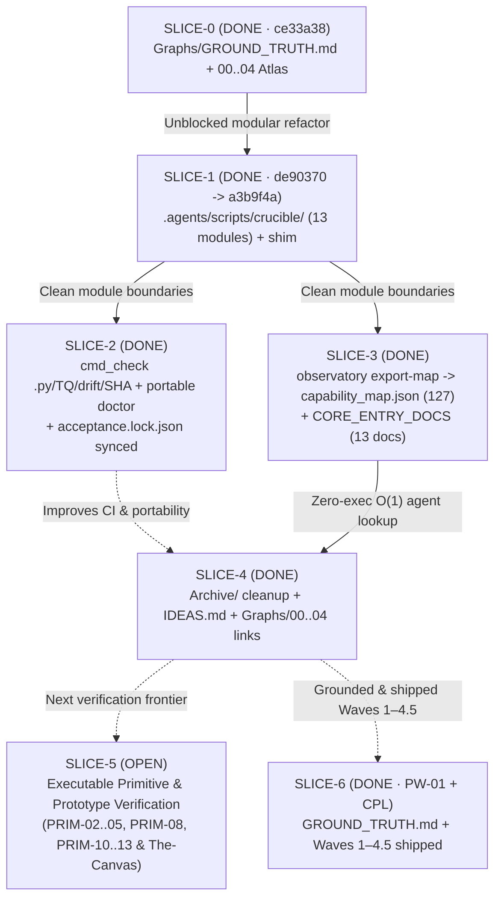

# 03 — Neon Refactoring Plan (Decoupling & Reachability Slices)

**WOS Graph Types:** `Planning decision flow` & `Plan dependency graph` (`P-WOS` / `K-WOS-02` / `K-GRAPH-01`)

> **Execution Status:** Slices `SLICE-0` through `SLICE-4` and `SLICE-6` (`Calgary Public Library/GROUND_TRUTH.md`, `Personal Work/GROUND_TRUTH.md`, and Waves 1–4.5 systems platform) are **completed**. `SLICE-5` (external `The-Canvas` / `PRIM-*` prototype runtime receipts) remains open. Keep `python ".agents/scripts/crucible_gate.py" doctor` at `0 FAIL` after every slice.

---

## 1. Plan Dependency Graph

---

## 2. Bounded Slice Specifications & Observed Status

### `SLICE-1` — Decouple `crucible_index.py` -> Modular Package · **DONE (`de90370` -> `a3b9f4a`)**
* **Observed State:** Split the legacy `crucible_index.py` monolith into focused modules under `.agents/scripts/crucible/` (evolving to **13 modules** by Wave 4.5, with `forge`, `sieve`, and `exporter` moved to the `crucible-observatory` MCP spoke):
  * [`__init__.py`](../.agents/scripts/crucible/__init__.py) — public entrypoint re-exports
  * [`models.py`](../.agents/scripts/crucible/models.py) — constants, regexes, `CORE_ENTRY_DOCS`, `CANONICAL_LOCAL_FIRST_FILES`, and dataclasses
  * [`indexer.py`](../.agents/scripts/crucible/indexer.py) — `build_index`, `validate_primitives_registry`, Markdown/JSON/frontmatter parsers
  * [`router.py`](../.agents/scripts/crucible/router.py) — `route_query`, BM25 + graph-walk scoring
  * [`doctor.py`](../.agents/scripts/crucible/doctor.py) — `run_doctor`, hook/link/duplicate/MCP audits, `[INFO] portability`
  * [`tx_patch.py`](../.agents/scripts/crucible/tx_patch.py), [`campaign_ir.py`](../.agents/scripts/crucible/campaign_ir.py), [`contracts.py`](../.agents/scripts/crucible/contracts.py), [`solver.py`](../.agents/scripts/crucible/solver.py), [`outcome_ledger.py`](../.agents/scripts/crucible/outcome_ledger.py), [`ast_scanner.py`](../.agents/scripts/crucible/ast_scanner.py), [`replay_loop.py`](../.agents/scripts/crucible/replay_loop.py), [`story_engine.py`](../.agents/scripts/crucible/story_engine.py) — Waves 1–4.5 execution, verification, AST discovery, replay, story, and G5 ledger primitives
* **Backwards Compatibility:** [`crucible_index.py`](../.agents/scripts/crucible_index.py) remains a backwards-compatible re-export + CLI shim for [`crucible_gate.py`](../.agents/scripts/crucible_gate.py) and existing tests.
* **Observed Check:** Wave 4.5 verified `22/22` `verify_all.ps1` checks, `5/5` `mutation_gate.py` kills, `10/10` G5 entries, clean `doctor`, and [`test_quality_gate.py`](../.agents/scripts/test_quality_gate.py) (`TQ-01..TQ-05`) PASS.

### `SLICE-2` — Harden `acceptance.lock.json` & Host Portability (`C-03`, `D-02`) · **DONE**
* **Observed State:**
  * `cmd_check --strict` in [`crucible_gate.py`](../.agents/scripts/crucible_gate.py) syntax-checks `.py` files, runs `TQ-01..TQ-05`, detects plugin/kernel self-model drift and stale `depends_on_sha256`, and validates [`Knowledge/Crucible_Primitives.json`](../Knowledge/Crucible_Primitives.json).
  * `_audit_hooks()` and `_audit_mcp_configs()` in [`doctor.py`](../.agents/scripts/crucible/doctor.py) emit non-failing `[INFO]` portability when `~/.gemini/config` is absent and validate zero hardcoded host paths across `.agents/plugins/*/mcp_config.json` (`CD-W19`).
  * [`.agents/acceptance.lock.json`](../.agents/acceptance.lock.json) (`RW-04` protected) is synced, and legacy `install_pack/` staging fossils are retired to [`Archive/README.md`](../Archive/README.md).

### `SLICE-3` — Machine-Readable Capability Map & Atlas Indexing (`D-01`) · **DONE**
* **Observed State:**
  * `crucible-observatory` (`export-map` via `observatory.exporter`) writes deterministic [`Graphs/capability_map.json`](./capability_map.json) (`crucible-capability-map/v1` schema, `127` portable entries sorted by `id`) for zero-exec O(1) lookup.
  * `CORE_ENTRY_DOCS` indexes `CRUCIBLE-ATLAS`, `CRUCIBLE-AUDIT`, `CRUCIBLE-ML-ARCH`, `CS-ARCH`, `CS-SCORECARD`, `IG-OBS`, and `CPL-PILOT-MAPS` ([`cpl_pilot_maps.md`](../Archive/overnight_mvp/cpl_pilot_maps.md)); `CANONICAL_LOCAL_FIRST_FILES` enforces Markdown link resolution across all canonical entry files including [`GROUND_TRUTH.md`](./GROUND_TRUTH.md), [`00_System_Atlas_and_Neon_Handoff.md`](./00_System_Atlas_and_Neon_Handoff.md), and [`04_InRAM_ML_and_Control_Plane_Architecture.md`](./04_InRAM_ML_and_Control_Plane_Architecture.md).

### `SLICE-4` — Reconcile Stale Staging & Reference Links (`M-01`, `M-02`) · **DONE**
* **Observed State:**
  * Retired legacy Nov 15/22 staging files, `overnight_mvp/`, and `system_blueprint_v2/` under [`Archive/README.md`](../Archive/README.md) ([`system_blueprint_v2.yaml`](../Archive/system_blueprint_v2/system_blueprint_v2.yaml) · [`System_Blueprint_v2_Visual_Guide.md`](../Archive/system_blueprint_v2/System_Blueprint_v2_Visual_Guide.md)).
  * Updated [`IDEAS.md`](../IDEAS.md) (moving completed Waves 1–4.5 items under `## Shipped` and keeping `Stage 4` empty).
  * Updated [`Project/Inner Gravity/README.md`](../Project/Inner%20Gravity/README.md) with status link to [`00_System_Atlas_and_Neon_Handoff.md`](./00_System_Atlas_and_Neon_Handoff.md), and reconciled `Graphs/00..04` links.

### `SLICE-5` — Executable Primitive & Prototype Verification (`D-03`) · **OPEN (Next Frontier)**
* **Goal:** Exercise one candidate at a time (starting with `The-Canvas` 27 code / 22 tests or `PRIM-02..05`, `PRIM-08`, `PRIM-10..11`, `PRIM-13`) in an isolated workspace and record observed receipts in [`Knowledge_Register.md`](../Knowledge/Knowledge_Register.md) and [`Crucible_Primitives.json`](../Knowledge/Crucible_Primitives.json).
* **Receiving Check:** Exact test command, commit SHA, pass/fail counts, and `TQ-01..TQ-05` audit recorded per `K-ARCH-03`.

### `SLICE-6` — Domain Ground-Truth Intake & Platform Execution (`PW-01`, `P-CPL-YOUTUBE`) · **DONE**
* **Observed State:** Completed canonical `GROUND_TRUTH.md` intakes for both `Calgary Public Library/` (23 files) and `Personal Work/` (4 files: `GROUND_TRUTH.md`, `CS_Loop_Weakness_Audit.md`, `CS_Opportunity_Map.md`, `CS_Process_Validity_Scorecard.md`) and shipped Waves 1–4.5 (`a3b9f4a`: `22/22` `verify_all.ps1` checks, `5/5` mutation kills, `10/10` G5 outcomes).
