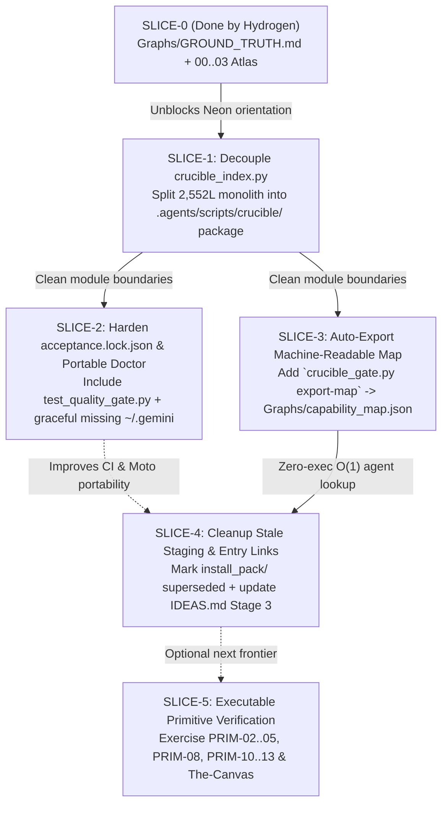

# 03 — Neon Refactoring Plan (Decoupling & Reachability Slices)

**WOS Graph Types:** `Planning decision flow` & `Plan dependency graph` (`P-WOS` / `K-WOS-02` / `K-GRAPH-01`)

> **Instructions for Neon:** Execute these slices **one at a time (`WIP <= 1`)**. Solid arrows (`-->`) are hard prerequisites; dashed arrows (`-.->`) are advisory or optional. Keep `python ".agents/scripts/crucible_gate.py" doctor` at `0 FAIL` after every slice.

---

## 1. Plan Dependency Graph

---

## 2. Bounded Slice Specifications

### `SLICE-1` — Decouple `crucible_index.py` (2,552L -> Modular Package)
* **Goal:** Split `.agents/scripts/crucible_index.py` into focused, single-purpose modules under `.agents/scripts/crucible/`:
  * `models.py` (dataclasses: `CapabilityEntry`, `CapabilityIndex`, `ForgeBrief`, `DoctorReport`, etc.)
  * `indexer.py` (`build_index`, Markdown/JSON/frontmatter parsers)
  * `router.py` (`route_query`, `_score_entries`)
  * `forge.py` (`forge_brief`, exhibit/primitive synthesis)
  * `doctor.py` (`run_doctor`, hook/link/duplicate audits)
  * `sieve.py` (`fetch_github_repos`, `compute_melt_diff`, `run_melt_scan`)
* **Backwards Compatibility:** Keep `.agents/scripts/crucible_index.py` as a thin re-export/CLI shim so `crucible_gate.py` and existing tests keep working without breakage.
* **Receiving Check:** Run `pytest .agents/scripts/tests` and `python ".agents/scripts/crucible_gate.py" doctor` (`16 PASS | 0 WARN | 0 FAIL`).

### `SLICE-2` — Harden `acceptance.lock.json` & Host Portability (`C-03`, `D-02`)
* **Goal:** Add `.agents/scripts/test_quality_gate.py` to `acceptance.lock.json` `python_syntax`, add `Crucible_Primitives.json` schema check to `cmd_verify`, and ensure `doctor` degrades gracefully when `~/.gemini/config` is absent (e.g., in `Moto` / CI).
* **Receiving Check:** `python ".agents/scripts/crucible_gate.py" check` and `doctor` pass both locally and with a mocked missing home config.

### `SLICE-3` — Machine-Readable Capability Map (`D-01`)
* **Goal:** Add `crucible_gate.py export-map` to write a compact `Graphs/capability_map.json` (IDs -> paths, kinds, and summaries) so any model can resolve capabilities with a single `read_file` or `rg` without running Python.
* **Receiving Check:** `Graphs/capability_map.json` generated deterministically and validated against `doctor` counts (`142` items).

### `SLICE-4` — Reconcile Stale Staging (`M-02`)
* **Goal:** Mark `Project/Inner Gravity/install_pack/` as superseded by the live root files (`AGENTS.md`, `IDEAS.md`, `.agents/acceptance.lock.json`) and update `IDEAS.md` Stage 3 so future sessions don't mistake live governance for pending work.
* **Receiving Check:** `IDEAS.md` Stage 3 reflects reality; `doctor` passes `0 WARN | 0 FAIL`.

### `SLICE-5` — Executable Primitive & Prototype Verification (`D-03`)
* **Goal:** Exercise one candidate at a time (starting with `The-Canvas` 22 tests or `PRIM-02..05`) in an isolated workspace and record observed receipts in `Knowledge_Register.md`.
* **Receiving Check:** Exact test command, commit SHA, and pass/fail counts recorded per `K-ARCH-03`.
