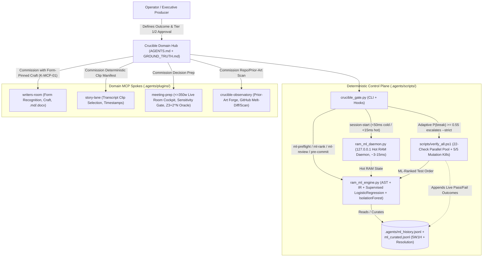
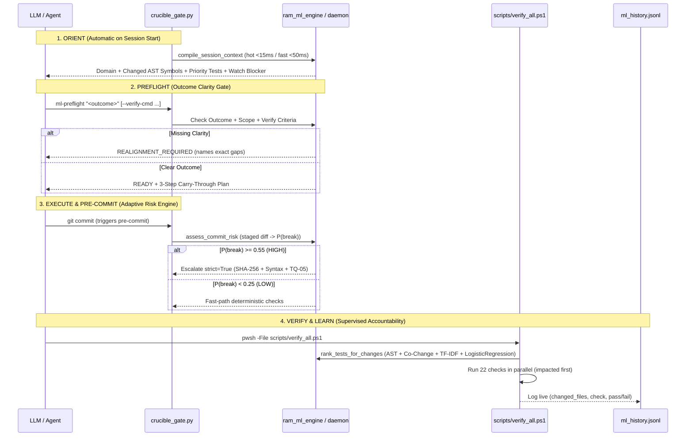

# 04 — Crucible Domain: Unified CS + In-RAM ML Control Plane Architecture

> **Purpose (Machine- & Human-Readable):** Canonical architecture view for any AI agent, LLM, or engineer entering `Crucible Domain`. Shows how **Deterministic Gates**, **In-RAM Supervised ML**, **Hot Localhost Daemon**, **MCP Spokes**, and **Parallel Verification** operate as one closed-loop control plane.
> **Edge Legend (`K-GRAPH-01`):** Solid arrows (`-->`) = blocking/enforced dependencies. Dashed arrows (`-.->`) = advisory signals or feedback loops.

---

## 1. System Topology (Hub + In-RAM ML + MCP Spokes)



---

## 2. Closed-Loop Execution Lifecycle (Reference Process Model)



---

## 3. Machine-Readable Capability Manifest

```json
{
  "system": "Crucible Domain",
  "role": "Sovereign AI Systems-Engineering Platform & Single Control Plane (PW-01)",
  "llm_calls_in_control_plane": 0,
  "commands": {
    "session_start": {
      "cmd": "python .agents/scripts/crucible_gate.py session-start",
      "purpose": "Compile minimal starting context (domain, AST symbols, priority tests, watch blockers)",
      "latency": "<15ms hot daemon / <50ms cold fallback"
    },
    "ml_preflight": {
      "cmd": "python .agents/scripts/crucible_gate.py ml-preflight \"<outcome>\" [--verify-cmd \"<cmd>\"] [--json]",
      "purpose": "Enforce outcome clarity (REALIGNMENT_REQUIRED vs READY) and emit 3-step carry-through plan"
    },
    "ml_rank": {
      "cmd": "python .agents/scripts/crucible_gate.py ml-rank [--json] [files...]",
      "purpose": "Rank pytest suites by failure likelihood using AST symbols/imports, git co-change, TF-IDF, and LogisticRegression"
    },
    "ml_review": {
      "cmd": "python .agents/scripts/crucible_gate.py ml-review [--json] [files...]",
      "purpose": "Score changed files for review priority, missing co-change partners, IsolationForest leads, and 5W1H past blockers"
    },
    "ml_curate": {
      "cmd": "python .agents/scripts/crucible_gate.py ml-curate [--json]",
      "purpose": "Deterministically deduplicate, domain-tag (crucible_engine, writers_room, story_lane, general), and balance training data"
    },
    "ml_train": {
      "cmd": "python .agents/scripts/crucible_gate.py ml-train [--json]",
      "purpose": "Extract 5W1H + Resolution records from transcripts and validate LogisticRegression with 5-fold StratifiedKFold CV"
    },
    "ml_daemon": {
      "cmd": "python .agents/scripts/crucible_gate.py ml-daemon {start|stop|status|bench}",
      "purpose": "Manage localhost-only (127.0.0.1) hot in-RAM ML daemon (~3.3ms min / ~15.5ms median)"
    },
    "pre_commit": {
      "cmd": "python .agents/scripts/crucible_gate.py pre-commit",
      "purpose": "Adaptive risk-gated commit check; auto-escalates --strict when staged P(break) >= 0.55"
    },
    "verify_all": {
      "cmd": "pwsh -File scripts/verify_all.ps1",
      "purpose": "ML-ranked 22-check parallel verification suite + 5/5 mutation kills with live outcome logging"
    },
    "ast_scan": {
      "cmd": "python .agents/scripts/crucible_gate.py ast-scan [--import-root <dir>] [--json]",
      "purpose": "Pure-Python in-RAM cross-repo AST call-edge scanner"
    },
    "discover": {
      "cmd": "python .agents/scripts/crucible_gate.py discover [--import-root <dir>] [--emit-campaign <spec.json>] [--json]",
      "purpose": "Discover AST/contract/MCP/drift/TQ gaps in RAM and synthesize disjoint CampaignSpec JSON"
    },
    "campaign": {
      "cmd": "python .agents/scripts/crucible_gate.py campaign {compile|plan|run|ledger} <target> [--worktree] [--replay-out <trace.jsonl>] [--json]",
      "purpose": "Compile/plan/run DAG slices in RAM or detached git worktree with double-run replay and fault rollback"
    },
    "story": {
      "cmd": "python .agents/scripts/crucible_gate.py story {recognize|select|chg01|mcp} ...",
      "purpose": "Deterministic form grammars, DP story-arc clip selection, CHG-01 invalidation, and K-MCP-01 stdio RPC"
    },
    "g5_check": {
      "cmd": "python .agents/scripts/crucible_gate.py g5-check [--file <path>] [--target 10] [--json]",
      "purpose": "Verify 10 non-commit-counting material improvements against evidence SHA-256"
    },
    "kernel": {
      "cmd": "python .agents/scripts/crucible_gate.py kernel \"<outcome>\" [--autofix] [--json]",
      "purpose": "Salsa dirty-closure, SHA-256 grant verification, EVOI escalation, and Lyapunov potential convergence"
    },
    "mutation_gate": {
      "cmd": "python .agents/scripts/mutation_gate.py [--json]",
      "purpose": "Inject 5 controlled gate regressions in temp copies and verify 5/5 test kills"
    }
  },
  "spokes": [
    {"id": "writers-room", "purpose": "Form-pinned writing commissions, anchor checks, .md/.docx export"},
    {"id": "story-lane", "purpose": "Deterministic saved-transcript clip selection and timestamp validation"},
    {"id": "meeting-prep", "purpose": "<=350-word Live Room Cockpit, sensitivity benchmark gate, Z3 + 2^N oracle"},
    {"id": "crucible-observatory", "purpose": "Offline prior-art forging, GitHub melt-diff/melt-scan, capability maps"}
  ]
}
```
