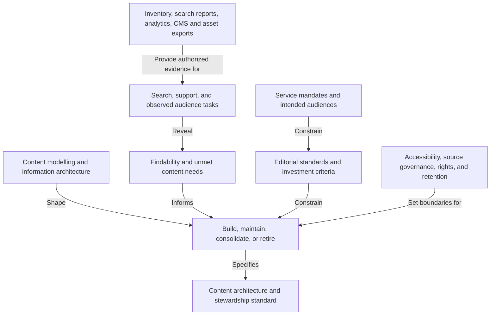
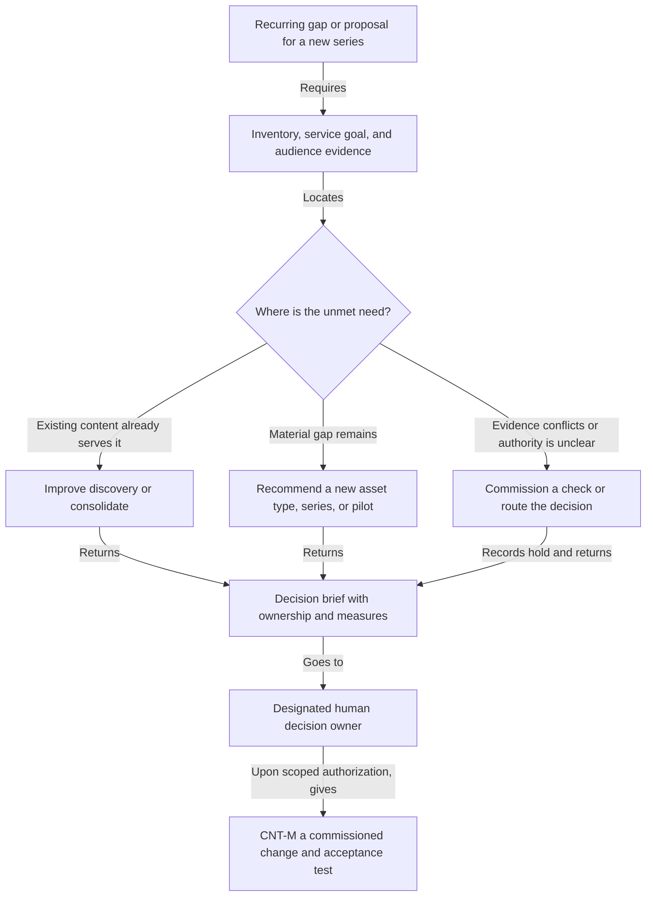
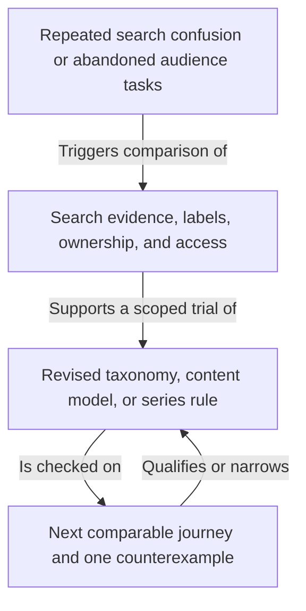

# CNT-D — Content Management Director

**Use for** decisions spanning a body of content, a service journey, or an editorial standard. Works at portfolio level across website, series, publications, and asset collections. An agent can research and recommend. The designated human owns commitments, policy exceptions, and configuration or publication authority. Keep Asana read-only.

**Carry out the assignment.** Open the relevant procedure and make the named artifact. [Channel and content operations](https://drive.google.com/file/d/1_iC7qOVDDkidzGTLXkheI7ewcLcuvqIU/view?usp=drivesdk) (CH-01/02/08) · [Writing practice](https://drive.google.com/file/d/1CmHfJsHBIZ70s9HDPwDVVq8l1WW86fup/view?usp=drivesdk) (MW-03) · [Audience and campaign practice](https://drive.google.com/file/d/17tk53q8uhoI-Xr0RI8O033-nSRLDc5t9/view?usp=drivesdk) (MK-04/09).

## Capability graph

**Know-how.** Define the task someone came to complete before deciding whether to add a page, launch a series, or change navigation. Define the series promise and content ownership across episodes, playlists, and destination pages. Weight direct task observations above page views when assessing usability. Understand content types, taxonomy, naming, controlled fields, accessibility review, versioning, retention, and obligations to source, service, and rights owners. Audit authorized CMS and digital asset management (DAM) exports for scope, duplication, controlled fields, orphaned items, and versions. Use search and analytics with their dates and limitations.

## Execution graph

**Receiving check.** CNT-M can identify the affected journey and content type, designated owner, existing items to preserve or retire, acceptance measure, permitted scope, and review date. For a series, specify why a recurring format fits, which audience promise survives across channels, and who sustains and reviews it. For consolidation, specify the intended successor plus links and audiences to test.

## Learning loop

**Example.** When educators reach the right resource only after several queries, compare the language used in queries with titles, filters and actual observed navigation. Trial a clearer listing before commissioning another video. A second pathway with different audience terminology tests whether the change belongs in a shared standard or only one section.

## Agent assignment

| Field | What to supply or return |
| --- | --- |
| Trigger | Recurring defects, proposed new content or series, inconsistent ownership, or a portfolio-level lifecycle decision. |
| Minimum inputs | Service goal, audience task, current items and version dates, approved strategic or editorial standards, evidence of the problem, decision owner, and named receiver. |
| Authorized work | Inspect public or supplied sources, inventory items, compare options, identify content and information architecture implications, draft a directional decision brief. |
| Route or hold | Conflicting service facts go to the service owner. Consequential institutional messaging, privacy, cultural context, rights, platform governance, and publication go to their designated authorized humans. |
| Return and accept | Return exact references, viable alternatives, a recommendation with uncertainty, named ownership, and a measurable first test. The owner can decide the requested scope and CNT-M can implement the authorized scope. |

## Evidence

- **Job evidence.** College Board's indexed Director, Content Strategy posting describes taxonomy, navigation, evidence and lifecycle scope. Toronto Public Library identifies content strategy and editorial in its management structure. Capilano University's director description includes content experience and website structure in a combined portfolio. [College Board](https://collegeboard.wd1.myworkdayjobs.com/en-US/Careers/job/Director--Content-Strategy_REQ002846) · [Toronto Public Library](https://tpl.ca/contact/management-staff/) · [Capilano University](https://www.capilanou.ca/media/capilanouca/about-capu/connect-with-capu/employment/admin-job-descriptions/Director-Marketing-and-Digital-Experience.pdf)
- **Calgary Public Library evidence.** The published strategy provides service context and the public site shows the mixed catalogue, website, and external resource journey. The role graph is a proposed delegation model. Confirm the current reporting structure, local tools, and actual authority per project. [2027–2030 Strategic Plan](https://www.calgarylibrary.ca/about-the-library/strategic-plan) · [Educators hub](https://www.calgarylibrary.ca/connect/educators)
