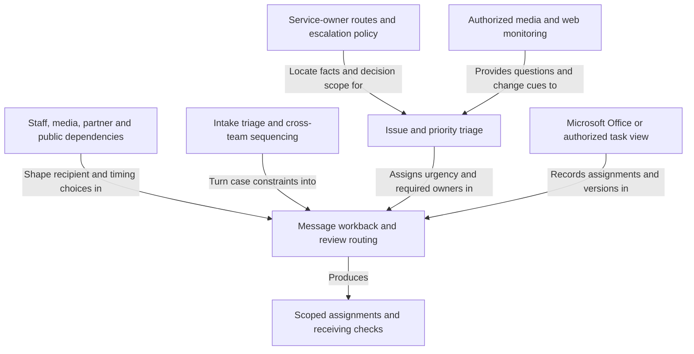
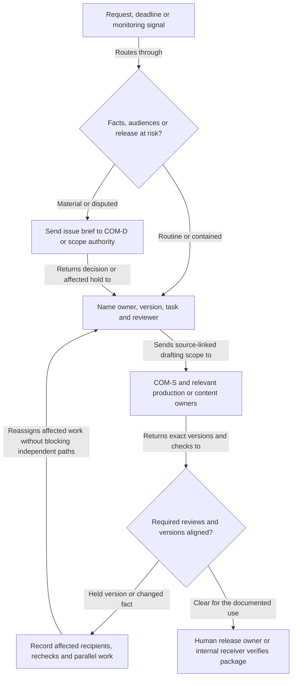
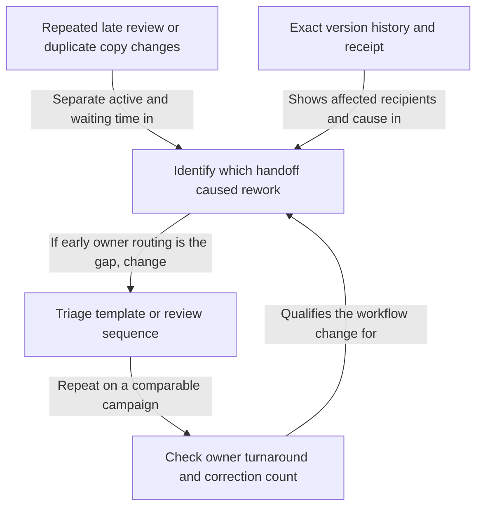

# COM-M — Communications Manager

Use this role to turn a confirmed message direction or inbound issue into coordinated work. Set priority, owners, versions, review windows, launch order and escalation paths. Agents can triage, draft workbacks and reconcile read-only evidence for the accountable manager.

**Carry out the assignment.** Open the relevant procedure and make the named artifact. [Communications and design practice](https://drive.google.com/file/d/1o3U1Yv1q7qrmFK1BjQnIykB13oictIe_/view?usp=drivesdk) (CD-01–04/08) · [Project and portfolio operations](https://drive.google.com/file/d/119wQhEWZhZfUynSX2IxUv_PJOcZsRbdF/view?usp=drivesdk) (OP-05/07) · [Writing practice](https://drive.google.com/file/d/1CmHfJsHBIZ70s9HDPwDVVq8l1WW86fup/view?usp=drivesdk) (MW-07).

## Capability graph

Know how to distinguish a true service or release dependency from a preferred review, and forecast critical review time separately from active effort. Use a source and version register to connect one factual change to staff notes, event pages, newsletter copy, social assets and recipient copies.

## Execution graph

For a time-sensitive announcement, establish earliest external use and the staff notice dependency independently. If a date changes after a provisional copy was issued, list who received which version, how they can access the replacement, and which uses need a final. Keep final-required use held until an authorized final copy is delivered and receipt is confirmed.

## Learning loop

## Agent assignment

| Field | Run instruction |
| --- | --- |
| Trigger | Multiple people, channels or deadlines need message coordination, or a service-change signal needs assignment and prioritization. |
| Minimum inputs | Current direction or open question, deadline for each affected use, exact drafts, audience and channel, source and review owners, capacity and known holds. |
| Permitted actions | Read authorized tasks, drafts and source records. Keep Asana read-only. Draft the workback, owner map, receiving checks and escalation note for the accountable manager. |
| Stop or route | Conflicting facts go to their service owner. Material audience, authority or reputation conflicts go to COM-D or the designated authority. Preserve independent approved work within scope, including template prep and sourcing. |
| Return and acceptance | Return one controlling queue view with task, owner, deadline, dependency, exact version, receiver and check. For a changed version include prior notes, recipient copies and scoped holds. A human reviewer can locate the package and tell who acts next and on what. |

## Evidence

- [Prince George Public Library's manager description](https://www.pgpl.ca/sites/default/files/postings/Manager%20of%20Communications%20and%20Engagement%20Job%20Description.pdf) establishes a comparator for managing official communications, engagement, media liaison and staff workflow, with Office, Adobe and web/social tools listed.
- The [Calgary Public Library Media Centre](https://www.calgarylibrary.ca/about-the-library/media-centre) gives a public media route. The [June 2025 Board packet](https://www.calgarylibrary.ca/assets/2025-06-25-Board-Meeting-Materials-Web.pdf) supplies historical civic engagement context for audience, public education and campaign coordination.
- Workback, approval and receipt handling are proposed for the Work Operating System. Confirm actual team ownership, visible tools and action permissions for each run.
