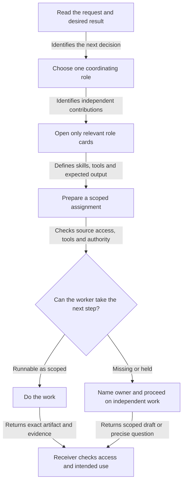
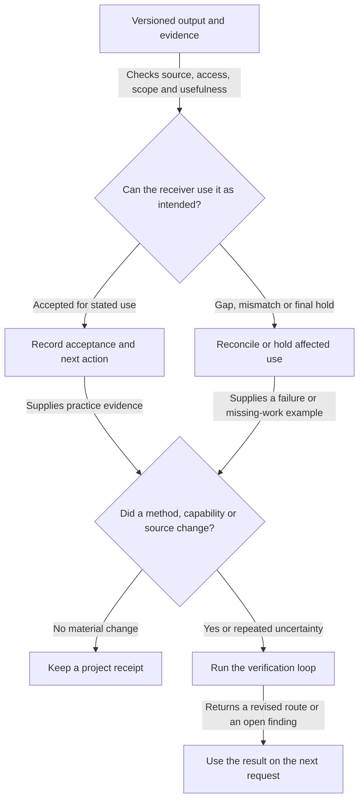

# How to use Media Agency

Start with the work you need done. Find the role, methods and judgment that fit the next decision. The role file equips the contribution. The actual project gives the worker its inputs, permissions, owner and receiving destination.

[Find a role in the index](https://drive.google.com/file/d/1PiaweOxTc2Le1WAd_5YYOdHhwZ3XrSpK/view?usp=drivesdk) · [See the cross-role routing guide](https://drive.google.com/file/d/1MRedi2IBSb2_Qz0J3hetu7Nk7EoKp_c_/view?usp=drivesdk)

In a synced copy, open `README.md`, then `Media_Work_Routing.md` or the selected role file named by its role ID. Find the next review in `Verify_and_Maintain_Media_Agency.md` and its results in `Media_Agency_Verification_Record.md`.

## 1. Choose a role and equip the assignment

| If you need to… | Open… | Take… |
| --- | --- | --- |
| Work out what needs to happen | Routing guide, **Choose the responsibility from the decision** | One lead for the next commitment and meaningful parallel contributions. |
| Assign a worker a contribution | Role index, named role's **Agent assignment** | Trigger, inputs, permitted work, exact return, next owner and acceptance check. |
| Do the work | **Capability graph**, **Execution graph**, and current linked method | Needed skill, judgment and available operation for this assignment. Load only the relevant sections. |
| Route a disputed fact, changed version, or missing permission | Routing guide, **Handle a changed or missing input** | Exact decision owner, affected use, recovery check and independent work. |
| Improve how this assignment runs again | Role card **Learning loop** and verification record | Evidence of the issue, scope of the observation and a scenario that can qualify a correction. |

Give the worker the request and desired outcome, role ID, brief and source versions, usable tools, named decision owner and receiver, due date, permitted use and observable acceptance. Verify it can access the inputs. Run complementary assignments in parallel when each has what it needs. A director-level recommendation goes to the named human who actually holds that authority.

## 2. Receive the result and improve future work

The receiver should be able to open the exact artifact, identify the action it permits, and find unresolved decisions or holds. Dispatch, access, receipt, acceptance and release approval are different events. Final-required use waits for the authorized final and confirmed receipt.

## 3. Example · a programme promotion with uncertain facts

A colleague requests a new promo. Two pages describe the programme differently, and a past video may be reusable.

1. **Campaign manager coordinates.** The audience promise and destination control whether the next commitment is production. Content captures the URLs and conflicting fields. Communications drafts the focused question and read-back. Production can independently audit the past media and prepare feasible treatments.
2. **Programme owner resolves the fact.** Hold disputed copy, unsupported footage claims and external promises. Prepare a neutral concept, audience path comparison or asset audit where the evidence allows.
3. **Receive a decision brief.** Include the evidence, exact version, options, release scope, decision and verification owners, and what can proceed. The requester can decide whether to repair the journey, explore reuse or consider new capture.
4. **Log a verification finding if needed.** Capture the role, branch or output the worker could not find. Re-test a supported change before treating it as a new standard.

An assignment you can give an agent is **Role COM-S · Confirm the programme description before drafting. Use the brief and exact page observations. Return a focused question, source-linked read-back draft, disputed wording held, and one neutral option for the campaign manager. Route factual confirmation to the programme owner. Read-only evidence and internal drafting.**

Keep institutional records in their authorized audience and storage. Asana stays read-only.
