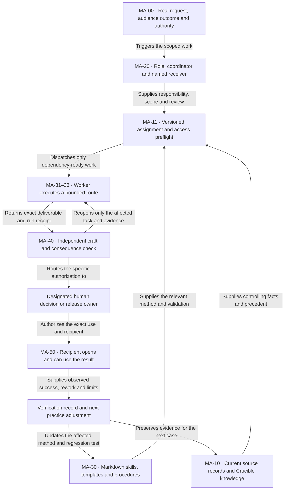

# Media Agency frontier review and master graph

**Decision for MA-SPRINT-01 · November 17–22, 2026.** Keep the role and work inventory broad. Put the highest effort into qualifying the three composed routes already in the commission. Use the research report as a record of its search limitations and as a source of hypotheses about pilots and feedback.

## What the report establishes

- **Local evidence.** I opened the Crucible root, the current commission, and the Media Agency catalogue in the connected Drive environment. Crucible contains project, knowledge and graph records. Its Media Agency catalogue links 12 roles and 55 existing portable procedures. The supplied report’s unsuccessful retrieval describes that researcher’s access. Its placeholder inventory and generic pipeline diagrams cannot establish Crucible’s identity, its actual handoffs, or its gaps. The catalogue’s presence also leaves runtime and receiving readiness to be tested.
- **Survey context.** IAB’s 2025 survey reports 30% full AI integration across participating agencies, brands and publishers. Its unit is adoption in an advertising sample. The supplied report offers no traceable source and method for the combined 22% ROI, 32% conversion and 29% acquisition-cost claim. I could not verify that bundle. Keep those figures out of the sprint case and acceptance criteria. [IAB original release](https://www.iab.com/news/iab-state-of-data-report-2025/)
- **Retain** a small pilot, review gates and feedback into the next run. Translate these into real artifacts and compare against the current Media Agency instructions. **Defer** general training, centralized campaign data ingestion, third-party audience segmentation, automated spend and pricing changes. Each would need a demonstrated local problem, a responsible owner and evidence that changes the choice. Calgary Public Library needs audience usefulness, accessibility, editorial integrity and reduced rework, measured at the actual destination.

## What the two fresh reviews change

| Discipline and documented practice | Adopt in this sprint | Evidence boundary |
| --- | --- | --- |
| **Agency craft and operating model.** WPP describes a curated agent catalogue with senior specialist validation and approved knowledge, and a production platform with human oversight. Monks’ Pixel case links source materials and campaign brief to scripts, storyboards and derivative production. | Approve each procedure through craft review. Carry one controlling source and intent through copy, A/V and variants. Transfer exact inputs, output and approval scope at each seam. | Company-described operating practices and a self-reported case. Use the mechanism as a design candidate. [WPP Agent Hub](https://www.wpp.com/en/news/2026/01/wpp-launches-agent-hub-on-wpp-open-providing-clients-with-access-to-advanced-agentic-ai) · [WPP Production Studio](https://www.wpp.com/en/news/2024/06/wpp-unveils-ai-powered-production-studio) · [Monks Pixel](https://www.monks.com/case-studies/google-pixel-agentic-accelerator) |
| **Public-service adaptation.** The BBC reports selective AI subtitle and transcript trials and retains editorial control. Monks’ Headspace case reports weaker initial click-through and later changes to creative and distribution together. | Grade the media in context with captions, sound and destination checks. Record comprehension or the receiving task separately from attention metrics. | Reported trials. For Calgary Public Library, use representative viewing and authorized assets; attribution and audience outcomes have their own evidence. [BBC Group Annual Report, pp. 10 and 41](https://www.bbcstudios.com/media/7322/bbc-annual-report-accounts-24-25-final-276-for-nao-1.pdf) · [Monks Headspace](https://www.monks.com/case-studies/headspace-personalized-at-scale-performance-creative) |
| **Context and delegation.** Anthropic describes independent research branches, just-in-time context retrieval and a cost tradeoff. | Load only the current case, controlling decisions and needed procedures. Delegate work with independent inputs. Compare one worker with a coordinator plus specialist on a case where parallel work could matter. | Research-system findings motivate testing. Record local quality, tool calls and correction effort when measurable. [Anthropic multi-agent research](https://www.anthropic.com/research/multi-agent-research-system) · [Context engineering](https://www.anthropic.com/engineering/effective-context-engineering-for-ai-agents) |
| **Engineering for reliable runs.** Anthropic documents resumable checkpoints and repeated evaluation. OpenAI describes repository scaffolding, boundary validation and review loops. Google SRE uses controlled exposure with evaluation. | Separate the mutable sprint state from versioned run receipts. Test restart and failure explicitly. Move from a desk test to one reversible internal work sample after the recipient and tools are confirmed. | Architecture patterns. The shared Drive can support procedural controls. Automated enforcement needs evidence and explicit authorization before adoption. [Long-running harnesses](https://www.anthropic.com/research/effective-harnesses-for-long-running-agents) · [Agent evaluations](https://www.anthropic.com/research/demystifying-evals-for-ai-agents) · [OpenAI harness engineering](https://openai.com/index/harness-engineering/) · [Google SRE canarying](https://sre.google/workbook/canarying-releases/) |

## Ranked gaps and what to build if selected

| Priority | Gap in the current evidence | Smallest build and exit check |
| --- | --- | --- |
| **1 · A composed run from the real entry point** | Individual written outputs were exercised. A worker can still choose a stale entry or fail to load the right procedure and source in the intended runtime. | **MA-10/11.** Agree the controlling entry per record, trace both Media Agency paths, and use a version-bound assignment card. Fresh worker reaches exact inputs and returns the named artifact or a precise hold. Test one stale-link variant. |
| **2 · Continuity and professional judgment** | A brief, A/V script, call sheet, caption file and release pack need linked acceptance. Local writing tests alone leave these seams unqualified. | **MA-30/40.** Bind claims, actual assets and use scopes to affected output rows. Set hard checks and a separate craft rubric before the run. Move one audience fact or the cut version and confirm the worker changes dependent outputs while preserving unaffected work. |
| **3 · Recovery and honest progress** | A daily note helps a restart. It leaves open whether a different worker can recover the last verified state without repeating an uncertain action. | **MA-11/40.** Save the exact inputs, outputs, last confirmed step, next eligible step and unresolved actions in the run receipt. Interrupt a harmless exercise. A fresh worker resumes the recorded state without advancing past the hold or duplicating an action. |
| **4 · Evidence for scale** | Present evidence establishes bounded drafts and retrieval. Incremental benefit from extra workers, receiving acceptance and real correction effort remain open. | **MA-40/50.** Compare single-worker and delegated arrangements where independence matters. Repeat one priority path and use one held-out variant. Blind reviewer scores artifacts. Report exact trials and scope, correction effort and instrumented costs where available, with any limits. |
| **Later · Infrastructure choices** | A new scheduler, database or agent per role could add maintenance before the actual failure is diagnosed. | Propose a specific component after observed recurring failures in wake, write contention or retrieval. Identify its consumer, enforcement boundary, recovery test and the successful manual path it replaces. |

## Master graph · design and qualification

This is the proposed operating relationship. Labels MA-10 through MA-50 link to the downstream views and task IDs in [the six-day commission](https://drive.google.com/file/d/1l6udWdkG4zUF7e1mCXcZau9Y77e5P-E5/view). The graph supplies routing. Source records and run receipts supply the evidence of actual outcomes.



## Give Mugen an assignment and a test it can run

Use existing Drive records. Preserve an exact read-only baseline for each fixture and mark approved changes. Use structured data only where the consumer can check it. A versioned compact Markdown receipt is sufficient for the first runs.

```yaml
assignment_id: MA-31.4
role_and_receiver: production writer to producer
controlling_inputs: [brief revision, asset manifest revision, exact source locations]
procedure: MW-04 and applicable production references
authority: authorized digital drafting only
expected_output: editable three-column A/V script and held items
hard_checks: [grounded claims, current source, exact output version, scoped use, no unauthorized action]
craft_check: viewer understands the promise and producer can plan the shots
changed_input_test: approved footage unavailable after drafting
checkpoint: last verified action, exact outputs, pending checks and next step
```

**What to execute.** Give the baseline and changed-input version to fresh workers through the actual entry route. Hold the answer key with the reviewer. Ask for the document itself. Check the exact output, including any failure that requires a hold, then compare the observable trace. Independently evaluate editorial usefulness, feasibility and accessibility. For an A/V draft use source and timing checks plus producer readability. For campaign and YouTube work check version, captions, destination and first outside use. For a live plan check cue ownership, audience-side rehearsal and fallback evidence. An unapproved or unverified action remains simulated.

**When to consider a change accepted.** A worker can retrieve and carry out the tested route, respect its authority and present an exact artifact another person can use. Log failed attempts, changed source facts and effective fixes in the existing verification record. The next run must earn a new receipt after a material change. Keep agent output evidence, domain reviewer acceptance and human release authority individually visible.
