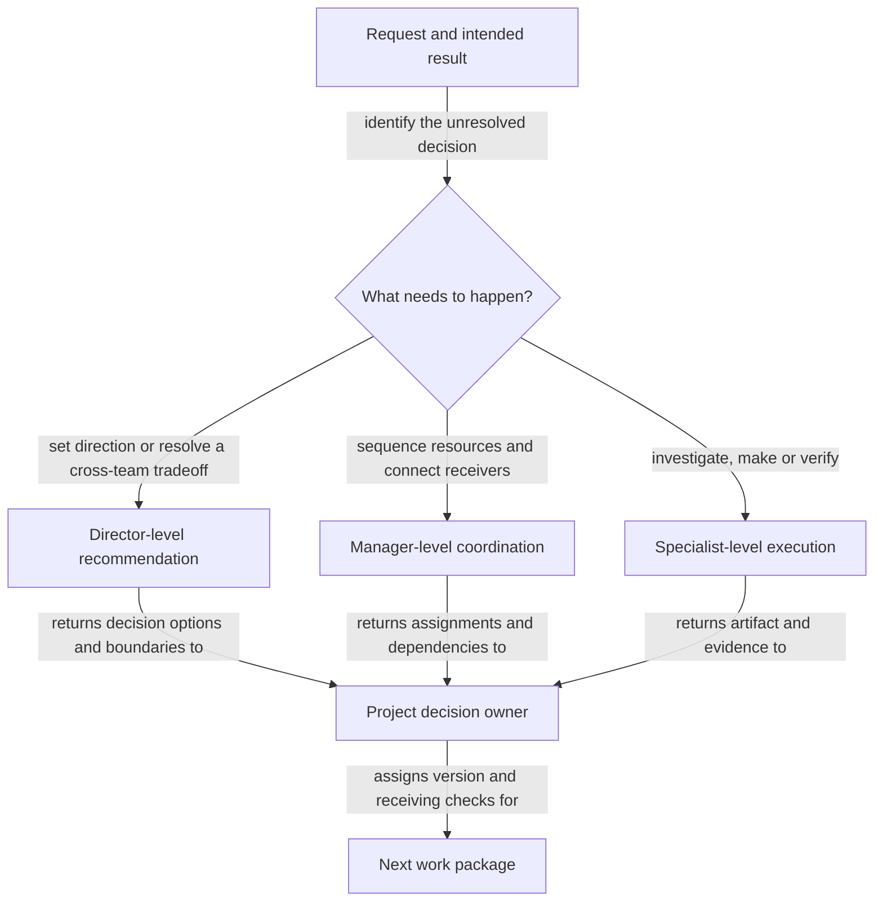
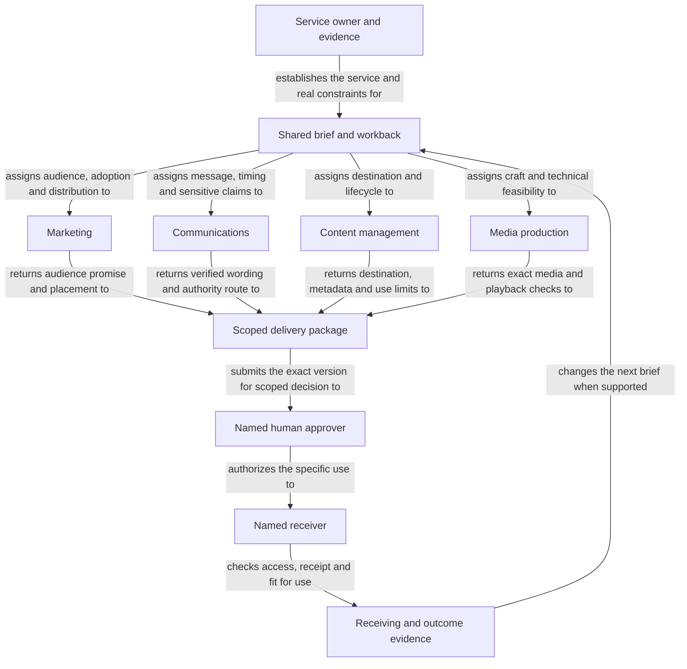
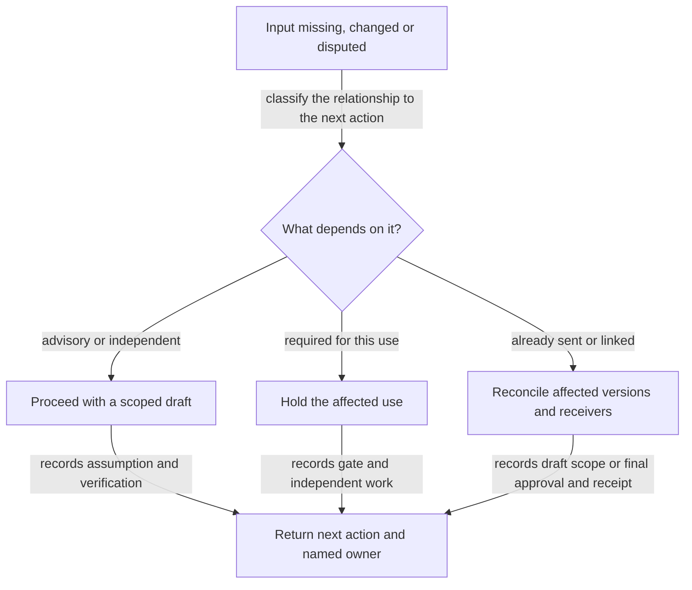

# Media work routing

The role cards describe a working model for media assignments. The current project supplies the named decision owner, authority, tools and destination. Roles can be combined in one person or separated across workers. An unresolved decision needs an owner even when one person holds several roles.

## Choose the responsibility from the decision

## Connect the disciplines through a shared assignment

A project manager or producer keeps the brief, open decisions, deadlines and workback aligned. Launch independent assignments when the controlling inputs are available. For instance, an audience researcher can investigate barriers while a producer audits asset availability. A publisher cannot treat either provisional return as release authority.

When several work types match, use one intake coordinator for the next commitment. Choose the coordinator whose domain owns the unresolved decision that controls that commitment. If the audience promise or public destination is unclear, the campaign manager coordinates intake and Production owns the feasibility contribution. If the audience and destination are settled and the next decision is crew, capture, or edit capacity, the production manager coordinates. Record the lead and the other owners in the same work package. Escalate when the project's assigned authority is unclear.

## Dispatch by work object

| Incoming work | First role to open | Parallel contribution or receiving route | Observable return |
| --- | --- | --- | --- |
| Executive message, statement, sensitive change, spokesperson brief | COM-D or COM-M for posture and review | COM-S drafts from verified facts. CNT-S checks the intended staff or public destination. | Exact message version, fact owners, permitted use and named reviewer. |
| Disputed programme or subject matter expert fact | COM-S drafts a focused question and read-back. COM-M or the project coordinator routes it. | The named fact or service owner confirms wording, scope and date. CNT-S records exact sources. | Source-linked fact record and usable draft with the disputed wording held until confirmed. |
| Public programme or campaign opportunity, audience question, collaborative content pitch | MKT-M coordinates. MKT-S researches. MKT-D handles portfolio and audience direction. | Service owner confirms eligibility and capacity. COM-M checks partner and message boundaries. PROD-M checks feasible formats. CNT-S tests the destination. | Audience and barrier evidence, partner fit or risk, channel and CTA recommendation, authorized decision route. |
| Series or ongoing channel direction, including YouTube | CNT-D defines editorial promise and lifecycle. MKT-D or MKT-M scopes audience and channel objective. | PROD-D or PROD-M assesses creative format and repeatable production workload. CNT-M assigns publishing cadence and archive rules. | Pilot proposal, audience action, format, realistic cadence and evaluation criteria. |
| Video or photo pitch, brief, A/V script, call sheet, shoot or editor handoff | PROD-D for creative direction, PROD-M for workback, PROD-S for draft or execution | COM-S verifies sensitive wording and facts. MKT-S validates placement and CTA. CNT-S confirms destination and metadata. | Exact brief/script/cut as appropriate, real asset and clearance state, technical checks, explicit recipient and permitted use. |
| Shoot wrap to editor ingest | PROD-M assigns the approved capture/ingest owner and editor. PROD-S prepares the transfer manifest. | Editor opens the required originals, checks playback and sync where relevant, and verifies any proxy relink. | Source and permission manifest, verified transfer and editor receipt, with missing or held items and an owner for each. |
| Online School Event or staff livestream in Microsoft Teams or Zoom | PROD-M coordinates roles and rehearsal. PROD-S prepares assigned checks and cue material. | Service or school-event owner validates audience and presenters. CNT-S checks viewing or replay route. COM-M routes language and incident messaging. | Run of show with cue ownership, role and access evidence, audience-side rehearsal, human fallback authority and separate clearance for any in-event stand-in and post-event replay. |
| Site page, intranet update, replay, video description, creative asset retirement | CNT-M routes lifecycle and review. CNT-S audits or drafts the exact object. | MKT-S checks channel promise and destination. COM-S verifies wording. PROD-S verifies the correct version, captions, and playback. | URL or asset with state and effective date, metadata/rights/accessibility check, and downstream links and receivers. |
| Competing deadlines, held release or revised asset already distributed | The assigned manager-level coordinator | All affected disciplines return constraints and exact version state. The named decision owner resolves conflicts. | Recomputed priorities and owners, hard gates, independent work, version and receipt reconciliation. |

## Handle a changed or missing input

| State | Receiving check |
| --- | --- |
| Disagreement | Name who has authority to resolve this issue. If the record leaves that unclear, identify who can confirm authority. Preserve the positions and affected decisions. |
| Active cut, script, asset or page changes | Identify still-valid notes to recheck and each affected copy, metadata record, caption file, link, or receiver. Carry approvals on their original version and scope. |
| Release held | List the hard gates with owner, next action and evidence. List independent work with its own owner and receiving path. |
| Draft can travel | Record the exact marked version, exclusions, audience, purpose, and actual send authority. Hold final-required use until the authorized final has been delivered and its receipt confirmed. |
| Rehearsal recording proposed for reuse | Evaluate an in-event substitute and a post-event replay as separate uses of an exact version. Confirm the authorized decision owner, rights and consent where applicable, recipient and viewing route for each. Test insertion and recovery in the run of show for any substitute. |
| A tool or a fact is unavailable | Mark the missing evidence and the specific affected action. Use authorized read-only inspection, an offline draft, or a human check where that can still answer the question. |

## Connect assignment to an available method

Start with the local [Media Agency skills and workflows](Skills%20and%20Workflows/README.md) *([Drive](https://drive.google.com/file/d/1MZLjp12rhXYT5o5XktIm_7Vn0xlemfjl/view?usp=drivesdk))* catalogue for the full portable instructions, templates and checks, or query any ID directly via `python ".agents/scripts/crucible_gate.py" route "<ID or task>"`.

Use the role card to decide which method you need. Every work row below resolves to a local procedure file in this repository; the original ChatGPT host skill links are retained beside them for ChatGPT environments only (`K-WOS-03`).

| Work | Local method (all environments) · ChatGPT host alias |
| --- | --- |
| Convert a service request to a grounded video brief | [MW-01](Skills%20and%20Workflows/media-writing.md#mw-01--write-a-project-or-media-production-brief) & [OP-01](Skills%20and%20Workflows/project-and-portfolio-operations.md#op-01--diagnose-and-frame-a-media-request) *(ChatGPT host only: [Shape media brief](https://chatgpt.com/skills?skill_id=6a88759040a88191a896614be5d93a01))* |
| Turn the approved direction into a treatment or script | [MW-02](Skills%20and%20Workflows/media-writing.md#mw-02--write-a-concept-or-treatment), [MP-01](Skills%20and%20Workflows/media-production.md#mp-01--choose-a-treatment-and-plan-the-workback), & [MW-04](Skills%20and%20Workflows/media-writing.md#mw-04--author-the-audiovisual-script) *(ChatGPT host only: [Write video concept](https://chatgpt.com/skills?skill_id=6ad142fb15388191a1634e7da79674dc) · [Write A/V script](https://chatgpt.com/skills?skill_id=6a8875c54d3c81919a7f6de589f82d02))* |
| Turn the production decision into resources, timings and handoffs | [MP-01..04](Skills%20and%20Workflows/media-production.md#mp-01--choose-a-treatment-and-plan-the-workback) & [OP-03](Skills%20and%20Workflows/project-and-portfolio-operations.md#op-03--build-and-rebalance-a-workback) *(ChatGPT host only: [Plan media production](https://chatgpt.com/skills?skill_id=6a8875e68af88191940f923dd303141b) · [Prepare media workback](https://chatgpt.com/skills?skill_id=6af01c95eb148191b50f2ee390de4170) returns a reviewable packet for manual entry.)* |
| Check finished media and publishing materials | [MP-10/11](Skills%20and%20Workflows/media-production.md#mp-10--edit-caption-and-qc-the-exact-cut) & [CH-03/04](Skills%20and%20Workflows/channel-and-content-operations.md#ch-03--prepare-a-youtube-upload-and-verify-release) *(ChatGPT host only: [Audit media release](https://chatgpt.com/skills?skill_id=6a8875fd6f8c81918cd0bd3934e74711))* |
| Investigate a claim or evaluate a public service journey | [CD-01](Skills%20and%20Workflows/communications-and-design.md#cd-01--discover-stakeholder-needs-and-verify-claims--skill) & [MK-02](Skills%20and%20Workflows/audience-and-campaigns.md#mk-02--research-claims-board-records-and-strategic-fit) *(ChatGPT host only: [Investigate with evidence](https://chatgpt.com/skills?skill_id=6acfae059d5881918e34ff0b0a55f8b6))* |
| Recover a practice and test it on another assignment | [OP-08](Skills%20and%20Workflows/project-and-portfolio-operations.md#op-08--turn-observations-into-better-practice) & `ig-discover-method` / `ig-improve` *(ChatGPT host only: [Recover working practice](https://chatgpt.com/skills?skill_id=6add61269f9081919a9eb9e24f7aae64) · [Trial practice in use](https://chatgpt.com/skills?skill_id=6add61c97c0c8191bc6cb4f84a1f3312))* |

## Cases to walk through

- **Educator resource request.** Begin with published facts for both public pages, ask the programme owner to confirm the intended audience, and let Production audit existing assets while Content records the mismatch. Check that the next package distinguishes correcting an existing journey from commissioning a new shoot.
- **Livestream with uncertain tenant access.** Prepare assignments, cue sheet, and rehearsal questions. Route platform operator permissions and attendance-side results to the authorized human. A proposed secondary route becomes an available fallback only after the project validates it.
- **Revised internal script.** One unresolved section can stay held while other work proceeds if its authority is scoped accordingly. A permitted marked draft has a separate recipient record. Check later which copies need updating and whether final-required use still waits.

[Research and Calgary Public Library sources](https://drive.google.com/file/d/1g3ZTgnYt_iyAS1sUheMh8rEbOUeknGK4/view?usp=drivesdk)
