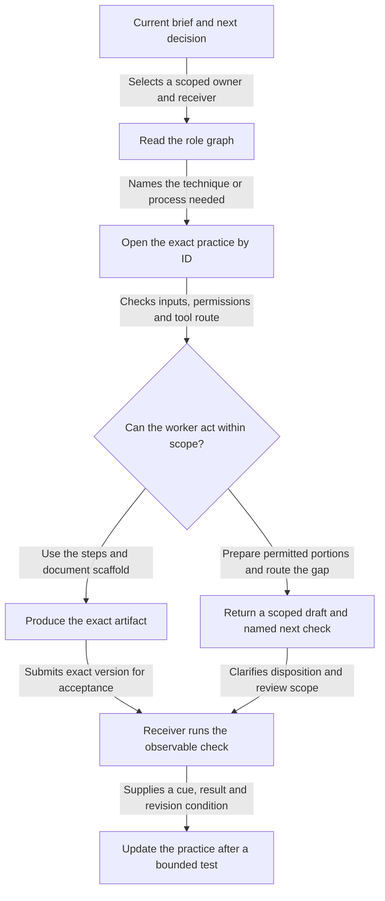

# Media Agency skills and workflows

**Start with the object you need to make.** The table gets you to the relevant procedure in one step. Each numbered practice has its inputs, return and receiving check at the start. Use the full steps, examples and templates to produce the work. The procedures are included in these files. A worker can read them directly from this folder or a synced copy.

| I need to… | Open | Start at |
| --- | --- | --- |
| Write a brief, concept, pitch, A/V script, episode, executive message or the same idea for another audience | [Writing for public-service media](https://drive.google.com/file/d/1CmHfJsHBIZ70s9HDPwDVVq8l1WW86fup/view?usp=drivesdk) | MW-01 brief · MW-02 concept · MW-03 pitch/series · MW-04 A/V · MW-05 adaptation · MW-06 spoken writing · MW-07 review |
| Write the call sheet or shot list, set up a shoot, plan or rehearse a livestream, edit or deliver media | [Media production practice](https://drive.google.com/file/d/1ZIlK7noZuDNMFKvn1gYD4c5DMGHpcHy0/view?usp=drivesdk) | MP-02 shots · MP-03 camera/sound/light · MP-04 call sheet · MP-07 live · MP-08 ingest · MP-09 selects · MP-10 edit and captions · MP-12 equipment |
| Find content ideas, compare trends, research an audience, earn engagement, find a partner or sustain a campaign | [Audience and campaign practice](https://drive.google.com/file/d/17tk53q8uhoI-Xr0RI8O033-nSRLDc5t9/view?usp=drivesdk) | MK-01 opportunity · MK-02 claims/strategy · MK-03 trends · MK-04 engagement · MK-05 partners · MK-06–09 campaign to evaluation |
| Prepare stakeholder or media communications, design graphics or brief and check motion | [Communications and design practice](https://drive.google.com/file/d/1o3U1Yv1q7qrmFK1BjQnIykB13oictIe_/view?usp=drivesdk) | CD-01 fact confirmation · CD-02 decision meeting · CD-03 institutional voice · CD-04 response · CD-05 visual brief · CD-06 graphics · CD-07 motion · CD-08 handoff |
| Plan, operate or evaluate a YouTube channel or series, post across channels, or manage a page, email or asset | [Channel and content operations](https://drive.google.com/file/d/1_iC7qOVDDkidzGTLXkheI7ewcLcuvqIU/view?usp=drivesdk) | CH-01 channel · CH-02 series · CH-03 YouTube · CH-04 first use · CH-05 maintenance · CH-06 variants · CH-07 CMS · CH-08 measurement · CH-09 email · CH-10 resource |
| Read the controlling project state, manage deadlines, delegate, run reviews or verify the audience outcome | [Project and portfolio operations](https://drive.google.com/file/d/119wQhEWZhZfUynSX2IxUv_PJOcZsRbdF/view?usp=drivesdk) | OP-01 intake · OP-02 Asana read · OP-03 workback · OP-04 delegation · OP-05 review · OP-06 service objective · OP-07 delivery · OP-08 learning |

[Institutional evidence](https://drive.google.com/file/d/1tBZZ9VnbhgJstFEjlmJgxkrpDQk2c7OJ/view?usp=drivesdk) records the reviewed cases and work patterns. [Media Agency role graphs](https://drive.google.com/file/d/1PiaweOxTc2Le1WAd_5YYOdHhwZ3XrSpK/view?usp=drivesdk) route decisions by discipline and level. In a synced copy, the link labels correspond to Markdown filenames inside this folder.

[Practice exercises and example outputs](https://drive.google.com/file/d/1-8nZVcXIk8irhzuT4z15w_sDO0FwsmC8/view?usp=drivesdk) contains the returned brief, timed A/V draft, shot list, call sheet and multi-channel release package from three fresh workers. The outputs are illustrative. The catalogue holds 55 procedures with their steps, examples or templates, and receiving checks.

## Give a worker the means to carry out a role

> Open [guide and practice IDs]. Use [exact brief and sources] to produce [named artifact and format] for [receiver] by [milestone and time zone]. You may [authorized operations]. [Decision owner] controls [specific approval]. Tell me what you could establish, what is held, and which work can move independently. Return the artifact itself with [one observable acceptance check].

A **skill** handles a focused operation, such as writing the brief or checking a destination. A **workflow** coordinates several operations over time, such as commissioning, publishing and measuring a series. Tool instructions and techniques live where the work uses them. A delegate can draft or inspect with the access it has. Booking, spend, clearance, publication and external communication require separate authorization. Asana is read-only.

## Load by role

Open the role graph for authority and the relevant procedure for execution. The assigned work and verified scope decide what each person or agent actually handles.

| Role | Common starting practices and resulting work |
| --- | --- |
| **Communications Director · COM-D** | CD-03 institutional posture, CD-04 escalation, OP-06 public-service objective, OP-05 scoped review decision |
| **Communications Manager · COM-M** | CD-01/02 stakeholder consultation and decision meeting, CD-03/04 response and messaging, CD-08/OP-07 release and recipient coordination |
| **Communications Specialist · COM-S** | CD-01 fact and evidence check, MW-05/06 channel or spoken drafts, MW-07 exact review revision |
| **Marketing Director · MKT-D** | MK-01/02 opportunities and strategic case, MK-04 audience experiment, MK-06/09 positioning and investment direction, OP-06 success evidence |
| **Marketing Manager · MKT-M** | MK-05–09 partner, campaign, kickoff, review and measurement workflow, OP-03 competing workback, CH-04 exposure sequencing |
| **Digital Marketing Strategist or Specialist · MKT-S** | MK-01–05 research and tests, MK-08–10 release and measurement, CH-06 native variants and CH-09 newsletter QA |
| **Media Production Director · PROD-D** | MW-02/03 creative direction and series pitch, MP-01 treatment/feasibility, OP-05 review of exact versions |
| **Media Production Manager or Producer · PROD-M** | OP-02–05 evidence/workback/crew/review, MP-01/04/06/07/08/11/12 live and recorded production handoffs |
| **Media Production Specialist or Videographer · PROD-S** | MW-04 A/V, MP-02/03 shots and systems, MP-05–11 direction, capture, live production, ingest, documentary selects, edit and QC |
| **Content Management Director or Strategist · CNT-D** | CH-01/02 channel promise, content lifecycle and series renewal, CH-08 performance, MW-03 pilot pitch |
| **Content Manager or Channel Producer · CNT-M** | CH-02–05 programme, stage publication, manage release and correct, CH-07/09/10 pages, access, newsletter and resource workflows |
| **Content Writer or Content Specialist · CNT-S** | MW-01/04/05 fit brief/script/copy by audience, CH-03/06/07/09/10 packaging, publishing preparation and receiving QA |
| **Graphic or Motion Designer** | CD-05–08 visual problem, draft layouts and hierarchy, thumbnails, timed motion, caption checks, source/export package. Assign via PROD-M/PROD-S and the relevant communications or content reviewer. |

## Connect skills across sustained workflows

| Assignment | Route | Receiving question |
| --- | --- | --- |
| Programme promotion | OP-01 → MK-01/02 → CD-01/02 → MW-01/02/04 → MP-01/02/04 → CH-03/04/06 → MK-09 | Can the intended person understand the offer, enter its actual route and act? |
| YouTube series | CH-01 + MK-03/04 → MW-03 → CH-02 → MP-06/09/10 → CH-03/06/08 | Does the pilot deliver the repeat viewing promise within actual capacity, and what supports another cycle? |
| Online School Event | OP-06 → MP-01/03/04/07 → MP-08/10/11 → CH-07/10 | Can the attendee see, hear and follow the demonstration, and can authorized users use any separate replay? |
| Competing deadlines or changed media | OP-02/03/05 → MP-10 or relevant artifact skill → OP-07 → CH-04/05 | Which version and use moved, who is affected, and what can continue? |
| Partner campaign | MK-05 → CD-02/MK-06 → MW-01/05 + CD-05 → MK-08/CH-04 → MK-09 | Can each party identify its exact copy, approved use, destination and checks? |

Apply a procedure to real work and return the artifact and evidence. Start a verification run if a missing skill, stale source, untested access or unusable output prevented execution. Keep institutional evidence in the authorized workspace. The practice in this folder generalizes observed work and includes illustrative examples.
