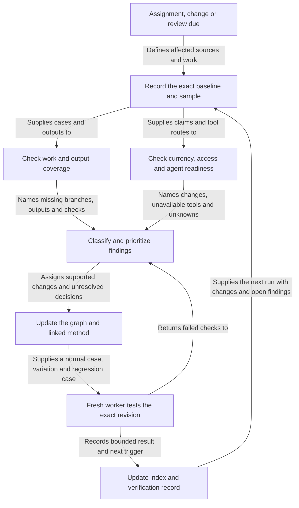

# Verify and maintain Media Agency

This loop checks whether the role graphs cover the work, whether their information is current, and whether an agent in the intended environment can perform the required operation. Each run leaves evidence and a next action.

## 1. Run the loop



| Step | Runner does | Evidence to record |
| --- | --- | --- |
| **Start** | Trigger when a skill, agent, tool, approval, source or output contract changes, or a real assignment exposes omitted work or repeat rework. Use a date review as a backstop. Proposed defaults are 30 days for high-change sources and 90 days for stable methods. Recheck time-sensitive or authority gates before use. | Run ID, trigger, scope, owner, prior record, exact graph revisions or hashes, next trigger. |
| **Inventory** | Sample real requests, recurring and live work, failures, revisions and lifecycle decisions, across levels and phases. Read job descriptions for remit, playbooks for method, and authorized projects for observed practice. Include outputs that different people actually need. | Source and date, work type, role ID, workflow start/decision/end, artifact, receiver and acceptance check for each sample. |
| **Compare** | Follow the normal entry point. Open the current controlling claim, skill instructions and tool documentation as authorized. Attempt the smallest representative operation in the intended environment only when authorized. | Complete path, missing edge, changed source, or scoped operation proof. Record actual runtime, actor scope and result. |
| **Patch** | If evidence and authority are clear, fix or link the existing method and affected graph. If either is unclear, identify the owner and what would resolve it. Keep the original baseline. | Exact graph and linked source revision, decision owner, coverage status, affected assignments and retest case. |
| **Retest** | A worker who did not write the patch receives a normal case, an input or permission change, and a known-good check. Ask them to return the specified artifact. Keep desk and live tests distinct. | Entry used, inputs actually opened, operations, exact return, changed-case result and independent acceptance. |
| **Close** | Update the record and index. Close only the scope actually supported, keep other gaps open, and set the next condition or due date. | Readback from normal entry, no orphaned IDs, verification evidence and a concrete next action for each open item. |

The runner can read, compare, draft and conduct permitted checks. A separate reviewer assesses the changed path. The project or institutional owner controls facts, permissions and consequential decisions. Asana remains read-only. No stage itself authorizes outreach, publishing, commitments, or changes to external platforms.

## 2. Test the representation that matters

| Subject | Questions to test | Evidence |
| --- | --- | --- |
| **Role and work** | Does recurring, strategic, live, internal, incident and end-of-life work have a route? Can a worker tell the lead from support and when to escalate? | Remit or actual work evidence, role, task, dependencies, named owner and result. |
| **Skill and know-how** | Do graph inputs, tools, outputs and checks match the current skill? If it moved or changed, what depends on it? | Skill ID, inspected version or locator, supported operations, limits, and a test or specific open check. |
| **Agent and tool** | Can this worker open the inputs, perform the exact operation, and return to the intended receiver? Does its runtime have the connector and grant? | Environment, actor/account scope, operation and version, time checked, access result, exact test output and receipt where exercised. |
| **Workflow and output** | Can the worker reach the right branch and produce the output at the necessary fidelity? Does a hold, revised file or different receiver change the route? | Start condition, workflow decision, exact output version, permitted use, next owner and observable acceptance. |
| **Information** | Is the statement still supported by the controlling source and effective date? Does a new document, governance decision, or programme page supersede it? | Exact claim, source locator and wording/state, observation date, scope and owner confirmation where needed. |
| **Graph** | Do IDs, link targets, edge directions, authority boundaries and exceptions hold? Can a person or agent find the graph quickly? | Structural/readback check, render when available, traced path, and known-good regression. |

Record three judgments independently:

| Judgment | Values |
| --- | --- |
| **Work coverage** | **Routed** · owner, inputs, decision path, output and receiving check exist for the sampled work. **Partial** · a consequential element is missing. **Absent** · there is no distinct route. |
| **Currency** | **Confirmed** within cited scope, **changed** or superseded, **unverified** for missing evidence or access. A working URL can contain a stale claim. |
| **Capability evidence** | **Documented**, **access checked**, **operation executed**, **receiver accepted**. Record each observed step on its exact scope. A desk trial exercises the decision path. Record human authorization separately. |

An operation can have a complete workflow, current public documentation, and unverified local access. Invalidate only the evidence affected by a change. For example, a new cut can invalidate captions and recipient copies without invalidating an unrelated approved asset or fact.

## 3. Leave a reusable record

```yaml
run_id: MA-VR-000
trigger: new assignment, change, post-use signal or due review
baseline: affected graph IDs and exact revisions
sample: work type, source and role IDs
coverage: routed, partial or absent
workflow_and_output: decision, artifact version, receiver, acceptance
currency: confirmed, changed or unverified with source and date
capability: exact operation, environment, actor, grant and input
evidence: document, access test, operation result or receiving proof
finding_id: stable ID if action required
disposition: patch, ask owner, keep open or close scoped finding
owner_and_next_check: who, when, and what outcome verifies it
```

Prioritize decisions that could expose material, lose source footage, miss a real deadline, misdirect a live event, or propagate unwanted rework. Keep competing evidence and tentative proposals visible. A context-bound lesson becomes a shared method only when the next relevant case supports it. Use authorized pointers for restricted records.

**Start a run with an agent.** Give it this file, the current verification record, the triggering change or real assignment, and the permitted sources and actions. Ask it to return a baseline, a coverage table, a currency and capability check, and the smallest supported patch with a receiving test. Give the patch and case to a separate reviewer. Record the revision and proof at the same finding ID. If the receiver cannot use it, reopen the finding before broadening the route.

[Media Agency role index](https://drive.google.com/file/d/1PiaweOxTc2Le1WAd_5YYOdHhwZ3XrSpK/view?usp=drivesdk)
