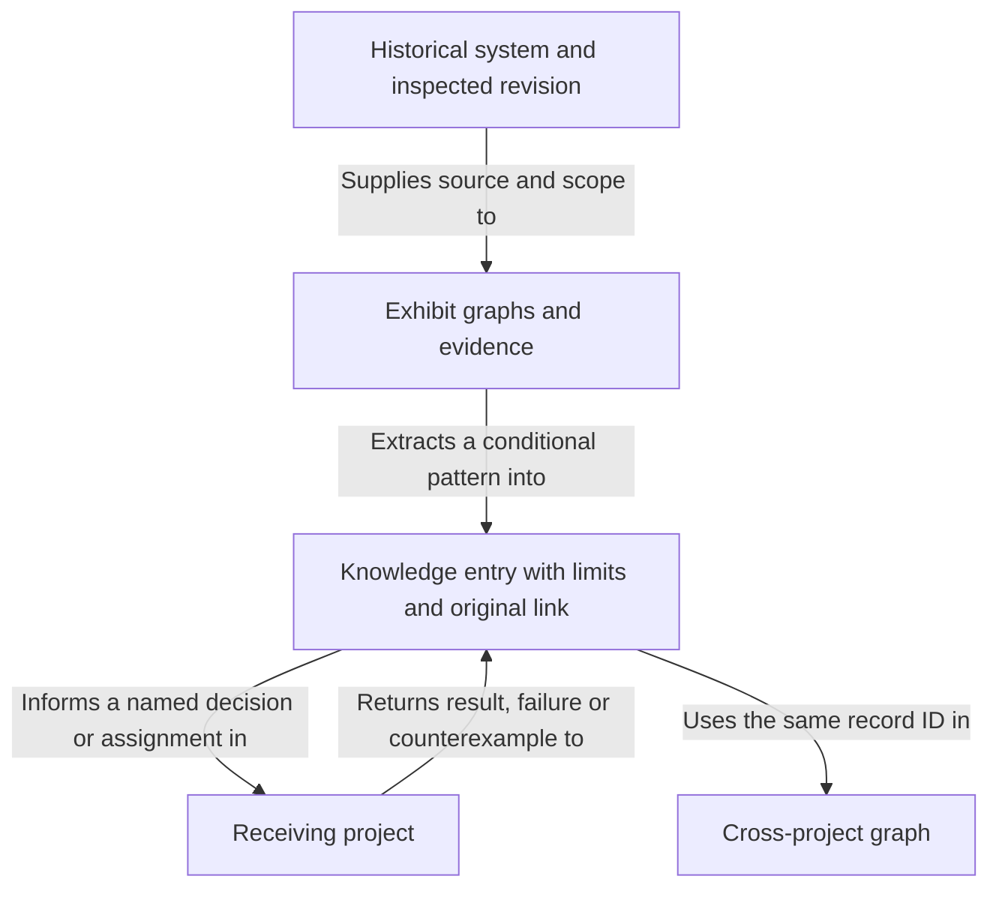

# Repository Archaeology

Ten systems studied as historical artifacts · November 15, 2026 · Calgary

[Crucible Domain](https://drive.google.com/drive/folders/1jpG-7DjOa2xtiYPbBhL07qmCRSVrK1fU) · [Project Register](https://drive.google.com/file/d/1hejOpxES0oMfwcZHxAgxb7cvvnUcLm3i/view) · [Work Operating System](https://drive.google.com/drive/folders/1Wa4YCSoXhpfuv01dfgVysKEg-g_bP6ZT)

## What is being studied

The Work Operating System is a top-level project with an ongoing outcome and its own decisions. Crucible Domain is the hub that preserves findings across projects. A repository is a source artifact. The exhibits identify historical systems and use repositories as evidence. Two exhibits can describe parts of the same wider effort. A historical relationship rests on evidence of shared ancestry, stated succession, or reuse.

The ten were selected to cover the origins of the practice, the coordination and verification experiments, the formation and retrieval of knowledge, and two different media workflows. Entonkageyoni opens the exhibit at Levi's direction. Exhibit numbers are a reading order. The Work Operating System is the receiving project.

Each exhibit has three editable Mermaid views: **intent and mechanism**, **evidence and breakpoint**, and **transfer candidates**. A counterfactual says which condition would need to change, why it could affect the result, and what would test it. Implementation claims are scoped to inspected source, reported historical runs, or directly inspected evidence as indicated. The investigation used read-only GitHub operations.

## How to use the exhibit

1. Start with the decision you need to make. Use the index to find a mechanism that may help.
2. Open the source exhibit and read the evidence and limits. Identify the failure or condition that matters in the receiving project.
3. Use the smallest transferable unit, such as an assignment rule, a receiving check, a skill, a workflow, a graph relationship, or a software primitive. Preserve the exhibit ID when proposing it.
4. Record the result of trying it in the receiving project. Add or revise a Knowledge Register entry when evidence changes what a future collaborator should do.

A source-linked pattern can be useful even when the original system cannot be operated. Adoption depends on the receiving project, runtime, and test.

## The ten exhibits

| ID | System | First useful extraction |
| --- | --- | --- |
| A01 | [entonkageyoni](https://drive.google.com/file/d/1FaYNwSlqUpVKq3-T3XAADLitvuJg5tch/view?usp=drivesdk) | Use one brief for independent perspectives and reconcile into one accountable decision. Keep event identity stable across a save or resume. |
| A02 | [Kageyoni](https://drive.google.com/file/d/1Z6Z8ZMjaui28jv3wvNfXg2wp0c5-6b4e/view?usp=drivesdk) | Bind verification to an exact operation and source revision. Keep release claims within observed qualification. |
| A03 | [Shinobi](https://drive.google.com/file/d/1HLKf5GHhtQ4oACIlKvdJo39shv3YZ2qB/view?usp=drivesdk) | Give a worker a bounded packet and track execution effects, delivery and receipt separately. |
| A04 | [SAMSARA](https://drive.google.com/file/d/1VA6UokEn6qc8Eh9fiy_kMwwpscSX4VbE/view?usp=drivesdk) | Use existing knowledge chapters and explicit research roles where they improve work. Preserve the paired pilot's neutral result. |
| A05 | [Constellation](https://drive.google.com/file/d/1YkwHjacDLsfz5SXB3JS7s0pTwauybCmt/view?usp=drivesdk) | Select a method when it can change a real judgment. Retain the conditions and evidence of use. |
| A06 | [Constellation Knowledge Sidecar](https://drive.google.com/file/d/1jlkBqRnkXo0Nnj1TuAYonoyVTfs2bUVp/view?usp=drivesdk) | Retrieve conditional lessons with exact source identity, explicit evidence status and linked revisions. |
| A07 | [Story-Lane](https://drive.google.com/file/d/1vWEcOZN7TEewRleXmAUlIv1RFi9NKMOw/view?usp=drivesdk) | Tie a clip or quote to the exact recording, time, selection rationale and receiving check. |
| A08 | [Hagoromo](https://drive.google.com/file/d/1qnBtqwiPnXjAzFObVjRCAv7vnViNGcpY/view?usp=drivesdk) | Extract work history with attribution and counterevidence. Tie creator drafts to current evidence and version. |
| A09 | [cognitive-os](https://drive.google.com/file/d/1hLm4mJ9gZaKCVyeLJhJc6nk1u4lHk6Bf/view?usp=drivesdk) | Put reconsideration conditions in decision records. Preserve failed prerequisites across a resume. |
| A10 | [Nelson](https://drive.google.com/file/d/1u9ymRZoHM3YX9_8G7-y4bLRbG5zJZNRO/view?usp=drivesdk) | Set acceptance criteria before the review and preserve claim-bound objections until a current recheck. |

## What carries forward into the Work Operating System

| Need in the receiving project | Recoverable pattern | Smallest useful trial | Evidence that changes the decision |
| --- | --- | --- | --- |
| A worker can pick up a task with bounded context. | Commission with a source version, allowed action, expected return, and receiver check. Use a separate reviewer when the judgment warrants it. | Give one fresh worker the current entry and one exact artifact. Ask for the method and result, then check the authorized return from the receiver's environment. | The receiver can use the exact result without clarification. Record any tool, access, instruction, or judgment failure separately. |
| A handoff can recover after interruption. | Keep the work assignment, attempt, effect, delivery, and receipt individually addressable. Resolve an uncertain effect before retrying it. | Use a reversible draft handoff. Interrupt or simulate failure after a return exists and before receipt is recorded. | A second worker identifies the last verified state, avoids a duplicate, and identifies the current recipient action. |
| Craft guidance can be retrieved at the moment it matters. | Use a source-linked method with the conditions under which it worked, limits, and a counterexample. Bring over the smallest carrier that preserves the useful operation. | Compare one relevant practice with the normal approach on the same review decision. Track what each worker could use and whether the result changes. | A material change in the decision or the receiver's correction work, with the domain and test basis explicit. |
| Media outputs remain traceable to evidence and editorial authority. | Use a manifest that links a creative claim to the exact source, clip or quote, current artifact version, and the human decision that permits use. | Reconstruct one reviewable scene or claim from its supporting source. Change one input version and trace which review must reopen. | A new reviewer can find the source, verify the version, and identify what can continue without repeating unaffected reviews. |

These are proposed trials and operating patterns. A repository mechanism can be documented, a historical run can support a bounded claim, and a receiving project can still need its own check.

## How Crucible Domain turns an exhibit into useful knowledge

Record a reusable finding with its exhibit ID, the evidence that supports it, and the decision or action it might change. Keep the original test conditions visible. Track disagreements between prose and test records, unresolved aliases, and failed attempts as knowledge when they matter. Keep a project-specific application beside its project and connect it to the lesson. This gives the hub an entry point for both people and agents while leaving source artifacts in their authorized systems.

## Evidence and scope

- In the original **entonkageyoni**, the inspected save path can append one logical event twice. That is a source-level finding and an argument for operation identity in a future replay design.
- In **cognitive-os**, an isolated synthetic probe skipped a failed prerequisite on resume even after the pinned unit suite passed. That directly informs the proposed failed-prerequisite check.
- **SAMSARA** and the **Knowledge Sidecar** retain comparisons with limited or neutral benefits. Keep neutral results beside successes so the next team can decide when extra retrieval or coordination is worthwhile.
- **Story-Lane** adds one clean human-voice reference to its native synthetic test evidence. It still needs evidence for the intended speech environment, editorial judgment, and the receiving workflow.
- **Constellation** and its sidecar are distinct specimens within a related initiative. Treat evidence of other lineages or reuse as relationships between exhibits. The opening pair does not establish Git ancestry by its naming.

The 30 exhibit diagrams are editable Mermaid source embedded in Markdown. The scope included inspection of recorded test artifacts and one isolated runner probe during the cognitive-os review. A source report, an exercised probe, and an adopted practice have separate meanings.
