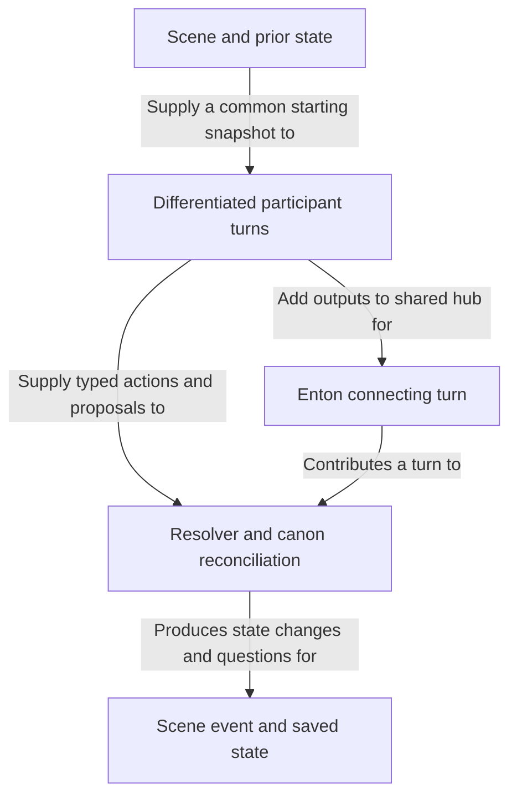
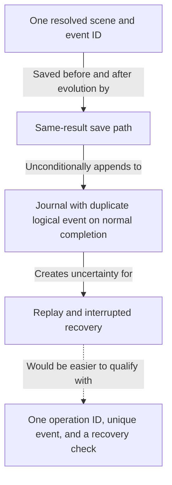
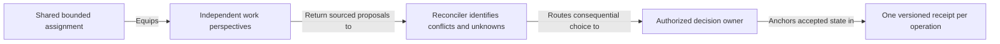

# A01 · entonkageyoni

**Exhibit:** The early Kageyoni narrative runtime. **Source snapshot:** April 10, 2026, commit `337488a75359facf0747a52eafa7de05cb34664e`. The repository uses the Kageyoni name for this world. A Git ancestry relationship to the later Kageyoni repository has not been established here. [Snapshot](https://github.com/guarani-ux/entonkageyoni/commit/337488a75359facf0747a52eafa7de05cb34664e)

## 1. What it set out to do and how it worked

The target was a fictional world that could advance one scene at a time with distinct character and faction viewpoints, persistent consequences, and explicit canon. The engine gives baseline participants the same initial scene message snapshot and calls them sequentially. Enton is held until those turns are collected, then receives the updated hub and contributes a connecting turn. The reconciler resolves structured actions, validates canon proposals, and records accepted updates, open questions, and review flags. The engine can use deterministic fixtures or an adapter. This ordering and branching are established by source inspection. [Engine](https://github.com/guarani-ux/entonkageyoni/blob/337488a75359facf0747a52eafa7de05cb34664e/src/kageyoni/engine.py#L261-L370) · [Reconciler](https://github.com/guarani-ux/entonkageyoni/blob/337488a75359facf0747a52eafa7de05cb34664e/src/kageyoni/agents/orchestrator.py#L210-L288)

A useful design distinction survives the fictional framing. Canon facts carry a different weight from inferences and unknowns. In strict proposal mode the policy can normalize new facts to inferred status, reject a proposed downgrade, and route attempts to fill restricted unknowns for human attention. The action resolver has its own path. Review flags on risky action turns are added after resolution, so these flags cannot be assumed to block the underlying state change. [Proposal policy use](https://github.com/guarani-ux/entonkageyoni/blob/337488a75359facf0747a52eafa7de05cb34664e/src/kageyoni/agents/orchestrator.py#L103-L156) · [Resolution order](https://github.com/guarani-ux/entonkageyoni/blob/337488a75359facf0747a52eafa7de05cb34664e/src/kageyoni/agents/orchestrator.py#L228-L281)

## 2. What the evidence supports and what broke at the boundary

- **Implemented and exercised in test source.** The inspected test file defines state round-trip, preservation of unknowns, rejection of canon downgrade, deterministic mock advancement, and transcript creation. The commit author reports 168 passing tests. The inspected green Actions job is Copilot with no recorded pytest steps, so it does not independently establish that count. [Test source](https://github.com/guarani-ux/entonkageyoni/blob/337488a75359facf0747a52eafa7de05cb34664e/tests/test_kageyoni.py#L95-L285) · [Commit report](https://github.com/guarani-ux/entonkageyoni/commit/337488a75359facf0747a52eafa7de05cb34664e) · [Actions jobs](https://api.github.com/repos/guarani-ux/entonkageyoni/actions/runs/24298869162/jobs)
- **Static persistence defect.** The inspected `advance_and_save()` invokes `save(result)` before and after an evolution stage. Both saves persist the same scene result and append its event ID to the JSONL journal. The append function writes unconditionally. If both saves complete normally, the same logical event is appended twice. The sequence also exposes boundaries between state, transcript, journal, and evolution where an interrupted run can leave artifacts representing different points in the step. This follows from the code path. Crash recovery and actual on-disk runs were outside this review. [Save path](https://github.com/guarani-ux/entonkageyoni/blob/337488a75359facf0747a52eafa7de05cb34664e/src/kageyoni/engine.py#L553-L585) · [Append path](https://github.com/guarani-ux/entonkageyoni/blob/337488a75359facf0747a52eafa7de05cb34664e/src/kageyoni/events.py#L39-L62)
- **Conditional alternative.** If the history was meant for replay or resumed work, stable operation and event IDs with a uniqueness check would address duplicate appends. Pair that with one commit boundary for controlled state, and reconcile separately written artifacts after interruption. If a risky action needs approval, evaluate that approval before the consequential mutation. Model-assisted narrative quality and live multi-agent benefit remain open.

## 3. What to carry into Crucible Domain and the Work Operating System

| Form | Candidate | Receiving check |
| --- | --- | --- |
| Skill | **Reconcile proposals against evidence.** Classify a contribution as confirmed, inferred, unresolved, or a proposed change. Keep the source and the decision owner explicit. | A contradictory worker answer is retained with its basis, and a participant cannot silently fill an open prerequisite. |
| Workflow and agent roles | **Common brief → independent perspectives → synthesis → authorized decision.** Give evidence, audience fit, and production feasibility workers the same scoped packet. Assign one synthesis role to surface conflicts and name the human decision owner. | The synthesis can trace each finding to its worker and source without converting agreement into approval. |
| Graph and routine | **Proposal and receipt trace.** Keep an append-once receipt per handoff operation. Store status and links to outputs separately from the workers' prose. | Retrying a handoff demonstrably preserves one logical dispatch record and the correct current output reference. |

For the Work Operating System, start with the workflow and trace on an existing review or request. Load predecessor methods only where they change the next decision. Treat the append-once routine as a proposed component that earns implementation once retry or recovery is a recurring problem.
