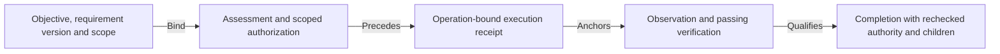
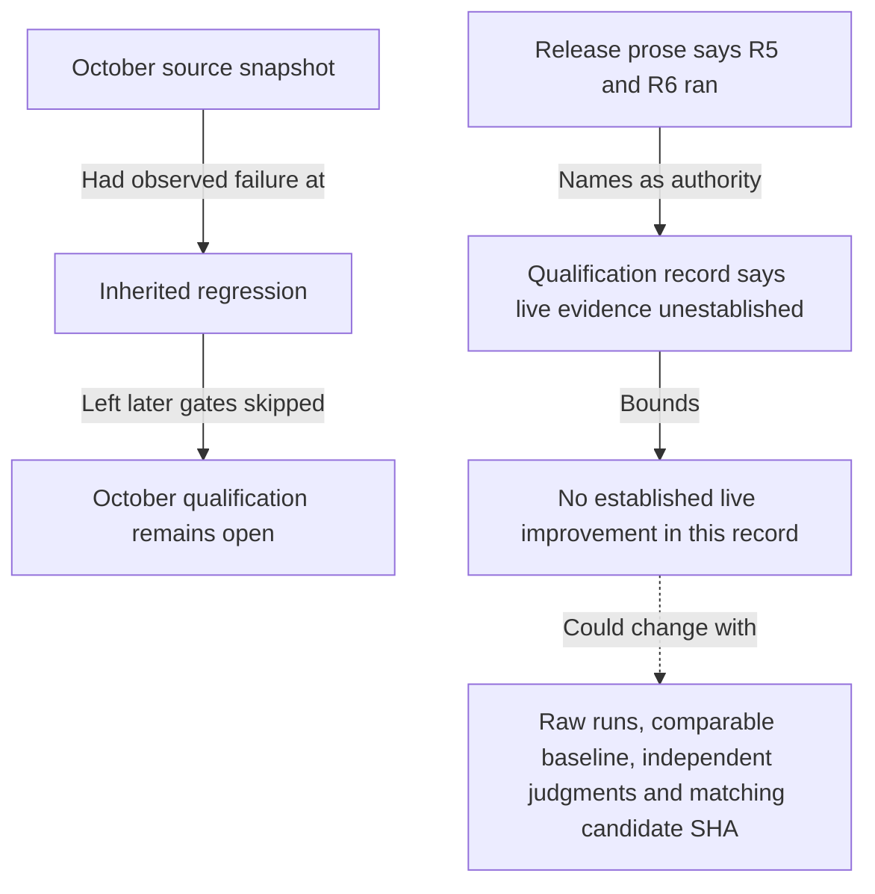
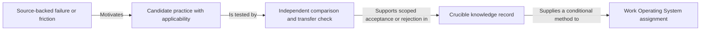

# A02 · Kageyoni

**Exhibit:** Bounded adaptation and qualification in a later Kageyoni engine. **Source snapshot:** October 28, 2026, commit `18c2763950cdb4d3211df3a18ed92fb9203baff8`. This exhibit studies the protected-operation, transfer, and evidence layers of a larger repository. It makes no claim about Git ancestry from entonkageyoni. [Snapshot](https://github.com/guarani-ux/Kageyoni/commit/18c2763950cdb4d3211df3a18ed92fb9203baff8)

## 1. What it set out to do and how it worked

The v11 target was to let a system adapt its investigation, context, and representation while preserving objective, requirement version, decision authority, and evidence. The protected-operation runtime declares an immutable objective/version/scope, checks an engine-held assessment bound to that operation, and requires scoped enforcer qualification. Execution evidence is linked to an existing supported result, observation to the execution receipt, and passing verification to the observation. Completion revalidates that chain and requires completed declared child operations. These checks are visible in the runtime and tests. [Runtime](https://github.com/guarani-ux/Kageyoni/blob/18c2763950cdb4d3211df3a18ed92fb9203baff8/kageyoni/v11/runtime.py#L34-L160) · [Trust tests](https://github.com/guarani-ux/Kageyoni/blob/18c2763950cdb4d3211df3a18ed92fb9203baff8/tests/test_v11_frozen_trust_gate.py#L85-L235)

The v10 inheritance ledger also records a practical predecessor to this exhibit: identify a current workflow with an exposed weakness, recover a single mechanism from a prior system, preserve the receiver's invariants, and require a reason to reject weaker candidate transfers. It attributes exact input-basis binding to Nelson, executed verification registries to Outer Sanctum, typed deficits to 10 Shadows, and representation-invariance tests to Espada. These are documented decisions and attributions. [Inheritance ledger](https://github.com/guarani-ux/Kageyoni/blob/18c2763950cdb4d3211df3a18ed92fb9203baff8/INHERITANCE-LEDGER.md#L1-L53)

## 2. What the evidence supports and where it stops

- **Concrete verification design.** Tests define a valid protected-operation cycle, cross-operation receipt replay rejection, invalidated qualification handling, and a context packet that allows named nonblocking unknowns. R6 tests explicitly use mock encounter executors and assert that stored history and changed reasoning alone do not establish changed capability or outcome. [Trust tests](https://github.com/guarani-ux/Kageyoni/blob/18c2763950cdb4d3211df3a18ed92fb9203baff8/tests/test_v11_frozen_trust_gate.py#L164-L235) · [R6 test source](https://github.com/guarani-ux/Kageyoni/blob/18c2763950cdb4d3211df3a18ed92fb9203baff8/tests/test_situation_r6_long_horizon_qualification.py#L16-L146)
- **The release claims and their putative authority diverge.** The root release report asserts that blind comparative and long-horizon trials were executed and names `qualification.json` as status authority. That JSON explicitly labels live empirical R5/R6 results unestablished and binds its mechanical result to September 24 commit `ac5ec3f`. The separate engineering report names a September 22 candidate `7686541` and also limits empirical claims. The exact October snapshot has an observed failed GitHub run at inherited regression, with later trust, evidence, packaging, and qualification steps skipped. A historical test count does not qualify October source or live external-model benefit. [Root report](https://github.com/guarani-ux/Kageyoni/blob/18c2763950cdb4d3211df3a18ed92fb9203baff8/V11-RELEASE-REPORT.md#L3-L34) · [Status record](https://github.com/guarani-ux/Kageyoni/blob/18c2763950cdb4d3211df3a18ed92fb9203baff8/evidence/qualification/qualification.json#L1-L48) · [Engineering report](https://github.com/guarani-ux/Kageyoni/blob/18c2763950cdb4d3211df3a18ed92fb9203baff8/evidence/V11_RELEASE_REPORT.md#L4-L30) · [October Actions run](https://github.com/guarani-ux/Kageyoni/actions/runs/40646049252/job/122674999255)
- **Static evidence interface mismatch.** The release workflow expects R5 keys `trials_executed` and `rubric_evaluations`, and R6 key `trajectories_executed`. The inspected report artifacts present different corresponding keys. Those validators were skipped on the October run, so this mismatch is a separate finding from the observed regression failure. A schema and evidence digest shared by trial producer, checker, and release summary could prevent this class of drift. Actual held-out comparison with an independent evaluator and recorded model outputs would still be needed to qualify a claim of improvement. [Workflow](https://github.com/guarani-ux/Kageyoni/blob/18c2763950cdb4d3211df3a18ed92fb9203baff8/.github/workflows/v11-release-qualification.yml#L105-L127) · [R5 artifact](https://github.com/guarani-ux/Kageyoni/blob/18c2763950cdb4d3211df3a18ed92fb9203baff8/evidence/comparative/r5_comparative_trials.json#L1-L32) · [R6 artifact](https://github.com/guarani-ux/Kageyoni/blob/18c2763950cdb4d3211df3a18ed92fb9203baff8/evidence/horizon/r6_long_horizon_trials.json#L1-L24)

## 3. What to carry into Crucible Domain and the Work Operating System

| Form | Candidate | Receiving check |
| --- | --- | --- |
| Skill | **Qualify the exact operation and claim.** Bind objective, requirement revision, authority, source revision, run receipt, outcome, and verification method. Separate structural and judgment checks. | Review a real approved scope and a same-looking artifact from the wrong revision. Only the in-scope observation supports promotion. |
| Workflow and agent roles | **Turn a miss into a reusable practice.** A worker records the miss, a second agent proposes a narrowly scoped remedy, and an independent reader tests against the baseline and an irrelevant transfer case. The decision owner records qualified use, limits, or rejection. | Another worker can find the failure, versioned remedy, evidence, and conditional applicability from one knowledge entry. |
| Graph and small routine | **Source → run → observation → accepted claim.** Track stored, retrieved, reasoning changed, practice invoked, and result changed as separate observations. A lightweight evidence parser could validate the required IDs and digests where a repeating workflow warrants it. | A deliberate missing join or stale source makes the graph visibly incomplete, and the summary cannot claim more than the receipts. |

A first transfer can be a manual acceptance record for a Work Operating System draft handoff. A second worker should be able to distinguish draft creation, recipient readback, and approval for the intended use. Start there before choosing an engine.
