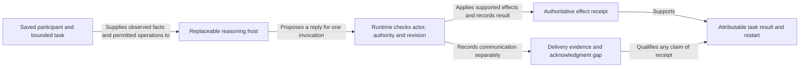
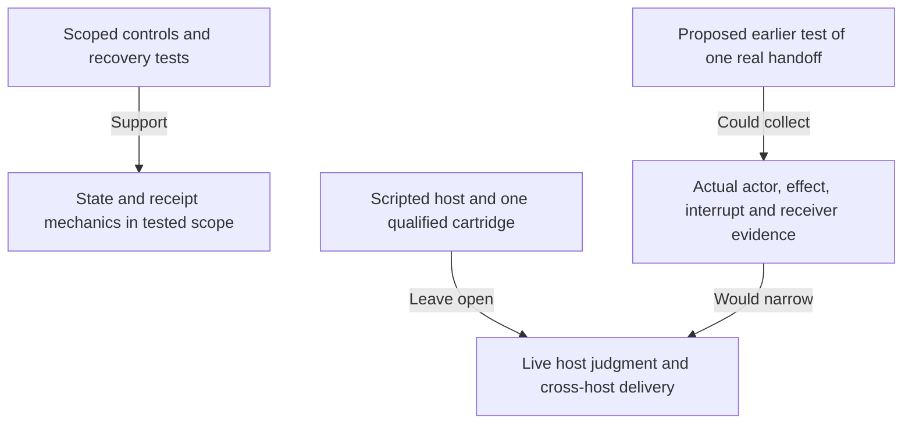
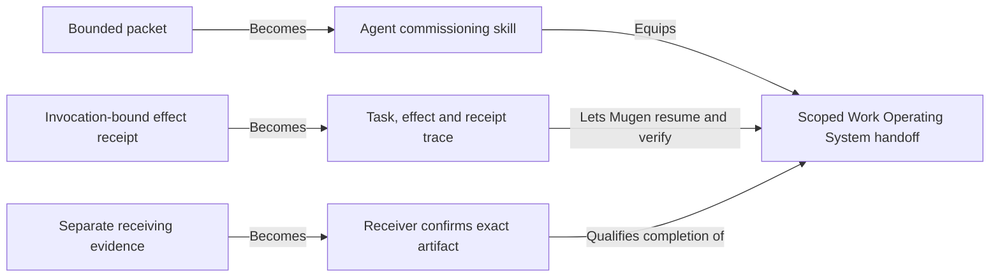

# 03 · Shinobi

**Exhibit ID:** ARCH-SHINOBI  
**Repository evidence:** [guarani-ux/Shinobi, inspected revision](https://github.com/guarani-ux/Shinobi/tree/d3581257d1f13f507b84c6706ac59ad5a525e5fb)  
**Portfolio relationship:** Historical engineering source for bounded agent work and verification. Its patterns can inform the Work Operating System.

## What it was trying to make possible

Shinobi tried to preserve a participant as an inspectable configuration across encounters while allowing different hosts to supply its reasoning. The host receives an observation, relevant context, and permitted operations. The runtime checks the reply, applies authorized effects against the expected revision, and preserves evidence of the result. A participant name can orient the interaction. Capability claims require evidence about what the configured participant actually did.

The current source makes the separation tangible. The packet builder keeps authority, task, observation, available operations, and a reply schema. It removes optional records measurably under a byte budget and refuses a packet if required content still will not fit. Exchange advancement binds the incoming reply to its task, actor, domain, and invocation. Before dispatch it checks whether that invocation already has an authoritative receipt. It then records the effect and the separate delivery information before attaching the result to the round. [README](https://github.com/guarani-ux/Shinobi/blob/d3581257d1f13f507b84c6706ac59ad5a525e5fb/README.md#L75-L116) · [Packet source](https://github.com/guarani-ux/Shinobi/blob/d3581257d1f13f507b84c6706ac59ad5a525e5fb/runtime.py#L214-L231) · [Binding and dispatch source](https://github.com/guarani-ux/Shinobi/blob/d3581257d1f13f507b84c6706ac59ad5a525e5fb/runtime.py#L1101-L1206)

### Graph 1 · Outcome and architecture

## What happened and where the design stopped

| Finding | Evidence and scope |
| --- | --- |
| Source adoption can pass while runtime baseline still fails tests. | The S1.1 receipt records 61 matching source blobs and a clean export with 67 passes and three known missing-sibling fixture failures. The verifier accepted that exact baseline, and its falsifying controls rejected modified runtime bytes, an unrecorded parent, and an added local file. This qualified source adoption, under same-agent review. |
| Later mechanical work had a stronger recorded result. | The evidence file reports 129 tests passed on S4 and 133 on a subsequent S5.1 candidate. The repository's recovery tests encode real kill and resume, checking that the finalized packet survives and an invocation has one exchange record. The exhibit inspected those tests. It did not replay the historical runs. |
| Broader tasks and cognition remained out of scope. | The reported support registry qualifies Observatory only. The later report leaves S5.2 unfinished and calls for actual-host feedback before integration. Scripted effects, persisted text, and tracker tests establish different claims from live-model competence, external execution, or human acknowledgment. |

[Source-adoption receipt](https://github.com/guarani-ux/Shinobi/blob/d3581257d1f13f507b84c6706ac59ad5a525e5fb/docs/verification/receipts/S1.1/attempt-001/qualification.json#L1-L75) · [Evidence ledger](https://github.com/guarani-ux/Shinobi/blob/d3581257d1f13f507b84c6706ac59ad5a525e5fb/EVIDENCE.md#L1-L82) · [Kill/restart test](https://github.com/guarani-ux/Shinobi/blob/d3581257d1f13f507b84c6706ac59ad5a525e5fb/tests/test_runtime_recovery.py#L173-L209) · [Actual-host feedback join](https://github.com/guarani-ux/Shinobi/blob/d3581257d1f13f507b84c6706ac59ad5a525e5fb/docs/execution/PARALLEL_PLAN.md#L9-L29)

**Conditional alternative.** If the build question had been narrowed to one real cross-host handoff, an actual-host check could have been isolated sooner. Give a fresh host one reachable record and a scoped action, attempt a return, and interrupt after the effect is saved. Measure whether the right work resumes and whether the recipient can identify which effect occurred. That would have tested the chosen handoff, while recovery across other task types and live developmental effects would have remained separate questions.

### Graph 2 · Evidence and counterfactual

## What carries forward

- **Skill:** Prepare a bounded agent request. Include the current task, source and version, allowed operations, required context, acceptance check, and explicit omitted material. Use a simple checklist before considering automated validation.
- **Workflow and roles:** Mugen as dispatcher opens the exact input and sets an invocation ID. The commissioned worker proposes or performs the allowed action. A receiver checks the exact returned artifact and records acceptance. The roles may be served by fewer people when independence is unnecessary.
- **Graph:** Keep a provenance view connecting assignment → invocation → accepted effect → delivery → receipt. If an invocation is interrupted, consult the effect record before deciding to replay. The runtime source demonstrates this pattern for its own domain; a Work Operating System connector needs its own evidence of what can be safely replayed.
- **Small system candidate:** An invocation and receipt register. Give it one task ID and exact artifact link first. Introduce typed dispatch or recovery automation after a real repeated failure establishes what must be enforced.

### Graph 3 · Transfers to Work Operating System

**First test:** Give Mugen and a fresh receiver one allowed, versioned handoff. Interrupt it after draft generation, resume once, and show exactly which artifact exists and whether the next person can act. Keep the archaeology read-only and label the proposed test separately from the historical source.
