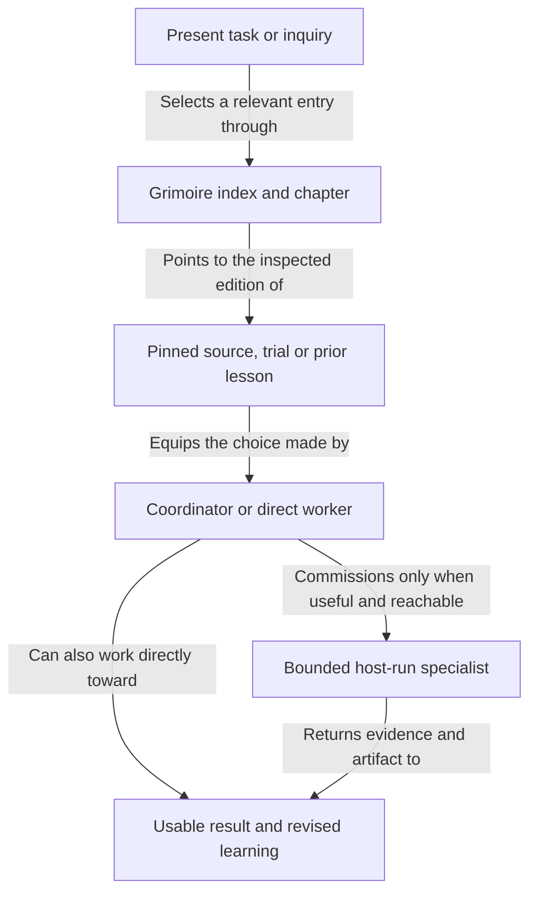
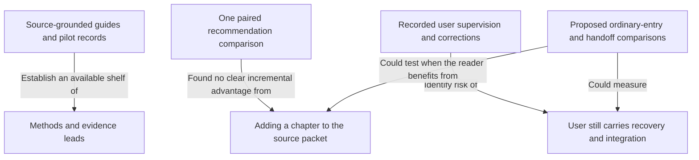
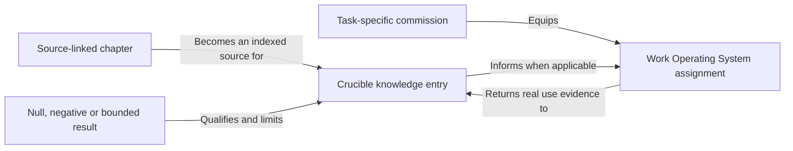

# 04 · SAMSARA

**Exhibit ID:** ARCH-SAMSARA  
**Repository evidence:** [guarani-ux/SAMSARA, inspected revision](https://github.com/guarani-ux/SAMSARA/tree/c526409b9fad76ee9e05cb211178eca6ec0d66d7)  
**Portfolio relationship:** Prior art for Crucible Domain's knowledge shelf and selective coordination. The GitHub repository, Komorebi workspace, and any similarly named conversation or runtime need their own identity and source evidence.

## What it was trying to make possible

SAMSARA's October 14 initial commit was a title-only README. The historical chapter correctly preserved that starting point. By the inspected October 15 revision, the repository also had a Grimoire and selectable agent profiles. The root README still says little about them. The useful intent is in the newer material: return to earlier knowledge through present work, select only the relevant practice, and commission actual help through the available host when direct work would benefit from it. [Historical chapter](https://github.com/guarani-ux/SAMSARA/blob/c526409b9fad76ee9e05cb211178eca6ec0d66d7/grimoire/references/chapter-samsara.md#L1-L25) · [October 15 revision](https://github.com/guarani-ux/SAMSARA/commit/c526409b9fad76ee9e05cb211178eca6ec0d66d7)

The Grimoire routes an inquiry from a page index to a chosen chapter and its pinned primary sources. Its eight repository-agent commissions equip a worker with historical material, a task, reachable inputs, authority, and a usable return. SAMSARA's separate Sciel profile proposes a coordinating role that checks real tools, preserves disagreement, recruits selectively, and integrates a result. These are documented, host-run methods at the examined revision. No installed participants or background service were verified in this inquiry. [Grimoire skill](https://github.com/guarani-ux/SAMSARA/blob/c526409b9fad76ee9e05cb211178eca6ec0d66d7/grimoire/SKILL.md#L27-L66) · [Repository-agent commissions](https://github.com/guarani-ux/SAMSARA/blob/c526409b9fad76ee9e05cb211178eca6ec0d66d7/grimoire/references/repository-agents.md#L1-L46) · [Sciel profile](https://github.com/guarani-ux/SAMSARA/blob/c526409b9fad76ee9e05cb211178eca6ec0d66d7/agents/sciel.md#L48-L86)

### Graph 1 · Outcome and reference process

## What happened and where the design stopped

| Finding | Evidence and scope |
| --- | --- |
| An archaeology method already existed. | The Grimoire preserves chapters, source trails, reusable commissions, and comparisons. Its repository-agent index describes different degrees of bounded transfer across chapters. The early report on SAMSARA itself examined a specific initial commit. Applying that report to current main would miss the later work. |
| A saved chapter did not show clear incremental advantage in one test. | In an October 11 paired source-reading pilot about Mugen, both recommendations met the frozen rubric and no substantive winner emerged. Launch settings were coordinator-attested, isolation was cooperative, and blinding was partial. A later adapter read improved evidence for one call edge without demonstrating a safe resume path or changing what the original workers had available. |
| The setup did not consistently relieve the user of coordination. | The October retrospective records episodes where Levi had to restore source scope, ask where workers stood, and reassert qualification. Its claims are grounded in the recovered conversation corpus. It did not rerun every reported action or establish a cause in the underlying model. |
| The proposed captain remains a testable design. | Sciel's profile explicitly leaves whole-task delivery, selective recruitment, independent contribution, and user-intervention cost to be checked against ordinary direct assistance. |

[Pilot manifest](https://github.com/guarani-ux/SAMSARA/blob/c526409b9fad76ee9e05cb211178eca6ec0d66d7/grimoire/references/investigation-pilot/manifest.json#L107-L156) · [Coordination retrospective and coverage](https://github.com/guarani-ux/SAMSARA/blob/c526409b9fad76ee9e05cb211178eca6ec0d66d7/grimoire/references/coordination-burden-retrospective.md#L1-L54) · [Sciel qualification boundary](https://github.com/guarani-ux/SAMSARA/blob/c526409b9fad76ee9e05cb211178eca6ec0d66d7/agents/sciel.md#L79-L89)

**Conditional alternative.** If the question had been whether a chapter saves source-recovery effort, the comparison could have started with an ordinary request and the normal entry point for each condition, measuring time to controlling evidence, consequential omissions, and corrections from the user. If the question had been whether a coordinator reduces supervision, use actual handoff episodes, count recovery and intervention work, and compare with direct assistance. A more elaborate roster would introduce additional coordination costs to measure.

### Graph 2 · Evidence, limits and alternatives

## What carries forward

- **Skill:** Open the smallest relevant chapter, then follow the exact source before applying its method. Preserve material that changes the next decision, including neutral comparisons and limits. The archaeology can reference the existing Grimoire where it has strong coverage and add current checks where the pin has aged.
- **Workflow and roles:** Let a project owner choose between doing the assignment directly and commissioning a specialist. Bind the chosen specialist to a reachable source, actual tools, delegated authority, expected result, and named receiver. Keep the roles available interchangeably across host environments where they fit.
- **Graph:** A project-to-practice map links project records to chapters, source editions, trials, transferable advice and contradictory evidence. A separate execution trace records whether someone actually used a skill, what they did, and what became easier or remained unresolved.
- **Small system candidate:** Start with Crucible's linked registers. Use a short reusable entry format and readback check. The Work Operating System can pull a relevant lesson into a handoff without requiring the whole Grimoire or an automatic orchestrator.

### Graph 3 · Transfers to Crucible Domain

**First test:** Give a fresh worker an ordinary Work Operating System assignment where a known handoff or review issue could recur. Check whether the Crucible entry leads to the exact useful lesson, changes the worker's choice, and reduces correction work. Record a neutral result if adding the chapter offers little. Keep the chapter, use result, and next action linked even when the outcome is mixed.
