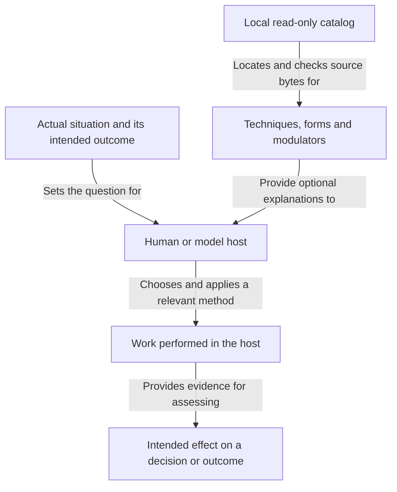
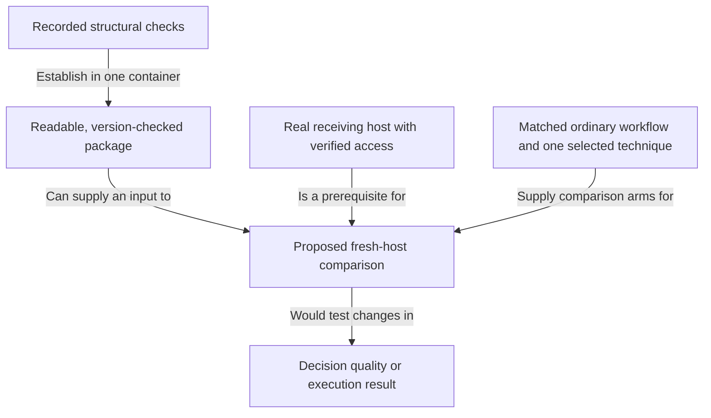
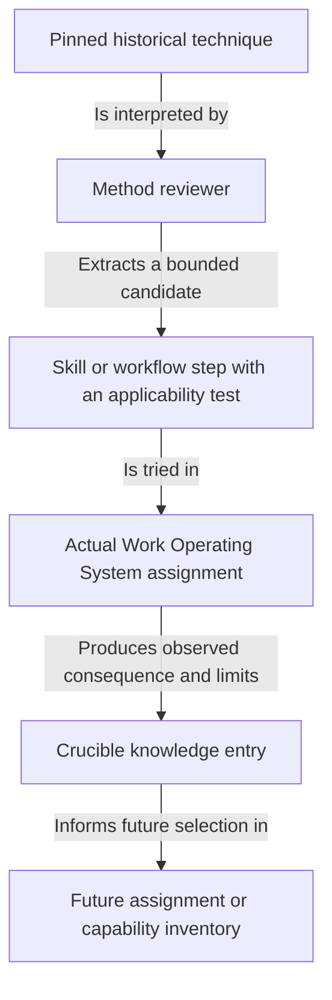

# 05 · Constellation

**Exhibit ID** A05-CONSTELLATION  
**Repository** [guarani-ux/Constellation](https://github.com/guarani-ux/Constellation)  
**Parent initiative** Constellation practice and knowledge. The repository is the portable practice library within that initiative.  
**Source revision** [v0.1.0 commit, October 3, 2026](https://github.com/guarani-ux/Constellation/commit/f7e30752e777e92262c3c5c6c8af19c0fec2c467).  
**Evidence boundary** Read-only repository inspection, including source and historical receipts. No fresh runtime or reasoning comparison was executed for this exhibit.

## 1. Outcome map and target architecture · A portable practice library

Constellation aimed to make differentiated human and AI capabilities easier to notice, select, combine, or set aside in an actual situation. Its concrete delivery was a collection of Markdown techniques, forms and modulators, with an optional local Python catalog. Techniques describe operations, forms describe ways to perceive or develop capability, and modulators change the conditions under which an operation participates. This is a deliberately low-friction mechanism. An authorized host selects and interprets a relevant entry and can read the file directly. The catalog lists or shows entries and checks source identity using local paths and hashes. The host owns decisions and permissions. [README](https://github.com/guarani-ux/Constellation/blob/f7e30752e777e92262c3c5c6c8af19c0fec2c467/README.md#L19) · [Catalog implementation](https://github.com/guarani-ux/Constellation/blob/f7e30752e777e92262c3c5c6c8af19c0fec2c467/tools/catalog.py#L71) · [Host use](https://github.com/guarani-ux/Constellation/blob/f7e30752e777e92262c3c5c6c8af19c0fec2c467/HOST_USE.md#L3)

## 2. Evidence map · What was qualified and what the library could not establish

The recorded v0.1.0 release checked 18 catalog entries and reports 12 inherited files preserved byte-for-byte. The attached log records 15 passing structural tests, including exact retrieval, rejection of invalid or changed entries, and preserving files during read-only commands. This is good evidence of package integrity in the recorded container. The claim about improved reasoning remains open, as do host discovery, portable activation and actual external operation. The repository explicitly treats letters, forms and a source pointer as descriptive content whose usefulness depends on whether a host can access and apply it. A repo name becoming visible in a host is a different observation from a technique changing a decision. [Observed status](https://github.com/guarani-ux/Constellation/blob/f7e30752e777e92262c3c5c6c8af19c0fec2c467/evaluation/observed-status.json#L5) · [Structural test log](https://github.com/guarani-ux/Constellation/blob/f7e30752e777e92262c3c5c6c8af19c0fec2c467/evaluation/structural-test.log) · [Evaluation design](https://github.com/guarani-ux/Constellation/blob/f7e30752e777e92262c3c5c6c8af19c0fec2c467/evaluation/README.md#L9)

**Conditional alternative.** If a host can open the repository and a technique addresses a real bottleneck, compare the ordinary method with one selected entry, keeping tools, task inputs and evaluation criteria fixed. If the host cannot read the repo, transfer a permitted excerpt and check the receiver can actually use it. For a routine task that already works, leave the technique available on demand. For a useful method that performs better only in a certain situation, record those conditions instead of promoting it into a default.

## 3. Transfer graph · Preserve the method in a form the Work Operating System can use

| Reusable form | Candidate carry-forward | Receiving check |
| --- | --- | --- |
| Skill | A source-grounded practice selection step. Decide whether the problem calls for observation, constraint change, a different configuration, or ordinary work. Load only the source that changes that decision. | A worker identifies the blocked operation, explains what the entry changes, and avoids loading it in a routine counterexample. |
| Workflow | Review an existing form before transforming it. Name the constraint the current form addresses, test whether that function survives a smaller carrier, and preserve source, authority, and observed limits. | A reviewer can say what was retained, why, where it is proven, and under what condition to restore the original. |
| Agent role | A bounded method reviewer authors a comparison or challenge. The receiving project owner decides whether any practice becomes an operating step. | The reviewer returns source IDs, relevant conditions, ordinary alternative and an observable difference. |
| Graph or small system | Capability inventory that keeps discoverability, access, actual use, evidence and authority as separate relationships. Build it as linked records before considering a software integration. | A reader can follow the path from capability to current environment, concrete action, and permission without interpreting a label as a grant. |

**Destination.** Place the historical exhibit in the Crucible. Put a derived practice in Knowledge when its source and conditions are explicit. Link it from a Work Operating System workflow only at the point where it can change a decision. The source already contains an apt precedent for this extraction process in its treatment of mature forms. [Crucible technique](https://github.com/guarani-ux/Constellation/blob/f7e30752e777e92262c3c5c6c8af19c0fec2c467/techniques/CONSTELLATION_TECHNIQUE_CRUCIBLE.md#L9)
