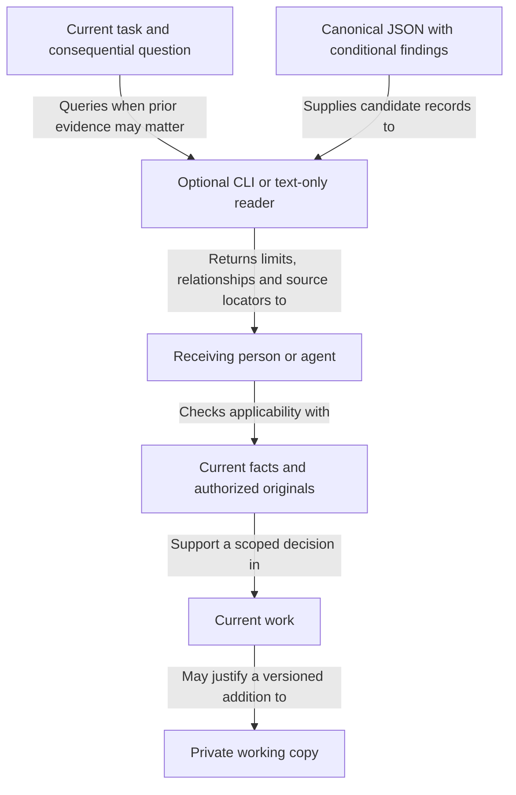
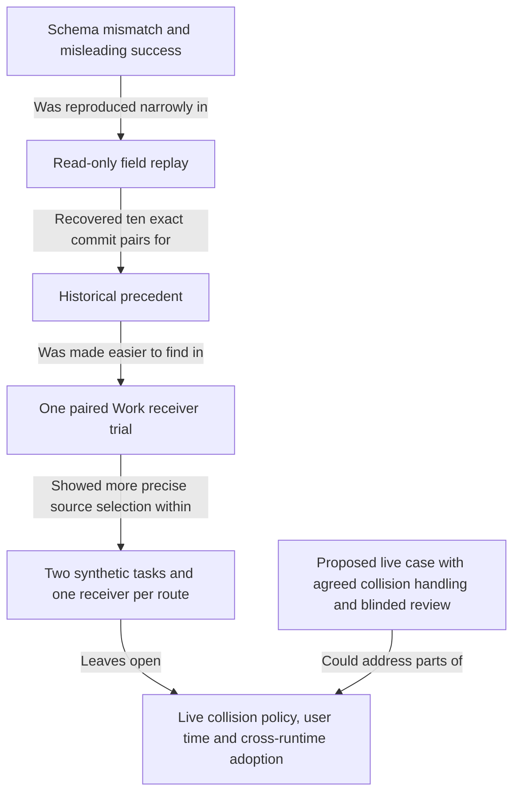
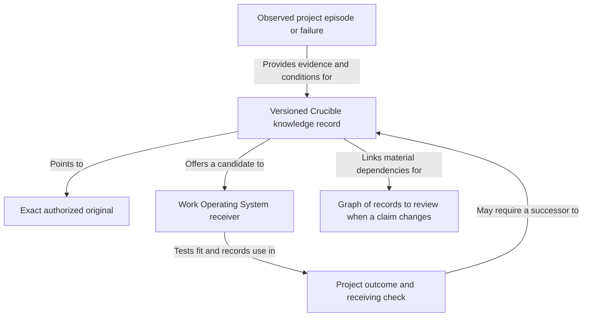

# 06 · Constellation Knowledge Sidecar

**Exhibit ID** A06-SIDECAR  
**Repository** [guarani-ux/sidecar](https://github.com/guarani-ux/sidecar)  
**Parent initiative** Constellation practice and knowledge. The repository is a distinct retrieval and maintenance implementation, which can be understood separately from the parent practice-library repository.  
**Source revision** [v0.1 implementation](https://github.com/guarani-ux/sidecar/commit/742c00d11bd4da900e0b65e349390462abcb555a), [v0.2 CLI serialization](https://github.com/guarani-ux/sidecar/commit/07fc792e2234dd78bf56f86f37f09f541a83e779), and [graph-expansion guide](https://github.com/guarani-ux/sidecar/commit/3c1f52b5a8bc624b605c95632fe07945a355cb9f).  
**Evidence boundary** Read-only inspection of repository source and historical receipts. This exhibit independently parsed the retrieved seed to confirm 16 records and 14 sources. It did not rerun the CLI, reproduce historical archive inputs, or test Drive, Slack or a Dot runtime.

## 1. Outcome map and target architecture · Recover a prior lesson at the point of work

The Sidecar aimed to make a consequential prior correction, condition or capability available without an assistant remembering a whole project history. Its implementation is one canonical JSON seed, an optional file-first Python CLI and links to authoritative originals. Distinct records carry source IDs and anchors, statements, use conditions, limits and selected relationships. Deterministic lexical search, outcome views and exact lookup provide candidates. The receiver validates applicability and opens the original when the claim matters. An explicit local apply operation appends versioned entries to a selected working copy under a stable POSIX lock and atomically replaces the local snapshot. JSON and YAML are output views of the same store. [Seed](https://github.com/guarani-ux/sidecar/blob/3c1f52b5a8bc624b605c95632fe07945a355cb9f/knowledge.json) · [Data contract](https://github.com/guarani-ux/sidecar/blob/3c1f52b5a8bc624b605c95632fe07945a355cb9f/CONTRACT.md#L9) · [CLI source](https://github.com/guarani-ux/sidecar/blob/3c1f52b5a8bc624b605c95632fe07945a355cb9f/sidecar.py#L219)

## 2. Evidence map · Which errors were recovered and what the comparisons established

The antecedent Musubi consolidation kept an apparently populated graph with zero repository-baseline rows. The Sidecar report documents a read-only field replay: the mapping used the nonexistent outer key `repositories`, and correcting that alone still searched for version fields named `sha` or `commit_sha`. Reading `repos[].commit` recovered all ten exact repository and commit pairs, matching the earlier workspace and connector lookups. The report did not have the original consolidator for end-to-end reproduction. It also found a manifest that disagreed with its packaged database, a reminder to verify payload contents directly when the two conflict. This is evidence of a concrete silent-loss mechanism and a bounded recovery, not a universal migration diagnosis. [Investigation and replay findings](https://github.com/guarani-ux/sidecar/blob/3c1f52b5a8bc624b605c95632fe07945a355cb9f/REPORT.md#L60) · [Replay receipt](https://github.com/guarani-ux/sidecar/blob/3c1f52b5a8bc624b605c95632fe07945a355cb9f/verification/musubi-replay.json)

In the historical paired comparison, two fresh Work agents with identical synthetic task inputs both made a correct import repair and usable workback. Their saved import outputs were byte-identical. The Sidecar-equipped agent recovered the exact precedent and pinned workback tests, while the ordinary-source run found other relevant evidence. Both fixture repairs still accepted duplicate IDs when probed, leaving live collision policy open. One receiver per condition, differences in controls, and incomplete search telemetry limit attribution and leave user time, general quality and production adoption unmeasured. The original runtime receipt records 13 passing checks. The v0.2 changelog reports 14 after adding the YAML check. [Paired receiver record](https://github.com/guarani-ux/sidecar/blob/3c1f52b5a8bc624b605c95632fe07945a355cb9f/verification/receiving-summary.md) · [v0.1 runtime receipt](https://github.com/guarani-ux/sidecar/blob/3c1f52b5a8bc624b605c95632fe07945a355cb9f/verification/runtime-tests.txt) · [v0.2 changelog](https://github.com/guarani-ux/sidecar/blob/3c1f52b5a8bc624b605c95632fe07945a355cb9f/CHANGELOG.md)

**Conditional alternative.** Ordinary source lookup remains a viable baseline when the source is known or the task is simple. For recurring wrong-source matches or lexical misses, measure retrieval and use against a realistic holdout before changing the search engine. The repository's four-probe comparison preserved the same first hit on three positive probes and abstention on the irrelevant probe in both flat search and FTS5. That narrow result supported the file-first choice. If multiple actors must update shared state concurrently, use an explicitly supported shared write model with conflict and recovery tests. The demonstrated POSIX lock applies to cooperating local writers, so a Drive folder should not be treated as an interchangeable write backend. [Alternative comparison](https://github.com/guarani-ux/sidecar/blob/3c1f52b5a8bc624b605c95632fe07945a355cb9f/REPORT.md#L120) · [Write contract](https://github.com/guarani-ux/sidecar/blob/3c1f52b5a8bc624b605c95632fe07945a355cb9f/CONTRACT.md#L25)

## 3. Transfer graph · A small knowledge intake and correction loop

| Reusable form | Candidate carry-forward | Receiving check |
| --- | --- | --- |
| Skill | Source reconciliation for a migration or export. Check exact identity tuples and payload structure when records are present on one side and missing on the other. | A worker catches a zero-row false success, distinguishes a legitimately empty input, and preserves source identity with the same labels. |
| Workflow | Intake a conditional lesson from an actual episode. Record exact source, scope, counterexample and action. Append a successor when evidence changes and review only dependent records. | A new worker recovers the original claim, the current revision and one affected dependency without disturbing unrelated work. |
| Agent role | Evidence retriever proposes up to the context needed to resolve the question. A receiver checks first-party source, fit, access and authority before applying it. | The receiver can distinguish exact knowledge, a candidate analogy, and missing or inaccessible evidence. |
| Graph or small system | A Crucible record view linking episode, source, finding, corrective action, affected project and verified reuse. Begin with human-readable records. Add machine retrieval only where a real receiver shows a recurring navigation or revision need. | A project worker arrives with a concrete question, finds the record and permitted source, and documents the consequence of applying or rejecting it. |

**Destination.** The Crucible can adopt the record and revision conventions now. The Work Operating System can request candidate knowledge where it changes a decision and require the receiver to check the original. The repository's later domain graph guide supplies candidate node and edge vocabulary. Its branch charters and target portable interface are proposals in the inspected guide, with no receiving proof established here. [Domain expansion guide](https://github.com/guarani-ux/sidecar/blob/3c1f52b5a8bc624b605c95632fe07945a355cb9f/MORGAN_BUILD_GUIDE.md#L26)
