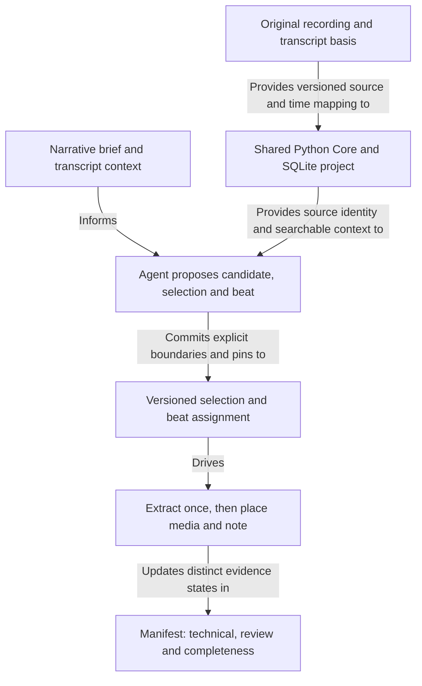
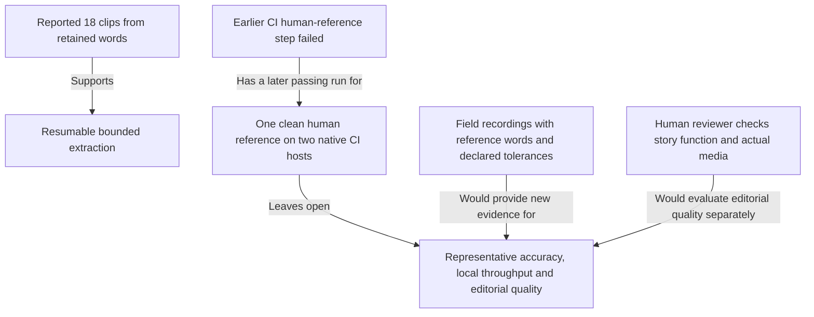

# 07 · Story-Lane

**Repository exhibit.** A source-media and editorial capability can support Work Operating System production without taking over the whole project. This exhibit inspects Story-Lane at commit `922aae2fda855e30fda9e79503348c126dc8777b` and selected historical CI records.

## 1 · Intended outcome and implemented mechanism

Story-Lane aims to turn supplied recordings and a narrative brief into retraceable selects in named story beats. An external reasoning agent examines transcripts and proposes editorial choices. The shared Python Core, CLI and SQLite project handle versioned source identity, transcript and time mappings, selections, media extraction, placements and manifest state. The source fixture asserts that the manifest keeps technical readiness, editorial review and completeness separate. [Project entry](https://github.com/guarani-ux/Story-Lane/blob/922aae2fda855e30fda9e79503348c126dc8777b/README.md#L45-L58) · [Canonical fixture, lines 44–105](https://github.com/guarani-ux/Story-Lane/blob/922aae2fda855e30fda9e79503348c126dc8777b/tests/test_canonical_external_e2e.py#L44-L105)



## 2 · What worked, where it stopped, and what would change the result

| Evidence | What it supports | Boundary |
| --- | --- | --- |
| README's November 4 receipt summary | A resumed run is reported to have delivered 18 clips and 18 notes from three originals using retained WhisperX words. The resume ran in an isolated copy and output identities were checked. | This review read the report and did not rerun or independently inspect those 18 files. Retained transcripts establish a different claim from fresh speech recognition. [Run summary](https://github.com/guarani-ux/Story-Lane/blob/922aae2fda855e30fda9e79503348c126dc8777b/README.md#L3-L10) |
| Failed native job and later passing main job | The earlier native matrix passed source-to-playable synthetic speech and failed the human-reference step on both platforms. In the later run at the inspected commit, both native macOS ARM64 and Windows x64 jobs passed both steps. | The later workflow uses one pinned public-domain LJSpeech recording with a WER threshold and wrong-word controls. It extends the older README's synthetic-only evidence. Representative speech, accent and noise coverage, throughput on the intended workstation, and editorial approval remain open. Failed-step metadata alone does not establish root cause. [Earlier failure](https://github.com/guarani-ux/Story-Lane/actions/runs/42026797816) · [Passing native run](https://github.com/guarani-ux/Story-Lane/actions/runs/42031205858) · [Reference test, lines 100–154](https://github.com/guarani-ux/Story-Lane/blob/922aae2fda855e30fda9e79503348c126dc8777b/dev/qualify_human_reference.py#L100-L154) |
| Canonical fixture | The designed recovery path covers a post-rename interruption and replays placement without re-rendering. The fixture asserts stable asset and original hashes, one job, and independent readiness states. | Source inspected. This exhibit did not run the fixture. [Recovery assertions, lines 44–75](https://github.com/guarani-ux/Story-Lane/blob/922aae2fda855e30fda9e79503348c126dc8777b/tests/test_canonical_external_e2e.py#L44-L75) |



**Counterfactual.** A small reference set reflecting the intended environment, such as clean interviews, overlapping speech and noisy room audio, would have made recognition and performance limits visible before generalizing from a clean speaker. A separate editorial review with a brief and playable output would address story usefulness. Those are prospective conditions, with no inferred result.

## 3 · What can carry forward without the repository

```mermaid
flowchart TD
    anchors["Source, word and time anchors"] -->|"Become"| skill["Skill: propose source-traceable story selects"]
    state["Separate media, review and completeness states"] -->|"Become"| handoff["Workflow: capture, place and verify a versioned review packet"]
    dependencies["Selection, beat and asset relationships"] -->|"Become"| graph["Graph: which placements and reviews a selection change affects"]
    handoff -->|"Gives assigned roles distinct evidence"| roles["Scout proposes, verifier plays back, editor judges"]
    graph -->|"Feeds"| wos["Work Operating System cut and review handoff"]
    skill -->|"Can be stored with conditions in"| crucible["Crucible Knowledge"]
```

**Smallest high-value transplant.** Make one source-selection receipt a Work Operating System artifact. Record the source ID, transcript basis, time window, selection and revision, intended beat, file and note states, who played the file, and whether the editor accepted its use. A spreadsheet, form or Markdown table can carry it. Revalidate the selection and dependent placements if the source or transcript mapping changes. Preserve technical verification and editorial approval as separate events.

**Admit to Crucible.** Store the recovery and qualification distinction as a reusable method, linked to the fixture and both CI outcomes. Attach the trace as a reference view. Keep restricted source recordings in their authorized location.
