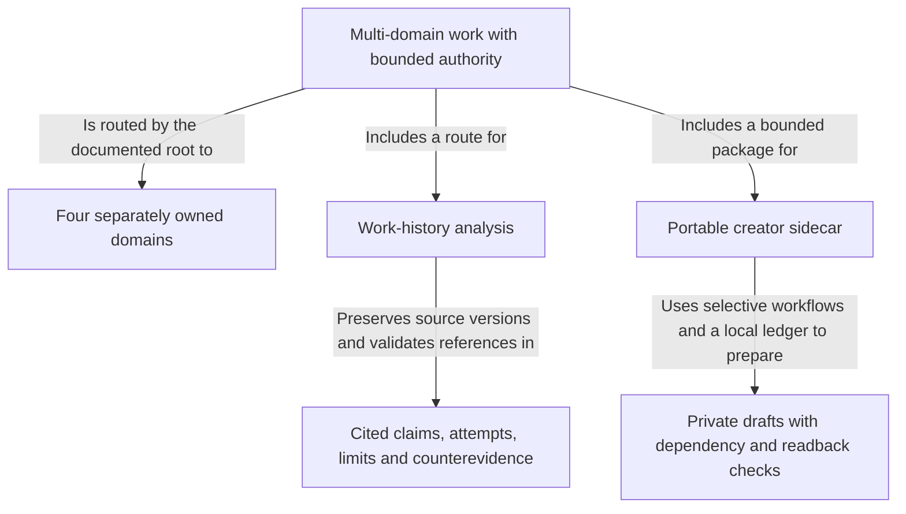
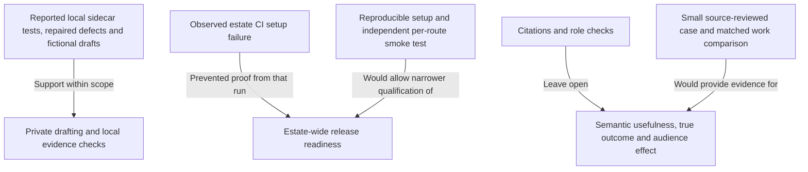
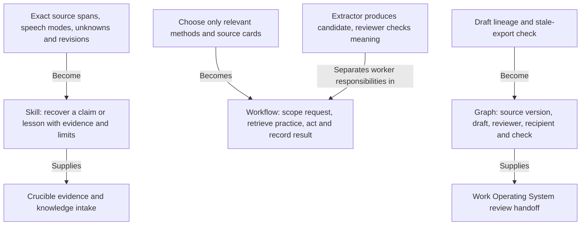

# 08 · Hagoromo

**Repository exhibit.** A multi-domain engineering workspace contains several scoped tools and methods. It is separate from the top-level Work Operating System and can be an evidence source for specific capabilities. Examined at commit `4d60c6b02c9a1b9c2d1a84f92ea00d37db968a4e`.

## 1 · Intended outcome and implemented mechanism

Hagoromo aims to provide a common orientation, routing and qualification layer for four separately owned domains. Its project document specifies a root dispatcher, engineering record workflow, host-specific hooks, and one authoritative document per concern. This exhibit focuses on two scoped mechanisms with a direct use in Crucible and Work Operating System, work-history analysis and the portable creator sidecar. Application of their rules still depends on the invoking host and permissions. [Project architecture, lines 12–83](https://github.com/guarani-ux/Hagoromo/blob/4d60c6b02c9a1b9c2d1a84f92ea00d37db968a4e/PROJECT.md#L12-L83) · [Source-audit remediation commit](https://github.com/guarani-ux/Hagoromo/commit/4d60c6b02c9a1b9c2d1a84f92ea00d37db968a4e)

The work-analysis code enforces primary-source coverage and citation and role agreement. Later protocols keep assistant completion claims distinct from user or tool reports of a result, which require bounded action and result evidence. The analyst still needs to inspect whether the report is relevant and what its source actually establishes. The sidecar facade operates on explicit state, checks the declared dependency status before export, and exposes no model, network, external effects, or authenticated approvals. [Work-analysis contract, lines 18–80](https://github.com/guarani-ux/Hagoromo/blob/4d60c6b02c9a1b9c2d1a84f92ea00d37db968a4e/docs/WORK_ANALYSIS.md#L18-L80) · [Validator, lines 124–198](https://github.com/guarani-ux/Hagoromo/blob/4d60c6b02c9a1b9c2d1a84f92ea00d37db968a4e/corpus_pipeline/work_analysis.py#L124-L198) · [Creator capabilities, lines 43–75](https://github.com/guarani-ux/Hagoromo/blob/4d60c6b02c9a1b9c2d1a84f92ea00d37db968a4e/packages/youtube-creator-sidecar/runtime/creator.py#L43-L75) · [Stale export check, lines 138–152](https://github.com/guarani-ux/Hagoromo/blob/4d60c6b02c9a1b9c2d1a84f92ea00d37db968a4e/packages/youtube-creator-sidecar/runtime/creator.py#L138-L152)

## 2 · What worked, where it stopped, and what would change the result

| Evidence | What it supports | Boundary |
| --- | --- | --- |
| Creator-sidecar qualification report | Reports a 16-test Linux suite and relocated-copy checks for retrieval, stale export, overwrite refusal, package identity and recovery. It documents repairs for rejection of a valid relative sibling destination and incomplete manifest acceptance. It also records one fresh model producing three fictional text-only artifacts. | Inspected report and selected facades. This pass did not rerun the original tests. The fresh-model run predates small final package edits and the exercises establish no real publishing, channel impact or media QA. [Qualification, lines 13–51](https://github.com/guarani-ux/Hagoromo/blob/4d60c6b02c9a1b9c2d1a84f92ea00d37db968a4e/packages/youtube-creator-sidecar/docs/qualification.md#L13-L51) |
| Work-analysis code and documented repair history | Source roles, exact quotes, speech-mode distinction, explicitly bounded calls, and visible omissions turn unsupported claims into checkable cases. The report retains prior failed responses and ties cached results to the protocol. | Structural checks do not verify original authorship, substantive interpretation or usefulness. No new archive analysis ran here. [Work-analysis contract, lines 37–82](https://github.com/guarani-ux/Hagoromo/blob/4d60c6b02c9a1b9c2d1a84f92ea00d37db968a4e/docs/WORK_ANALYSIS.md#L37-L82) |
| Observed current-commit V11 qualification CI | The GitHub job failed at the Python 3.11 setup step. This attempt did not establish release readiness for the estate. | Setup failure does not establish an engine defect. The bounded sidecar report and estate-wide CI have different scopes. [Run and job](https://github.com/guarani-ux/Hagoromo/actions/runs/42303063982/job/128185448403) |

**Counterfactual.** If host-independent handoffs and a usable per-route setup check had been made first-class deployment artifacts, the estate could have offered narrower verifiable capabilities even while the whole-estate gate remained open. If matched real work and source-review conditions had been established, the sidecar and archive workflow could be compared with ordinary files for effort, correction cost and output quality. This is a design implication of the documented boundaries, not an independently established outcome.

## 3 · What can carry forward without the repository

**Smallest high-value transplant.** Give an archive-review worker one project source set, stable locators and a time budget. Have them return the exact source for each consequential claim, mark speaker and speech mode, preserve failures and contrary evidence, and hand uncertain interpretations to a second reader. Promote a reusable result only when the source review establishes what it will change. This can work with Drive links and Markdown. A separate Work Operating System draft-version check can reuse the sidecar's explicit dependency idea without copying the estate or its host configuration.

**Admit to Crucible.** Retain the source-grounded extraction procedure and the earlier repairs as test cases. Keep the qualification record for each actual use environment and the outcome of a matched real task. The source archive and project-specific footage stay in their authorized homes.
