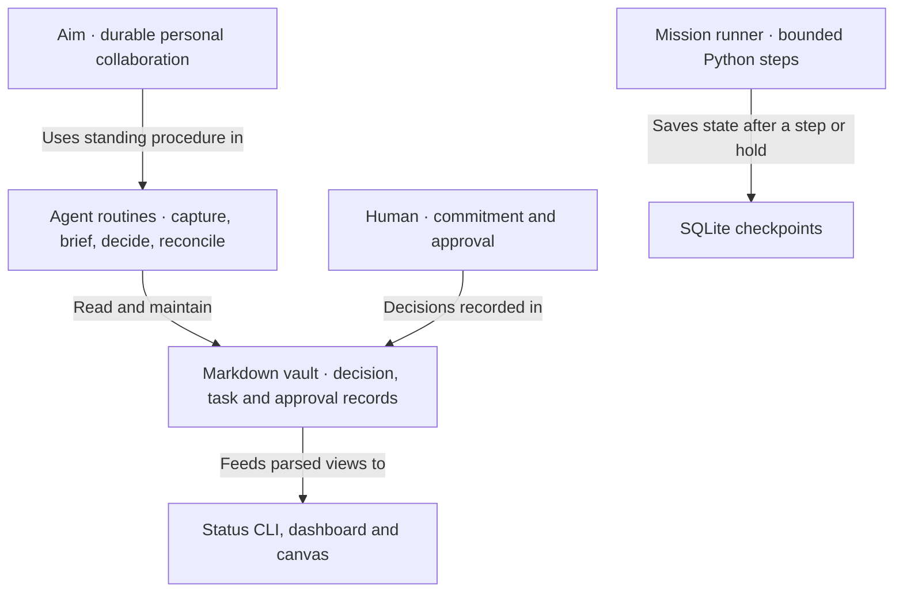
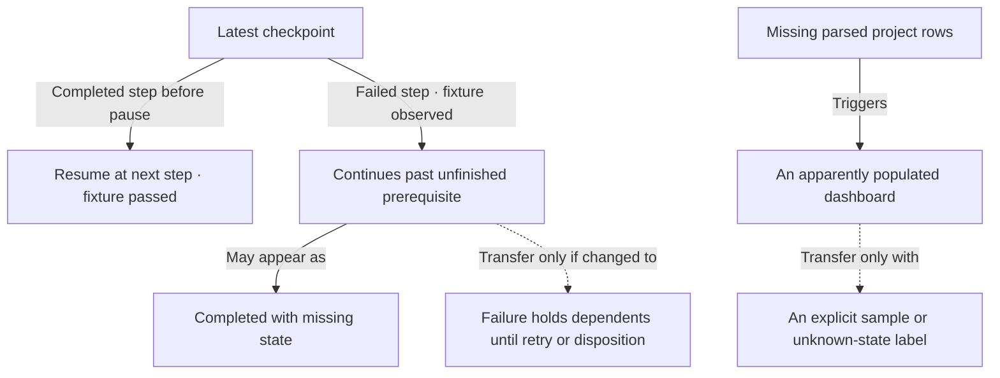
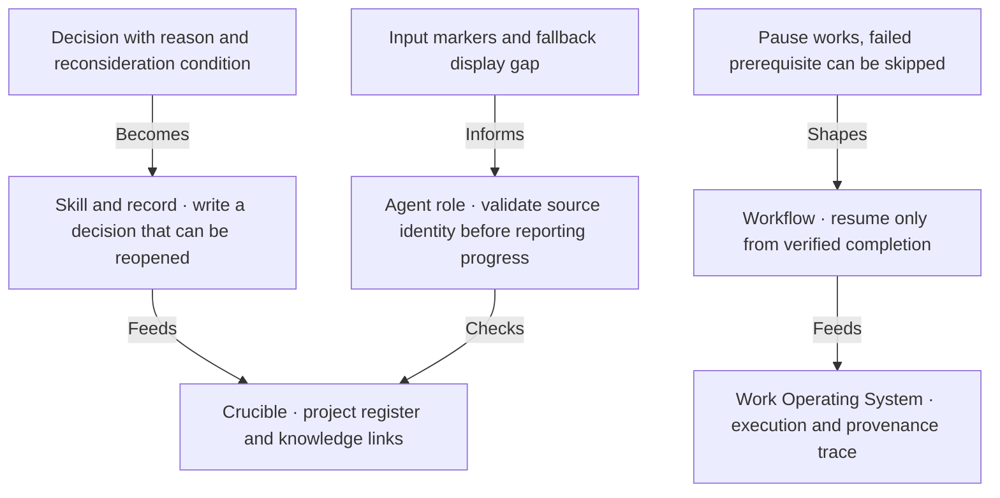

# 09 · cognitive-os

**Exhibit type:** historical repository for the personal cognitive operating-system initiative. Its current status and any formal lineage to Work Operating System are open. The evidence here is pinned to main at [1f10b5d](https://github.com/guarani-ux/cognitive-os/commit/1f10b5d6b2196263ebd8c8ec8e1c17773c384e54).

## 1. Intended outcome and actual mechanisms

The design aims to offload capture, synthesis, briefing, decision review and reconciliation while people retain judgment and control of commitments. Markdown and Git hold the records. Skills describe how an agent should use them. The standard-library CLI reads tasks, decisions, approvals and projects, and projects selected records into a dashboard or canvas. A later commit added an independent SQLite checkpointer for Python step sequences. The dashboard and checkpointer solve different jobs. [Design and skill suite](https://github.com/guarani-ux/cognitive-os/blob/1f10b5d6b2196263ebd8c8ec8e1c17773c384e54/README.md#core-design-principles) · [Audit and projection](https://github.com/guarani-ux/cognitive-os/blob/1f10b5d6b2196263ebd8c8ec8e1c17773c384e54/scripts/cos_cli.py#L1409-L1500) · [Checkpoint commit](https://github.com/guarani-ux/cognitive-os/commit/1f10b5d6b2196263ebd8c8ec8e1c17773c384e54)

## 2. What held up, what broke, and the condition that matters

**Exercised in this review.** Seven pinned unit tests passed in a temporary local copy of the runner and its test file. They cover checkpoint retrieval, rollback, tamper detection, completion, pause/resume after completed steps and the code-level gate. A separate synthetic two-step probe made the first step fail once. On restart the runner continued at step two, returned COMPLETED, and the preparatory action had only been attempted once. The observed second-step state showed that preparation was missing. The source advances from the latest checkpoint index for all statuses, including FAILED. [Runner branch and failure persistence](https://github.com/guarani-ux/cognitive-os/blob/1f10b5d6b2196263ebd8c8ec8e1c17773c384e54/scripts/mission_runner.py#L271-L347) · [Existing tests](https://github.com/guarani-ux/cognitive-os/blob/1f10b5d6b2196263ebd8c8ec8e1c17773c384e54/tests/test_mission_runner.py#L24-L163)

**Source inspection.** The dashboard contains fallback project rows and commit literals. The status audit counts presence of source markers, and due reconsiderations use the date field. A populated view is therefore limited evidence of current project status or verified source content. The repository describes a broader agent workflow. Autonomous wake, connector authority, and an end-to-end agent rehearsal were outside this review. [Dashboard fallbacks](https://github.com/guarani-ux/cognitive-os/blob/1f10b5d6b2196263ebd8c8ec8e1c17773c384e54/scripts/cos_cli.py#L276-L370) · [Source-marker check](https://github.com/guarani-ux/cognitive-os/blob/1f10b5d6b2196263ebd8c8ec8e1c17773c384e54/scripts/cos_cli.py#L159-L178)

## 3. What to extract

Start with a small decision record: ID, controlling source, decision owner, rationale, a dated or observable reason to reconsider and the affected assignments. For execution, carry the last verified output, any failed or held prerequisites and the permitted restart action. Check one resume fixture where a prerequisite has failed. A completed synthetic pause test is useful only within its input and status conditions.
