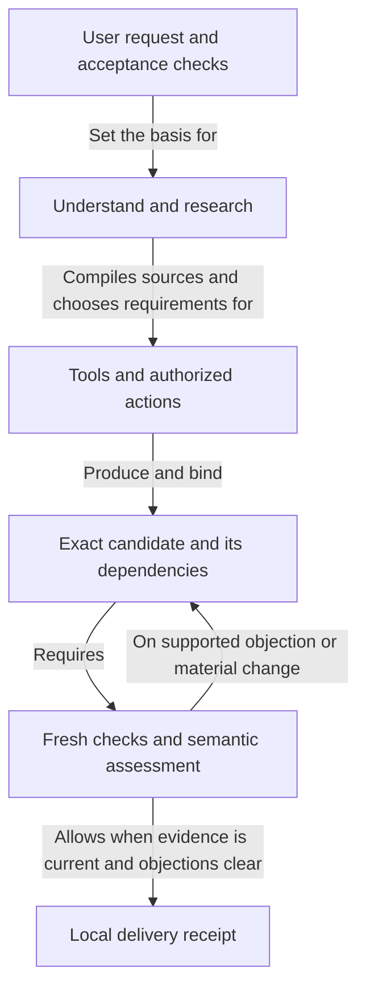
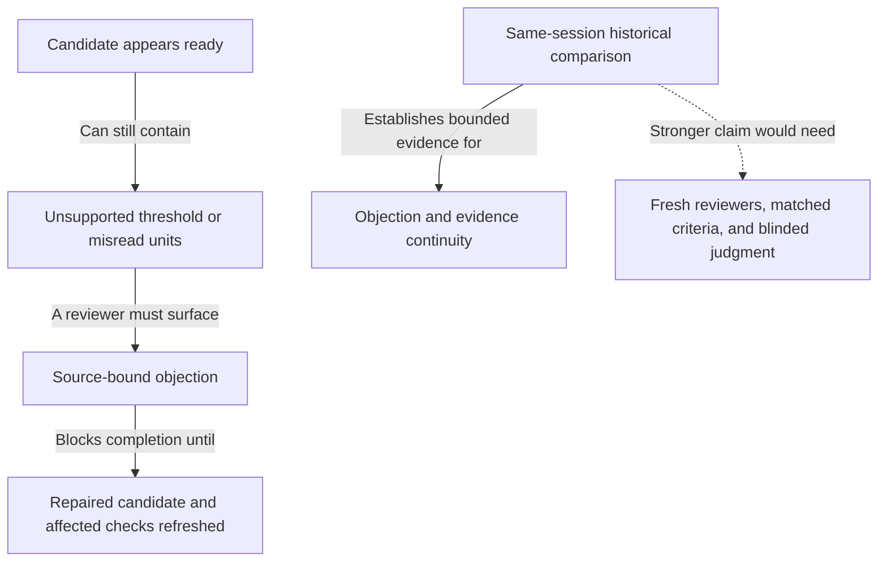

# 10 · Nelson

**Exhibit type:** historical repository for a supervised agent tool and verification harness. The repository calls Nelson the application and Levi its governance and verification component. The evidence here is pinned to main at [150e6458](https://github.com/guarani-ux/Nelson/commit/150e64582b733160516b2d8bfc09760b2ac63798). This audit establishes a transfer candidate for Work Operating System.

## 1. Intended outcome and actual mechanisms

Nelson gives an existing agent a durable task record, staged actions and mechanically captured evidence. The original objective and acceptance checks are preserved separately from revisable interpretations. The workflow records research sources, binds current work to the authorized output, requires fresh checks against the current candidate, and blocks delivery on unresolved or stale evidence. Semantic assessment still belongs to agents and people. [Use and boundaries](https://github.com/guarani-ux/Nelson/blob/150e64582b733160516b2d8bfc09760b2ac63798/README.md) · [Stage and artifact checks](https://github.com/guarani-ux/Nelson/blob/150e64582b733160516b2d8bfc09760b2ac63798/nelson/workflow.py#L85-L190)



## 2. What held up, what broke, and the condition that matters

**Repository-reported result.** The supervised Linux qualification records 30 bounded missions across six domains. Six initial text artifacts required repair. Missing compensation was treated as failure of a threshold the user had never set. A displayed chapter time was confused with a different unit in the underlying metadata. A provider test that already passed the older build was rejected and replaced. The agent identified semantic mistakes. Nelson retained objections and prevented stale or unresolved evidence from satisfying the completion condition. The report explicitly limits comparative claims because the evaluation reused the same agent and session and was unblinded. [Supervised production report](https://github.com/guarani-ux/Nelson/blob/150e64582b733160516b2d8bfc09760b2ac63798/evaluation/production/REPORT.md#L5-L41)

**Independently retrieved in this review.** GitHub Actions reports successful Nelson Orchestration CI for the pinned commit. This records that CI outcome. The 30 historical missions were not rerun. The report bounds use to a supervised host and notes that the current agent did the semantic assessment, host captures were not independently authenticated, and same-user potential bypass remains outside independent containment. [GitHub Actions run](https://github.com/guarani-ux/Nelson/actions/runs/34014519691) · [Detailed operating limits](https://github.com/guarani-ux/Nelson/blob/150e64582b733160516b2d8bfc09760b2ac63798/evaluation/production/REPORT.md#L13-L35)



## 3. What to extract

```mermaid
flowchart TD
    freeze["Original objective and acceptance checks"] -->|"Becomes"| brief["Skill · write a checkable task contract"]
    separate["Different acts of building, observing and judging"] -->|"Becomes"| roles["Agent roles · producer and independent reviewer"]
    obje["Material objection tied to affected claim"] -->|"Becomes"| graph["Graph · trace affected checks and output versions"]
    bind["Run, criteria and candidate identity"] -->|"Becomes"| receipt["Small system · exact-version receiving receipt"]
    brief -->|"Starts"| handoff["Work Operating System · bounded handoff"]
    roles -->|"Review"| handoff
    graph -->|"Maps changes to"| handoff
    receipt -->|"Closes when verified"| handoff
```

Start with one brief, concept or call-sheet assignment. Preserve the agreed outcome, assign a receiver, and bind the receipt to the exact version. Ask a second reader to record one material objection with its source. If the candidate changes, reopen affected checks and keep earlier objections retrievable in Crucible Domain. This extracts the operational property with a modest record. Any claim of independent semantic or host-level enforcement would need separate evidence.
