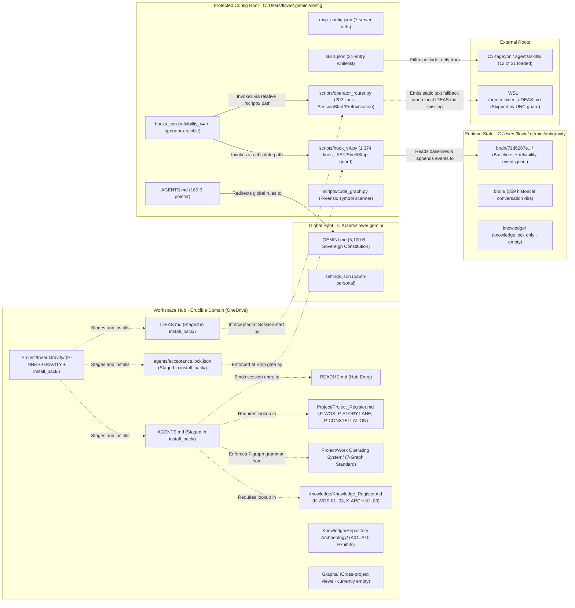
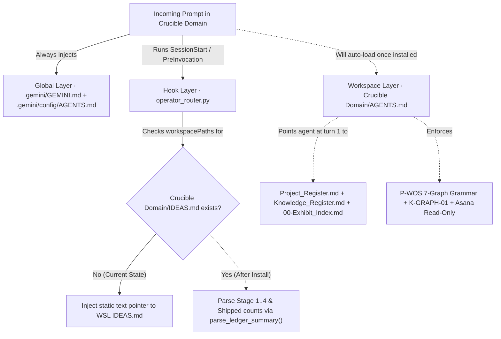

# 01 — Target System Architecture & Locations (`IG-ARCH`)

**WOS Graph Type:** `Target system architecture` (*How should the system be wired? Components, interfaces, information flows, and authority boundaries.*)  
**Related Records:** `P-INNER-GRAVITY`, `P-WOS`, `K-WOS-01`, `K-SIDECAR-01`, `K-GRAPH-01`, `A02` (Kageyoni), `A06` (Knowledge Sidecar)

---

## 1. Observed Current Wiring vs. Target Installed Wiring (`IG-ARCH-01`)

Solid edges (`-->`) represent **observed active links** in session `79d6267e-43c7-484f-9c9d-4e6762060706`. Dashed edges (`-.->`) represent **staged target links** in [`./install_pack/`](./install_pack/) waiting to be installed into `Crucible Domain` (`K-GRAPH-01`).

---

## 2. Rule & Context Discovery Hierarchy (`IG-ARCH-02`)

---

## 3. Authority Boundaries & File Inventory (What the Graph Cannot Show)

| Layer ID | Exact Path | Authority Tier & Protection | Observed State & Scale Implication |
| --- | --- | --- | --- |
| `IG-ROOT-GLOBAL` | `C:\Users\flowe\.gemini\GEMINI.md` | **Protected (`hook_v4.py` `RW-04`)** · Global | 5,100 bytes. Defines 3-Tier Reversibility, `idea-crucible`, `mode-reframe`, and `mode-worktree-build`. |
| `IG-ROOT-CFG` | `C:\Users\flowe\.gemini\config\` | **Protected (`PROTECTED_PREFIXES`)** · Global | Contains `hooks.json`, `mcp_config.json`, `skills.json`, `scripts/`. Also contains 14 `.bak*` files (`GEMINI.md.bak*`, `AGENTS.md.bak*`, `hooks.json.bak*`, `config.json.bak*`, `hook_v4.py.bak*`, `pre_tool_guard.js.bak*`). |
| `IG-ROOT-BRAIN` | `C:\Users\flowe\.gemini\antigravity\brain\` | **Hook State Protected (`RW-06`)** · Per-Session | 359 conversation directories (`conversation_summaries.db` is 58.5 MB). Active dir `79d6267e-43c7-484f-9c9d-4e6762060706` holds `db-baseline.json` (2 B), `test-baseline.json` (2 B), `root-files-baseline.json` (2 B), and `reliability-events.jsonl`. |
| `IG-ROOT-KNOW` | `C:\Users\flowe\.gemini\antigravity\knowledge\` | Runtime Store | Contains only `knowledge.lock`. Cross-project lessons instead live in `Crucible Domain\Knowledge\Knowledge_Register.md` and `Repository Archaeology\`. |
| `IG-ROOT-HUB` | `C:\Users\flowe\OneDrive\Desktop\Crucible Domain\` | **Workspace Root (Tier 0/1)** | Synced with Google Drive (`1jpG-7DjOa2xtiYPbBhL07qmCRSVrK1fU`). Houses `Project\`, `Knowledge\`, `Graphs\`, `Calgary Public Library\`, and `Personal Work\`. |
