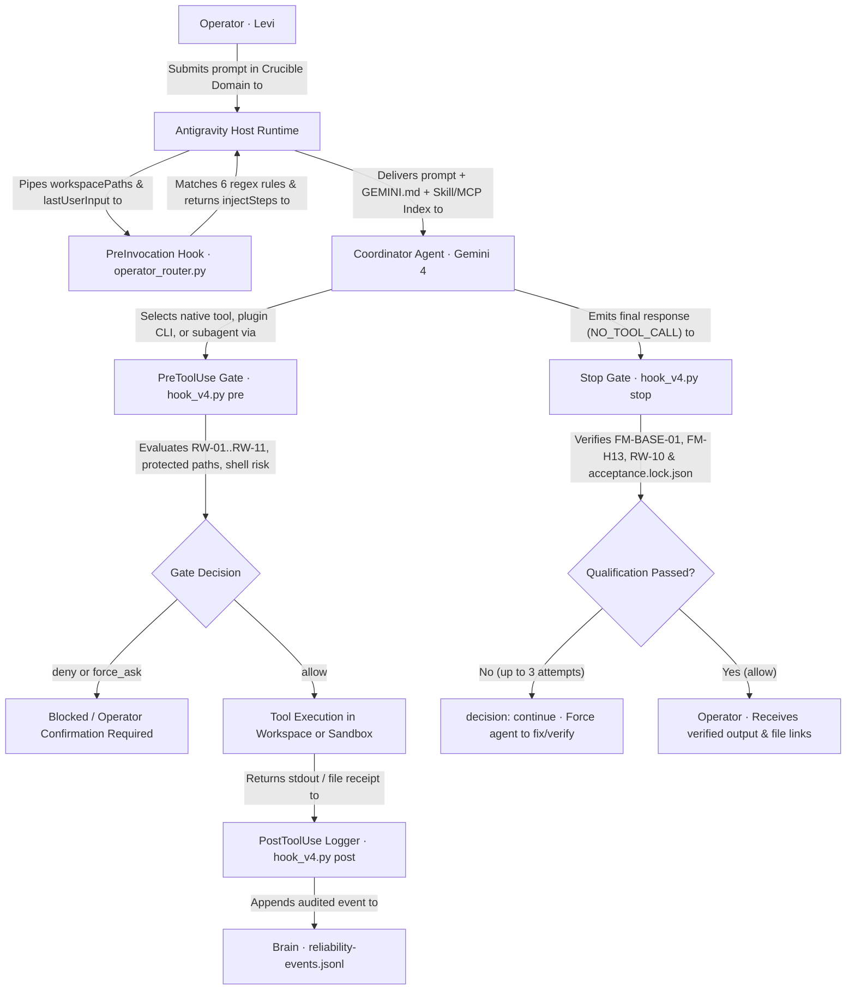
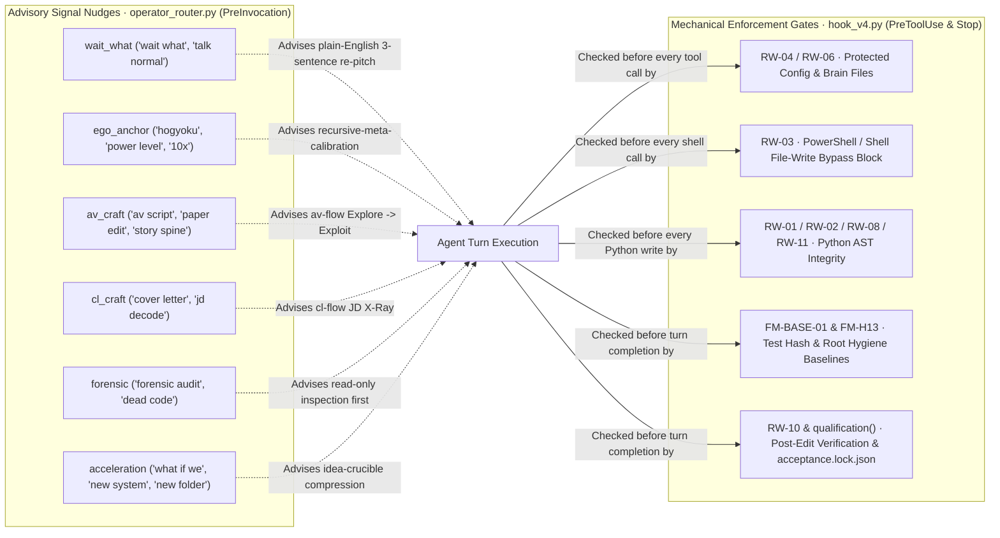
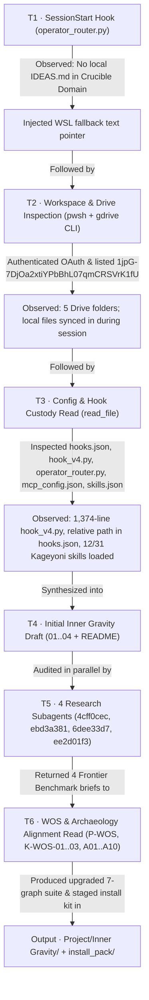
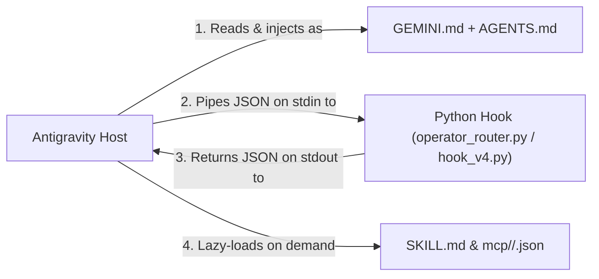

# 02 — Reference Process Model & Execution Trace (`IG-PROC` & `IG-TRACE`)

**WOS Graph Types:**
- `Reference process model` (*How do we do this kind of work? Who acts, which skills and tools they use, what they produce, and who receives it.*)
- `Execution and provenance trace` (*What actually happened? The actor, operation, exact input and output versions, evidence, and receiving decision.*)

**Related Records:** `P-INNER-GRAVITY`, `P-WOS`, `K-WOS-03`, `K-ARCH-01` (cognitive-os failed prerequisite on resume), `K-ARCH-02`, `K-ARCH-03` (Kageyoni operation-bound receipt)

---

## 1. Reference Process Model: Turn & Hook Lifecycle (`IG-PROC-01`)

---

## 2. Signal Routing & Enforcement Matrix (`IG-PROC-02`)

Solid edges (`-->`) show **hard mechanical gates** enforced by `hook_v4.py`. Dashed edges (`-.->`) show **advisory prompt nudges** injected by `operator_router.py` (`K-GRAPH-01`).

---

## 3. Observed Execution & Provenance Trace (`IG-TRACE-01`)

This graph records the **actual operations executed** during session `79d6267e-43c7-484f-9c9d-4e6762060706` on November 15, 2026 (`WOS Graph Type 5` + `K-WOS-03` + `K-ARCH-03`).

---

## 4. Provenance & Failure-Mode Notes (What the Graph Cannot Show)

1. **Why `RW-10` Needs `.agents/acceptance.lock.json` (`K-ARCH-01` & `K-ARCH-03`):**
   - In `hook_v4.py` (lines 1294–1351), `stop(payload)` calls `qualification(payload)`. When `.agents/acceptance.lock.json` is absent (`contract is None`), `hook_v4.py` only checks session-edited Python syntax, SQLite DB integrity, baseline test hashes (`FM-BASE-01`), untracked root scripts (`FM-H13`), and that at least one `run_command` occurred after a code edit (`RW-10`).
   - Installing `install_pack/acceptance.lock.json` to `Crucible Domain/.agents/acceptance.lock.json` binds `stop(payload)` to verify that every core register and `Inner Gravity` artifact exists and is non-empty (`os.path.getsize(full) > 0`).
2. **Failed-Prerequisite Resume Protection (`K-ARCH-01`):**
   - `K-ARCH-01` (from `A09 cognitive-os`) warns that a saved checkpoint can resume past a failed prerequisite. In `hook_v4.py`, `stop(payload)` caps forced continuations at `attempt >= 3` (`executionNum`). If an agent hits 3 consecutive failed tool calls (`recent_tool_errors`) or 3 failed stop checks, the host allows termination so the operator sees the failure rather than looping infinitely—meaning the operator or next session must check `reliability-events.jsonl` before assuming the prior turn succeeded.

---

## 5. Antigravity Host Glossary & Hook I/O Contract (For External Agents)

- **How `GEMINI.md` & `AGENTS.md` influence the model:** The Antigravity host automatically injects global `GEMINI.md` and `AGENTS.md` into every prompt as `<RULE[user_global]>` system instructions.
- **How `operator_router.py` influences the model (`SessionStart` / `PreInvocation`):** Receives `{"workspacePaths": [...], "lastUserInput": "..."}` on `stdin` and prints `{"injectSteps": [{"systemMessage": {"systemMessage": "..."}}]}` on `stdout`, which the host appends as a `<SYSTEM_MESSAGE>` before the model runs.
- **How `hook_v4.py` gates the model (`PreToolUse` / `PostToolUse` / `Stop`):** Receives tool call / turn-end JSON on `stdin` and prints `{"decision": "allow" | "deny" | "force_ask", "reason": "..."}` (on `PreToolUse`) or `{"decision": "allow" | "continue", "reason": "..."}` (on `Stop`) on `stdout`.

