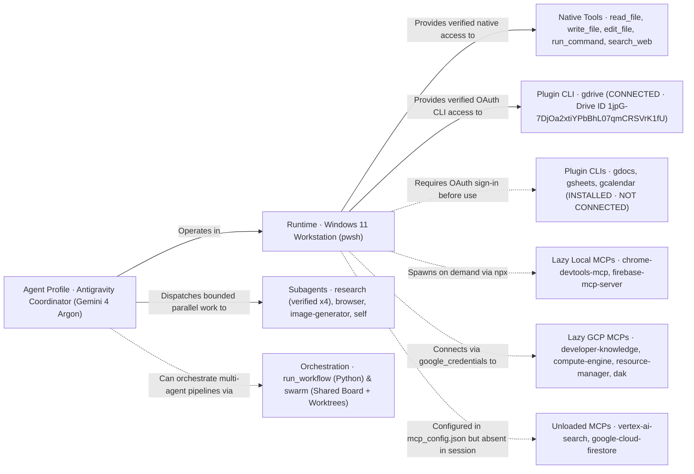
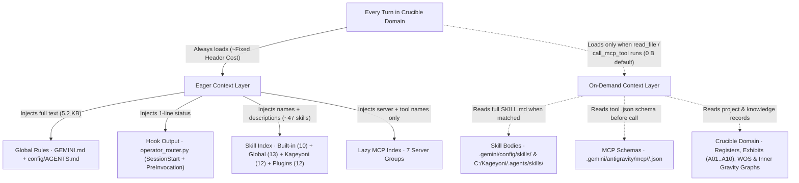

# 03 — Capability Inventory: Tools, Skills & MCP Topology (`IG-CAP`)

**WOS Graph Type:** `Capability inventory` (*What can we use, and where? Tools, skills, workflows, agent profiles, optional personas, and graph artifacts. Record availability and verified access by environment.*)  
**Related Records:** `P-INNER-GRAVITY`, `P-WOS`, `K-WOS-03` (Packet exercise vs. live environment access), `K-GRAPH-01` (Solid verified/blocking vs. dashed advisory/unverified)

---

## 1. Environment-Verified Capability Inventory (`IG-CAP-01`)

Solid edges (`-->`) indicate **verified active access** in this Windows workstation environment (`79d6267e-43c7-484f-9c9d-4e6762060706`). Dashed edges (`-.->`) indicate **installed but unauthenticated, lazy/untested in this session, or config-only entries** (`K-WOS-03`, `K-GRAPH-01`).

---

## 2. Context-Budget & Progressive Disclosure Topology (`IG-CAP-02`)

---

## 3. Verified Access & Config-vs-Runtime Ledger (What the Graph Cannot Show)

Per `K-WOS-03` (*A packet exercise proves the handoff only within the tested environment*), this table separates **verified live execution in this session** from **installed/documented presence**:

| Capability ID | Category | Component | Observed Status in Session `79d6267e` | Environment Constraint / Note |
| --- | --- | --- | --- | --- |
| `IG-CAP-NAT` | Native | `read_file`, `write_file`, `edit_file`, `run_command` | **Verified Live** | Governed by `hook_v4.py` (`PreToolUse`, `PostToolUse`, `Stop`). |
| `IG-CAP-GDRIVE` | Plugin CLI | `gdrive` (`cl/1015343799`) | **Verified Live (OAuth signed in)** | Listed root and `Crucible Domain` (`1jpG-7DjOa2xtiYPbBhL07qmCRSVrK1fU`). Use `readonly` unless mutation is requested. |
| `IG-CAP-GWS` | Plugin CLIs | `gdocs`, `gsheets`, `gcalendar` | **Installed · Unauthenticated** | Present in `list_plugin_accounts` as `not connected`. Require user sign-in via Plugin Card or Plugins Manager. |
| `IG-CAP-SUB` | Subagents | `research` | **Verified Live (4 parallel runs)** | Runs in read-only sandbox with no network access. `browser`, `image-generator`, and `self` also registered. |
| `IG-CAP-KAG` | External Skills | `C:\Kageyoni\.agents\skills` | **Partial Load (12 of 31)** | `skills.json` whitelists 31 skills (`av-flow`, `cl-flow`, `cos-flow`, etc.), but only 12 have valid skill folders loaded in the active index (`av-craft`, `av-review`, `av-scriptwriting`, `cl-craft`, `cl-review`, `cos-craft`, `launch-ssl`, `negative-space`, `nin-console`, `nin-probe`, `recursive-meta-calibration`, `visual-reflex`). |
| `IG-CAP-MCP` | Lazy MCPs | `chrome-devtools-mcp`, `firebase-mcp-server`, `dak-*`, `google-*` | **Schemas Indexed · Unexercised** | Listed in `<mcp_servers>`. `vertex-ai-search` and `google-cloud-firestore` appear in `mcp_config.json` but are not loaded into the session tool list. |
| `IG-CAP-ASANA` | External System | Asana | **Policy Constraint (`P-WOS`)** | Must remain **strictly read-only** across all `Work Operating System` and `Crucible Domain` workflows. |
