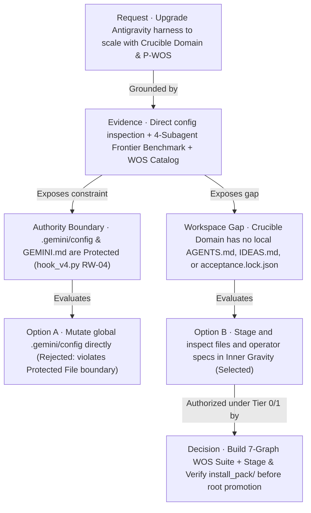
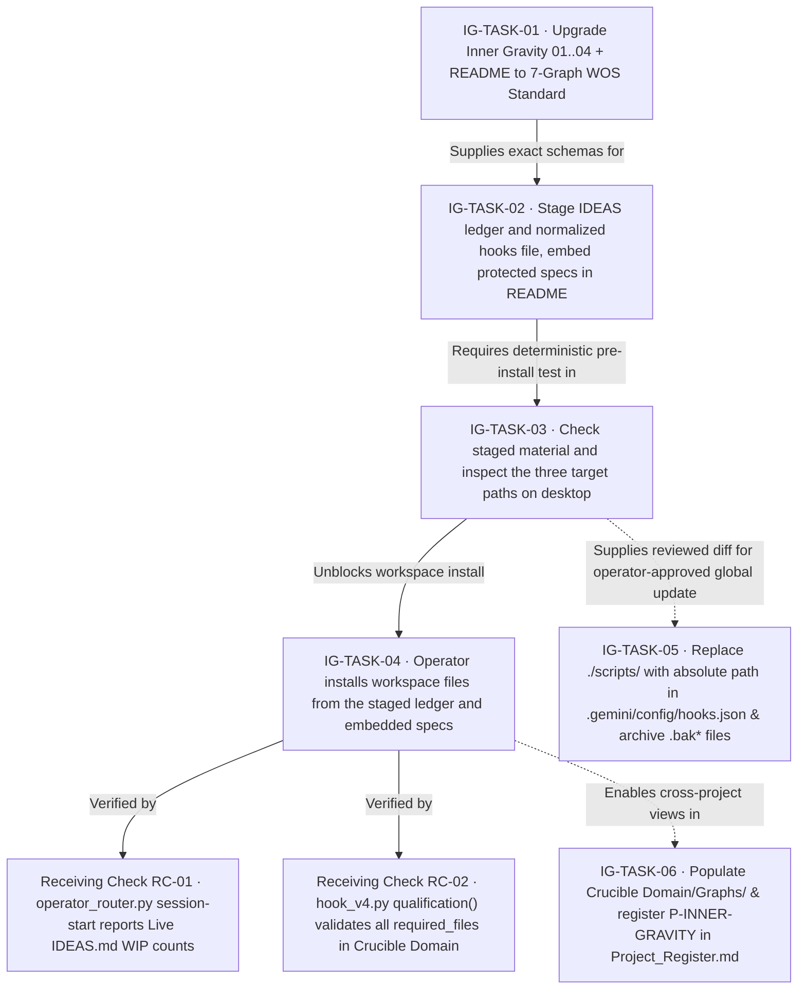
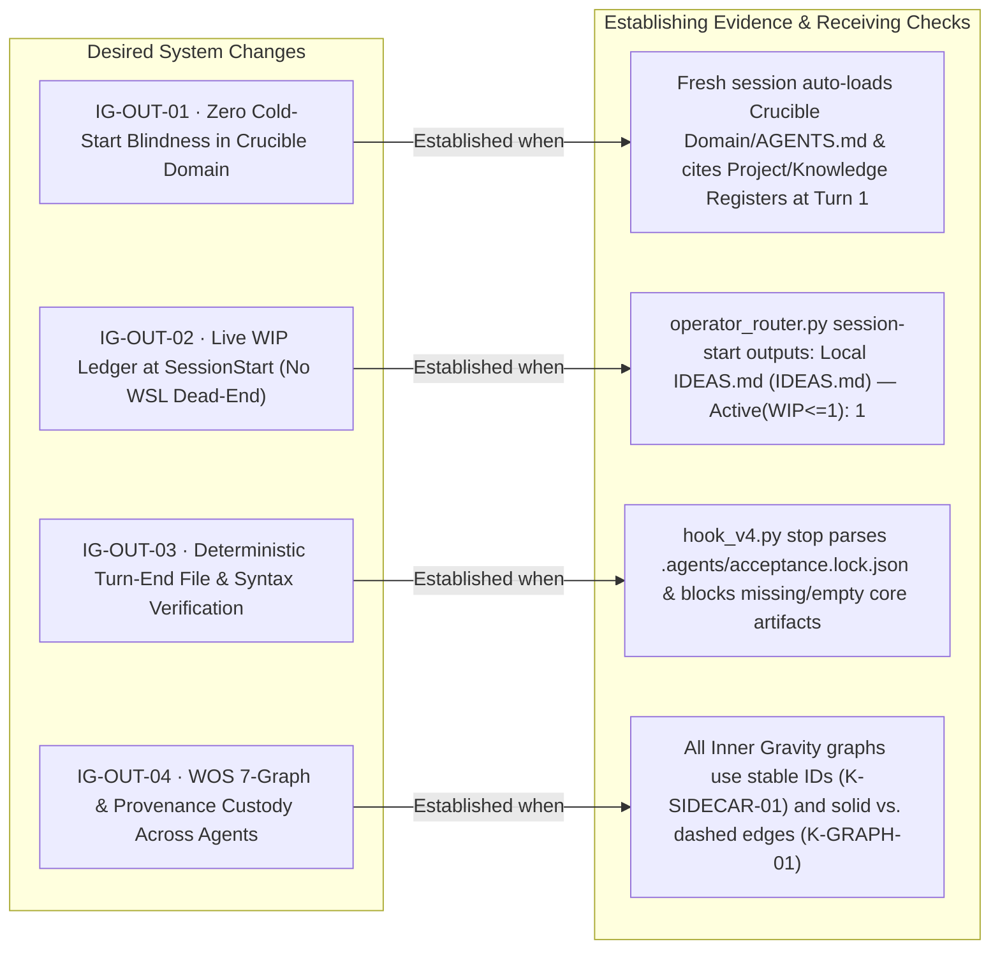

# 04 — Planning Decision Flow, Dependency Graph & Outcome Map (`IG-DEC`, `IG-PLAN`, `IG-OUT`)

**WOS Graph Types:**
- `Planning decision flow` (*How do we make a plan? Request, evidence, options, capacity, decisions, and authority.*)
- `Plan dependency graph` (*What needs to happen on this project? Named assignments, prerequisites, parallel work, and receiving checks.*)
- `Outcome map` (*What should change, and how will we know? Desired changes and the evidence that would establish them.*)

**Related Records:** `P-INNER-GRAVITY`, `P-WOS`, `K-WOS-01..03`, `K-ARCH-01..03`, `K-GRAPH-01`, `K-SIDECAR-01`

---

## 1. Planning Decision Flow: Upgrading the Harness for `Crucible Domain` (`IG-DEC-01`)

---

## 2. Plan Dependency Graph: Staged Installation & Receiving Checks (`IG-PLAN-01`)

**Current pickup.** Inspect the desktop Crucible Domain root for `AGENTS.md`, `IDEAS.md`, and `.agents/acceptance.lock.json`. The [Drive pack](https://drive.google.com/drive/folders/1gZJYLX5FEI97KIYnOCCT5wajx1w16GDZ) contains the staged ledger and normalized hooks file. The two protected workspace specifications are embedded in the [Inner Gravity README](https://drive.google.com/file/d/1pyrr2O0dMqXnehJpjbR_I8RlpcnVJNQ6/view). Record current desktop state before any operator installation. Drive visibility and a fresh local session are separate receiving checks.

Solid edges (`-->`) are **blocking prerequisites**; dashed edges (`-.->`) are **optional/advisory follow-ons** (`K-GRAPH-01`).

---

## 3. Outcome Map: Frontier Parity & WOS Alignment (`IG-OUT-01`)

---

## 4. Synthesis of the 4-Agent Frontier Benchmark & Upgrade Ledger

| Aspect | Observed or Reported Current Setup | Gap Identified | Proposed Change and Staging Status |
| --- | --- | --- | --- |
| **01 · Architecture & Locations** | Per-session baseline snapshots (`db-baseline.json`, `test-baseline.json`, `root-files-baseline.json`) + `skills.json` filtering | No workspace-local `AGENTS.md` or `IDEAS.md`; `.bak*` clutter; `antigravity/knowledge/` empty | Stages `install_pack/IDEAS.md`, embeds the protected `AGENTS.md` specification in the README, and maps `Crucible Domain/Knowledge/` (`Knowledge_Register.md` + `A01..A10`) as the canonical cross-project memory layer |
| **02 · Lifecycle & Hooks** | `hook_v4.py` AST & regex anti-reward-hacking (`RW-01..RW-11`), shell write-bypass blocking (`RW-03`), out-of-band test hash checks (`FM-BASE-01`) | Relative `./scripts/` path in `hooks.json`; `.agents/acceptance.lock.json` unwired | Embeds the protected `acceptance.lock.json` specification in the README and stages `install_pack/hooks.json.normalized`. Verify hook behavior in a fresh local session after authorized installation. |
| **03 · Tools, Skills & MCPs** | Progressive disclosure (lazy MCP schemas + on-demand `SKILL.md`); clean `browser` vs. `chrome-devtools-mcp` split; `subagent`/`workflow`/`swarm` range | Silent drift between `mcp_config.json` / `skills.json` (31 listed vs. 12 loaded) and live session; `gdocs`/`gsheets`/`gcalendar` disconnected | Documents exact verified vs. unverified capability inventory (`IG-CAP-01`) per `K-WOS-03` so plans never assume unverified tool access |
| **04 · WOS & Scale Readiness** | Strong individual safety & routing primitives | Graphs lacked `P-WOS` 7-graph typing, stable IDs (`K-SIDECAR-01`), and solid-vs-dashed dependency labeling (`K-GRAPH-01`) | Upgrades all `Inner Gravity` views to the `Work Operating System` 7-graph standard so agent and human handoffs share one visual and operational language |
