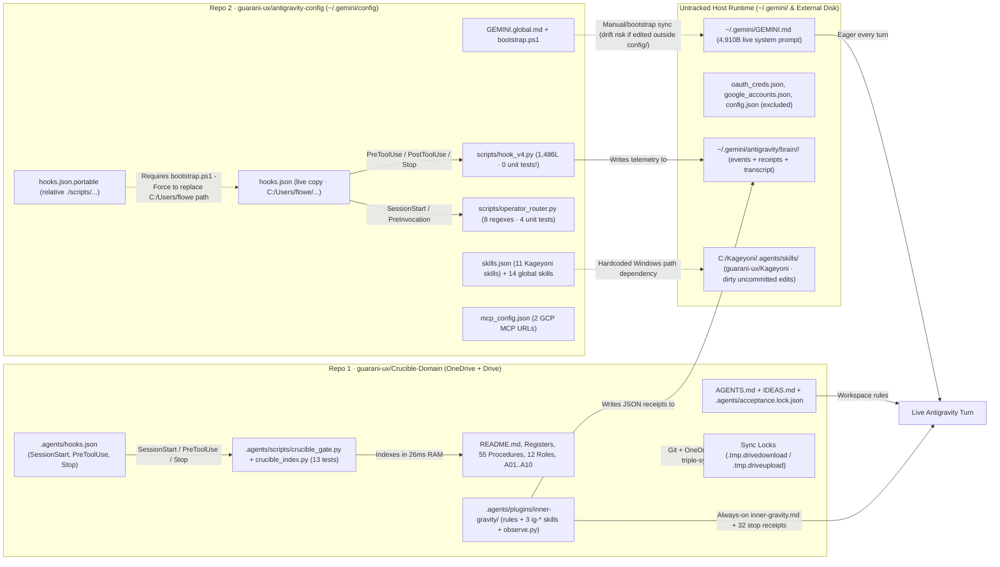
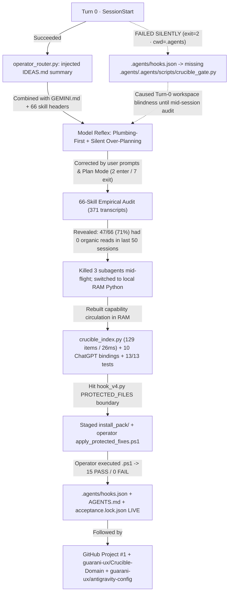
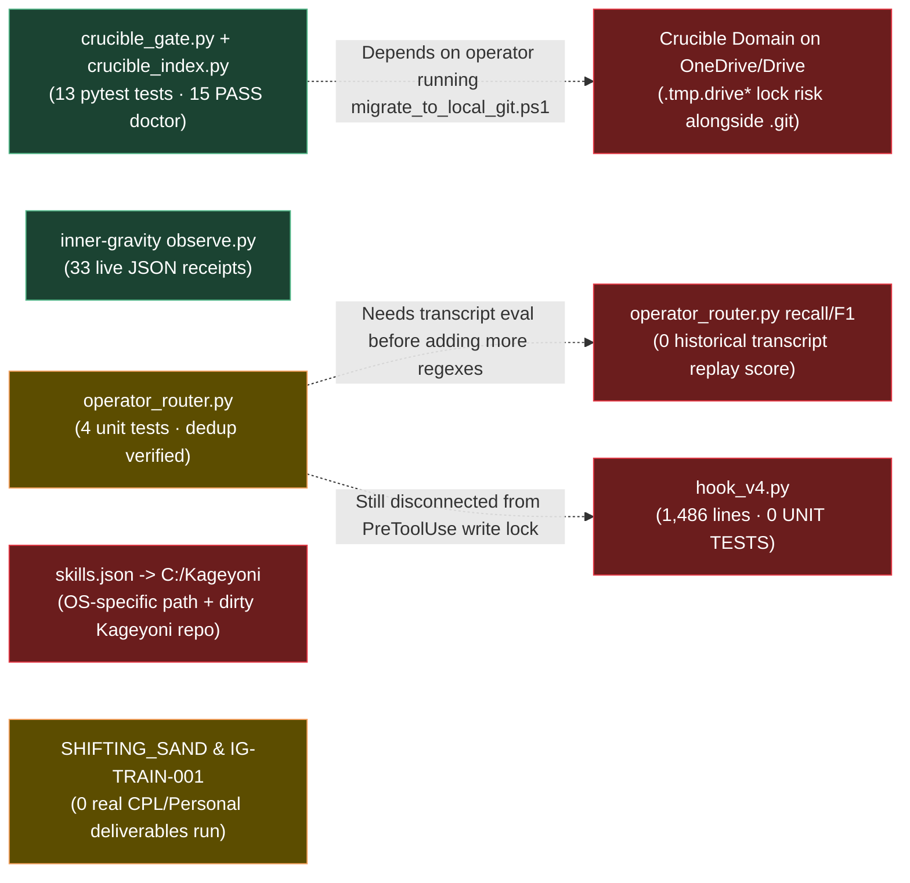

# 05 — Whole-System Observatory, Session `4188f88a` Causal Trace & Honest Gaps (`IG-OBS`, `IG-TRACE`, `IG-GAP`)

**WOS Graph Types:** `Target system architecture`, `Execution and provenance trace`, & `Outcome map` (`P-WOS` / `K-GRAPH-01` / `K-ARCH-03`)  
**Related Records:** `P-INNER-GRAVITY`, `P-CRUCIBLE-CIRCULATION`, `P-GOVERNANCE`, `P-STORAGE`, `K-WOS-03`, `K-ARCH-01..03`  
**Reproduce live metrics anytime:** `python "Project/Inner Gravity/collect_observatory.py"`

This document intentionally shows **both what works and what is weak, fragile, or untested** across `Crucible Domain`, `guarani-ux/antigravity-config`, external skill roots, and session `4188f88a-dc0c-4bba-96bb-c69ea9c4c1ee` (November 22–23, 2026).

---

## 1. Whole-System Topology & Cross-Boundary Coupling (`IG-OBS-01`)

Solid edges (`-->`) show **verified live active links**. Dashed edges (`-.->`) show **fragile, manual-sync, hardcoded-OS, or incomplete seams**.

---

## 2. What Actually Influenced Session `4188f88a` (`IG-TRACE-02`)

Observed from `reliability-events.jsonl` (`183` tool calls, `0` failed tool exceptions logged), `inner-gravity-observations/` (`33` lifecycle receipts), and `transcript.jsonl` (`364` steps, `37` user inputs, `5` model configs: `gemini-4-neon-xhigh/medium`, `claude-opus-5-5-medium`, `gemini-4-hydrogen-xhigh/high`):

### What Steered vs. What Failed to Steer in `4188f88a`
1. **Hard tool gates & Plan Mode actually steered execution:** `hook_v4.py` `PROTECTED_FILES` forced clean staged `.ps1` handoffs instead of silent protected-file edits; `plan_mode` (`2` entries, `7` exits) gated every Tier-1/Tier-2 jump.
2. **Passive prose skills mostly failed to fire:** Across `371` historical transcripts, `47/66` (`71%`) skills had `0` organic reads in the last `50` sessions (`domain-expansion` = `0`, `negative-space` = `0`, `diagnosing-bugs` = `0`, `visual-reflex` = `0`). Only hooked (`operator_router.py`) or always-on (`inner-gravity.md`) rules consistently fired.
3. **Broken local hook hid for an unknown duration:** `.agents/hooks.json` exited `2` silently because Antigravity runs hooks from the `hooks.json` directory (`.agents/`), not repo root — proving why closed-loop `cwd`-aware `doctor` checks are mandatory.
4. **Cloud/subagent latency vs. local RAM:** Spawning `3` parallel subagents (`0e65bb9c`, `18039589`, `bc2b584c`) was slower and less deterministic than running 1 local Python script in RAM (`<50ms` index build); all 3 were killed cleanly in favor of local RAM computation.

---

## 3. Hardening, Bottlenecks & Immaturity Matrix (`IG-GAP-01`)

### Exact Weakness & Immaturity Ledger (`[OBSERVED]`)

| Component | Maturity | Specific Weakness / Bottleneck | Evidence | Next Concrete Fix |
|---|---|---|---|---|
| `hook_v4.py` | **Enforced, Untested** | **`1,486` lines / `61.8 KB` with `0` unit tests**; any regex or AST regression fails silently or blocks valid work | `test_hook_v4.py` absent in `antigravity-config` | Add focused stdlib unit tests for `PROTECTED_FILES`, `RW-03`, and `stop()` |
| `operator_router.py` | **Partial** | `8` hand-written regexes with **no measured precision/recall** on historical prompts; not bridged to `PreToolUse` write locks | `4` synthetic unit tests only; no transcript replay run | Score against `brain/` prompt corpus (`K-ARCH-02`) before tuning |
| `skills.json` + `hooks.json` | **Fragile Portability** | `skills.json` hardcodes `C:/Kageyoni/.agents/skills`; live `hooks.json` still has `C:/Users/flowe/...` until `bootstrap.ps1 -Force` runs | Observed in `antigravity-config` + `collect_observatory.py` | Bundle/vendor needed skills into `antigravity-config` & apply `hooks.json.portable` |
| `GEMINI.md` sync | **Manual Seam** | Live `~/.gemini/GEMINI.md` sits outside `config/` Git tree; edits there drift unless synced to `GEMINI.global.md` | Outside `config/.git` | Run `bootstrap.ps1 -Force` or symlink `~/.gemini/GEMINI.md` |
| `Crucible Domain` storage | **Split-Brain Risk** | Git repo still lives inside OneDrive + Google Drive (`.tmp.drivedownload`, `.tmp.driveupload`) | `crucible_gate.py doctor` `[WARN]` | Run `migrate_to_local_git.ps1 -Apply` between sessions |
| Real domain deliverables | **Untested in Field** | `Calgary Public Library/` and `Personal Work/` have **`0` deliverables**; `SHIFTING_SAND` and `inner-gravity` `0.1.1` unproven on real work | `session-start` count `0 [EMPTY]` | Complete 1 `GROUND_TRUTH.md` intake + real deliverable (`P-DELIVERABLE`) |
