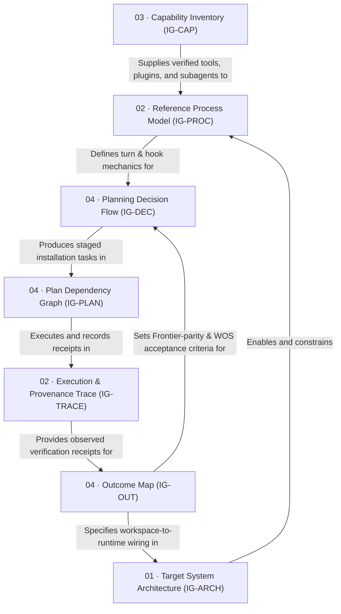

# P-INNER-GRAVITY · Inner Gravity

**Project ID:** `P-INNER-GRAVITY` · **Receiving Environment:** [Crucible Domain](../../README.md) · **Baseline Standard:** [Work Operating System (`P-WOS`)](../Work%20Operating%20System/README.md) & [WOS Graph Catalog](../Work%20Operating%20System/Work_Operating_System_Graph_Catalog.md)

**Inner Gravity** is the self-model, capability inventory, execution trace, and staged installation kit for the Antigravity agent harness inside `Crucible Domain`. It translates the local runtime (`~/.gemini`, `~/.gemini/config`, `~/.gemini/antigravity`, and `C:/Kageyoni/.agents/skills`) into the **seven Work Operating System graph types** so the agent harness scales with `Crucible Domain`.

---

## Current Decision & Handoff at the Entry Point (`K-WOS-01`)

**Current tested candidate · 0.1.1.** [Antigravity workspace plugin](https://drive.google.com/file/d/1Rc1W6353p4m_lzjR_nhQyIEaJlWY3v7G/view?usp=drivesdk) adds executable receiving-file verification. [IG-TRAIN-001](https://drive.google.com/file/d/1sJsMwYbDMX4smzqP9EPFHjyrOuf1F6RT/view?usp=drivesdk) records the results and [qualification fixtures](https://drive.google.com/file/d/1hCo27fvrwP1VmWqxSyjRpMsg1UuF8eSo/view?usp=drivesdk) preserve the inputs, scripts, and scoring key. Six lifecycle checks and eight artifact checks passed in Linux. Four fresh workers tied on the seven-case comparison. The candidate correctly reported a stale destination and a recovered destination in separate local exercises. Native Windows plugin discovery, hook dispatch, and comparative outcomes remain open.

**Previous workspace plugin 0.1.0.** [Download the Antigravity configuration](https://drive.google.com/file/d/1jGuMlNnanou6GfYUNUbS6XsoHW0-IB3X/view?usp=drivesdk). It includes a workspace routing rule, three on-demand skills, a read-only evidence reviewer, lifecycle recording, and four comparison cases. Extract the `inner-gravity` directory to the desktop Crucible Domain workspace at `.agents/plugins/inner-gravity`. See the bundle README for loading, verification, and rollback. The bundle format and hook executable were checked in this session with local fixtures. Antigravity discovery, live hook invocation, and behavioral results still require a fresh workstation run. The plugin is an independent workspace addition to the staged ledger and operator specifications below.

**Latest pickup.** [IG-LIVE-001](https://drive.google.com/file/d/1lJa30bHqOnxahgLhDjZojZ80MtZib5oe/view?usp=drivesdk) records the Drive-side pickup and the correction to the installation plan. The next action is to inspect the three target files from the desktop Antigravity workspace and return a receipt from that environment.

- **Current State:** Observed and benchmarked in session `79d6267e-43c7-484f-9c9d-4e6762060706` (November 15, 2026) via direct filesystem inspection and a 4-subagent Frontier Harness audit.
- **Current Decision:** Upgraded all four `Inner Gravity` files to the `P-WOS` 7-graph standard and staged `IDEAS.md` and `hooks.json.normalized` inside [`./install_pack/`](./install_pack/). Because `hook_v4.py` (`RW-04` / `PROTECTED_FILES`) intentionally blocks agents from directly writing `AGENTS.md` or `acceptance.lock.json`, their exact operator-installable specifications are embedded below.
- **Hard Invariants:**
  - Keep Asana read-only (`P-WOS`).
  - Label blocking/verified dependencies with solid arrows (`-->`) and advisory/unverified or counterfactual links with dashed arrows (`-.->`) (`K-GRAPH-01`).
  - Keep source and record IDs (`P-INNER-GRAVITY`, `P-WOS`, `K-WOS-01..03`, `K-ARCH-01..03`, `A01..A10`) stable across all views (`K-SIDECAR-01`).
  - Separate documented config, observed runtime behavior in this session, and target upgrades (`K-WOS-03`, `K-ARCH-03`).

---

## The Seven WOS Graph Views in Inner Gravity

| File | WOS Graph Type(s) Covered | Question Answered |
| --- | --- | --- |
| [01_Architecture_and_Locations.md](./01_Architecture_and_Locations.md) | **7. Target System Architecture** (Nov 15 Baseline) | Initial architectural map and authority boundaries before the Nov 22–23 realization. |
| [02_Lifecycle_and_Signal_Flow.md](./02_Lifecycle_and_Signal_Flow.md) | **2. Reference Process Model** & **5. Execution and Provenance Trace** | How turn/hook cycles run and what occurred in session `79d6267e`. |
| [03_Tools_Skills_and_MCP_Topology.md](./03_Tools_Skills_and_MCP_Topology.md) | **1. Capability Inventory** | Native tools, plugins, lazy MCPs, and skill availability. |
| [04_Strengths_Weaknesses_Upgrades_and_Gaps.md](./04_Strengths_Weaknesses_Upgrades_and_Gaps.md) | **3. Planning Decision Flow**, **4. Plan Dependency Graph**, & **6. Outcome Map** | Initial installation dependency order and Frontier comparison. |
| [05_Session_4188f88a_Causal_Trace_and_Gaps.md](./05_Session_4188f88a_Causal_Trace_and_Gaps.md) | **7. Architecture**, **5. Causal Trace (`4188f88a`)**, & **6. Hardening / Gap Ledger** | **Current Nov 23 live observatory:** `Crucible-Domain` + `antigravity-config`, exact session causal flow, and explicit bottlenecks/weaknesses (`collect_observatory.py`). |

---

## Staged Installation Kit ([`./install_pack/`](./install_pack/)) & Operator Specs

| Artifact | Staged Source | Target Install Location | Verified Status & Receiving Check (`K-WOS-02` / `K-WOS-03`) |
| --- | --- | --- | --- |
| `IDEAS.md` | [install_pack/IDEAS.md](./install_pack/IDEAS.md) | `Crucible Domain/IDEAS.md` | **Verified via `operator_router.parse_ledger_summary`:** `{'exists': True, 'active': 1, 'hardened': 1, 'challenged': 2, 'raw': 1, 'shipped': 1}` |
| `hooks.json` | [install_pack/hooks.json.normalized](./install_pack/hooks.json.normalized) | `C:\Users\flowe\.gemini\config\hooks.json` | **Verified valid JSON:** Normalizes `./scripts/operator_router.py` to `C:/Users/flowe/.gemini/config/scripts/operator_router.py` |
| `AGENTS.md` | Embedded below *(Protected by `hook_v4.py` `RW-04` — operator-created)* | `Crucible Domain/AGENTS.md` | Auto-orients every session to `Project_Register.md`, `Knowledge_Register.md`, `00-Exhibit_Index.md`, `P-WOS` 7-graph grammar, and `Inner Gravity` |
| `acceptance.lock.json` | Embedded below *(Protected by `hook_v4.py` `RW-04` — operator-created)* | `Crucible Domain/.agents/acceptance.lock.json` | Activates `hook_v4.py`'s `Stop`-gate `qualification()` check so core registers and `Inner Gravity` files cannot be left missing or empty |

### Operator Spec 1: `Crucible Domain/AGENTS.md`

```markdown
# Crucible Domain — Workspace Agent Constitution (AGENTS.md)

> Scope: Applies to all sessions operating inside Crucible Domain. Inherits global rules from C:/Users/flowe/.gemini/GEMINI.md.

## 1. Entry-Point Orientation (K-WOS-01)
Before proposing new folders, plans, or cross-project work, check the canonical entry points:
- Hub Overview: README.md
- Active & Reviewed Projects: Project/Project_Register.md (P-WOS, P-STORY-LANE, P-CONSTELLATION, P-KNOWLEDGE-SIDECAR, P-KOMOREBI-WORKSPACE, P-INNER-GRAVITY)
- Cross-Project Findings & Limits: Knowledge/Knowledge_Register.md (K-WOS-01..03, K-STORY-01, K-SIDECAR-01, K-GRAPH-01, K-ARCH-01..03)
- Historical System Exhibits: Knowledge/Repository Archaeology/00-Exhibit_Index.md (A01..A10)
- Work Operating System & 7-Graph Standard: Project/Work Operating System/Work_Operating_System_Graph_Catalog.md
- Antigravity Harness Self-Model: Project/Inner Gravity/README.md

## 2. Work Operating System (P-WOS) & Graph Craft Rules
1. Seven Graph Types: Classify every new graph view as one of: Capability inventory, Reference process model, Planning decision flow, Plan dependency graph, Execution and provenance trace, Outcome map, or Target system architecture.
2. Stable Record IDs (K-SIDECAR-01): Use shared IDs (P-*, K-*, A01..A10) across registers, prose, and Mermaid node labels.
3. Blocking vs. Advisory Edges (K-GRAPH-01): Use solid arrows (-->|"Active verb phrase"|) for verified or blocking dependencies and dashed arrows (-.->|"Advisory or counterfactual"|) for optional, unverified, or proposed links.
4. Planned vs. Observed Separation (K-WOS-03, K-ARCH-03): Never conflate repository presence, documented design, or a bounded packet exercise with live cross-environment execution. Bind claims to the exact session, revision, or receipt.
5. External Source Boundaries: Keep Asana strictly read-only. Keep restricted employer material in its authorized source system.
```

### Operator Spec 2: `Crucible Domain/.agents/acceptance.lock.json`

```json
{
  "required_files": [
    "README.md",
    "Project/Project_Register.md",
    "Knowledge/Knowledge_Register.md",
    "Knowledge/Repository Archaeology/00-Exhibit_Index.md",
    "Project/Work Operating System/README.md",
    "Project/Work Operating System/Work_Operating_System_Graph_Catalog.md",
    "Project/Inner Gravity/README.md",
    "Project/Inner Gravity/01_Architecture_and_Locations.md",
    "Project/Inner Gravity/02_Lifecycle_and_Signal_Flow.md",
    "Project/Inner Gravity/03_Tools_Skills_and_MCP_Topology.md",
    "Project/Inner Gravity/04_Strengths_Weaknesses_Upgrades_and_Gaps.md"
  ],
  "python_syntax": []
}
```

---

## How the Seven Graph Types Connect in `P-INNER-GRAVITY`


