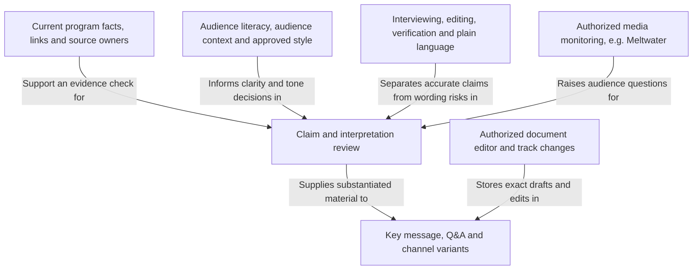
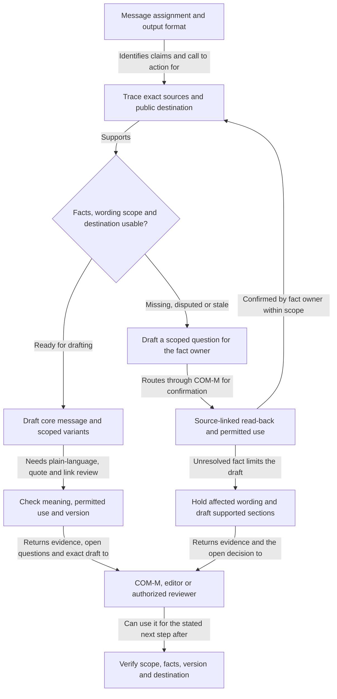
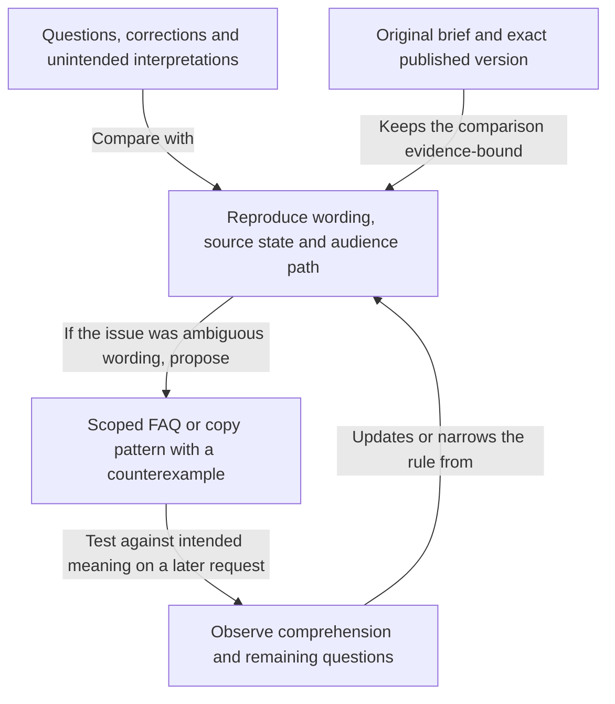

# COM-S — Communications Strategist or Specialist

Use this role to investigate a brief, substantiate claims, compose an audience-ready message, prepare scoped variants and report what people understood or asked. An agent may research and draft in the assignment's authorized scope. A named human retains approval and external distribution authority.

## Capability graph

Know how to verify quotes and claims against their date and source scope, preserve a common factual base across formats, and use plain language without stripping qualifiers. Treat a draft Board packet or monitoring alert as an input whose status affects how it can support a claim. Verify the institution's actual style source before applying it.

## Execution graph

If one section is held, mark it visibly and continue drafting the independent sections. Where a provisional handoff is permitted, identify exactly which language and recipient uses it covers. Record any final-only use and the version the receiver will need.

**Programme or subject matter expert fact check · MA-G01.** State which draft or decision needs the fact. Attach the exact wording and dates of the conflicting records. Draft the smallest question that would resolve the difference. The campaign coordinator or COM-M identifies the service or fact owner and routes the question if authorized. Read back the answer as one proposed claim or clearly scoped choice, with the source, date, qualifications and intended use. The owner verifies that interpretation. While awaiting confirmation, return the evidence and independently supported draft with the disputed language visibly held. Fact confirmation and approval to send or publish are separate decisions.

## Learning loop

## Agent assignment

| Field | Run instruction |
| --- | --- |
| Trigger | Draft or review a script claim, announcement, media response, internal note, FAQ, web copy or partner wording. |
| Minimum inputs | Requested message and intended audience action, channel, approved or proposed direction, exact evidence and dates, destination, permitted audience and reviewer. |
| Permitted actions | Read authorized sources and Asana read-only. Audit claims, compare context, test a public destination where permitted and draft clearly marked language. Record any tools used and limits. |
| Stop or route | Hold the affected text when a claim is unsourced, an intended-use statement is ambiguous, or the recipient needs a final version. Route a precise question through COM-M or the named fact owner. Preserve independently grounded drafting. |
| Return and acceptance | Return a versioned draft, exact source anchors, reusable claims, open questions and destination check. The reviewer can validate each consequential statement and see which variants can proceed, subject to review. |

## Evidence

- The [Edmonton Public Library Communications Specialist employer-text mirror](https://www.jobs.ca/edmonton-public-library/jobs/communications-specialist-epl-marketing-and-communications-division-canada-c5f14c10cbdf) covers communications projects, media support, reporting and tools such as Meltwater and Canadian Press style. It is a comparator for specialized work.
- The Calgary Public Library [Educators hub](https://www.calgarylibrary.ca/connect/educators) and [Stop Motion resource](https://www.calgarylibrary.ca/connect/educators/stop-motion) provide an observed example of conflicting grade and subject labels across a message and its destination. The service owner is the proposed route for the intended audience.
- Graphs model a recommended draft and review practice. Local role ownership and tool access depend on current authorization and case evidence.
