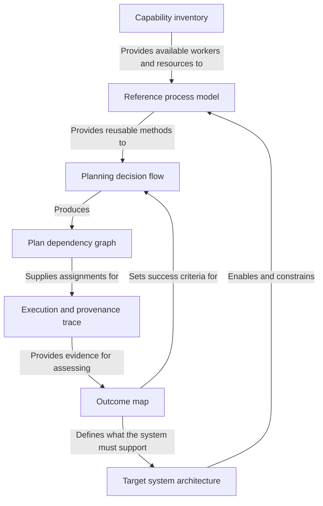
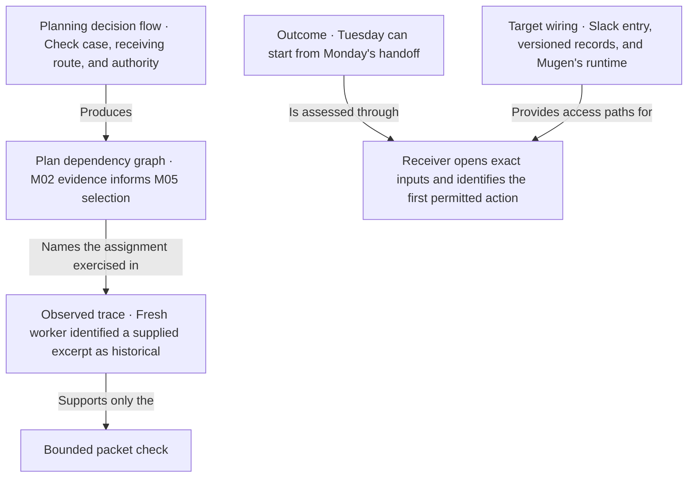

# Work Operating System Graph Catalog

This catalog records the seven graph types Levi selected. The Mermaid blocks are editable source. The FigJam boards provide the visual working views.

- [Graph catalog in FigJam](https://www.figma.com/board/1Cm8xnOs3zzLFpahMabx4T)
- [Monday planning board in FigJam](https://www.figma.com/board/7LOb9fzEM6BzYY9eoBCgjW)

## The seven graph types

| Type | Question | Records and relationships |
| --- | --- | --- |
| Capability inventory | What can we use, and where? | Tools, skills, workflows, agent profiles, optional personas, and graph artifacts. Record availability and verified access by environment. |
| Reference process model | How do we do this kind of work? | A reusable method showing who acts, which skills and tools they use, what they produce, and who receives it. |
| Planning decision flow | How do we make a plan? | Request, evidence, options, capacity, decisions, and authority. |
| Plan dependency graph | What needs to happen on this project? | Named assignments, prerequisites, parallel work, and receiving checks. Monday is the first example. |
| Execution and provenance trace | What actually happened? | The actor, operation, exact input and output versions, evidence, and receiving decision. |
| Outcome map | What should change, and how will we know? | Desired changes and the evidence that would establish them. |
| Target system architecture | How should the system be wired? | Components, interfaces, information flows, and authority boundaries. |

Use the same identifier for the same record across views. Keep planned events and observed execution distinct. Maintain a separate view when it helps a reader make a distinct decision.

## How the graph types connect



## Starter capability inventory

This example illustrates the relationships. Confirm tool access in the environment where the work will run.

```mermaid
flowchart TD
    mugen["Agent profile · Mugen"] -->|"Operates in"| runtime["Mugen's computer"]
    mugen -->|"May consult"| chat["Support endpoint · This chat"]
    persona["Optional persona guidance"] -->|"May guide communication for"| mugen
    mugen -->|"Coordinates"| workflow["Recover evidence and prepare a handoff"]
    workflow -->|"Calls for"| skill["Inspect and qualify evidence"]
    workflow -->|"Uses only where access is verified"| tool["Asana read operations"]
    runtime -->|"Determines availability of"| tool
    workflow -->|"Is instantiated in part by"| graph["Monday plan dependency graph"]
```

## Monday example



For the observed run, the worker only used a supplied historical excerpt. Live source access and the cross-agent return route remain separate checks. Keep Asana read-only.
