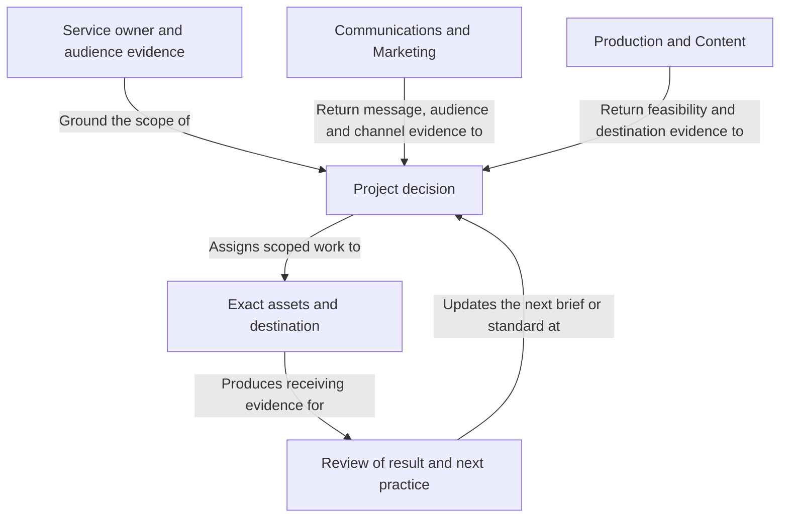

# Work Operating System · Media roles and Calgary Public Library practice

Research and proposed operating model · November 15, 2026 · Calgary

This guide separates four disciplines and three levels of responsibility. Use it to determine which expertise an assignment needs, who can act, and what a useful return looks like. It draws on public employer job descriptions, Calgary Public Library public records, and the opening role-description text of the supplied June 2024 Media Production Specialist document. The proposed responsibilities and judgments are a work design. Confirm assignments and approvals against the actual organization and project.

## 1. How to tell the roles apart

| Level | What the role handles | Typical output | What changes with experience |
| --- | --- | --- | --- |
| **Director or executive discipline lead** | Sets direction, defines the standard, allocates or sponsors major priorities, and handles cross-portfolio tradeoffs and escalations within delegated authority. | Strategy, scope decision, posture on a sensitive issue, portfolio priorities, major review or recommendation. | Learns which risks recur, where shared standards help, and which decisions services or partners need to retain. |
| **Manager, lead, or producer** | Converts direction to work. Owns the queue, plan, resourcing, timing, dependencies, and review route within scope. Coordinates specialist returns and escalates conflicts. | Workback, brief, crew or campaign plan, decision record, review schedule, ready-to-deliver package. | Learns where effort, waiting, review, and coordination really sit. Revises staffing, briefing, sequencing, and escalation based on observed misses. |
| **Specialist, strategist, coordinator, or operator** | Exercises hands-on professional judgment. Investigates, develops options, produces or operates, checks the result, and returns the work with evidence and limits. | Source-linked recommendation, script, cut, programme copy, publication package, media plan, content record, or playback check. | Learns when a method works, which cues predict trouble, and what a receiver needs to act without rework. |

Titles vary. A director of content strategy can be a lead individual contributor. A senior producer may assign and coach staff while working hands-on. A production director can mean the creative lead for a portfolio or the person calling a live show. Record the actual responsibility, scope, and authority for the assignment. [Toronto Public Library management scope](https://tpl.ca/contact/management-staff/) · [College Board Director, Content Strategy](https://collegeboard.wd1.myworkdayjobs.com/en-US/Careers/job/Director--Content-Strategy_REQ002846) · [CBC Senior Producer, Video Experience posting mirror](https://movojobs.ca/cbc-radio-canada/jobs/senior-producer-video-experience-english-services-on-site-3086538)

### Calgary Public Library evidence and limits

The public leadership page identifies Melanie Nicholson as Acting Director, Communications overseeing Communications, Marketing, and Production in the reviewed snapshot. Older Board records use different role-holder names and titles, so carry their date with them. The Media Centre names a press contact and offers separate routes for logos and photography guidance. These establish public routing. Specific review and release authority comes from the current project or authorized institutional source. The Calgary Public Library Foundation is a separate organization and its job profile is used as a comparator. [Leadership](https://www.calgarylibrary.ca/about-the-library/library-leadership) · [Media Centre](https://www.calgarylibrary.ca/about-the-library/media-centre) · [Foundation Director profile](https://libraryfoundation.ca/wp-content/uploads/2026/03/CPLF_JobOpp_DCDE_Mar2026.FINAL_.pdf)

The supplied June 2024 Media Production Specialist role section covers internal and external photo, video, audio, and livestream work. It includes pitches and scripts, directing and capture, image consent forms, brand and quality control, editing and motion graphics, production calendar, inventory, YouTube maintenance, and performance measurement. The opening role description establishes professional range. The supplied PDF changes abruptly into a separate technical workflow section midway through page 2. This guide used the opening role description and excluded those appended technical instructions as evidence of institutional workflow or software requirements.

## 2. Communications

**Working question.** What can the institution say or explain, to whom, with what evidence, tone, timing, and authority?

| Role | Explicit comparator scope | Practical judgment and workflow to model |
| --- | --- | --- |
| **Communications Director** | Foundation profile connects message, brand, executive advice, spokesperson readiness, and team leadership. London Public Library combines strategy, internal and external communication, creative, and website work with IT. | Turn an institutional decision into a public or staff position. Judge which issue needs executive, service-owner, privacy, cultural, or legal input. Set approved facts, spokesperson, audiences, sequence, and unanswered questions. Learn from repeated misunderstandings, correction cost, and whether replies reached the actual audiences. |
| **Communications Manager** | Prince George Public Library oversees official internal and external messaging, staff, strategic planning, media liaison, and community engagement. | Triage coverage and requests. Assign drafting or media response. Resolve factual owners, set copy and review windows, coordinate staff and public messages, and route escalations. Inspect timing and handoff failures after release. Adjust triage thresholds, source-owner routing, and response windows when repeated cases support a change. |
| **Communications Strategist or Specialist** | Edmonton Public Library posting describes bounded communications projects, messages, plans, media support, and reporting. | Verify a claim with its owner, test whether the audience will understand the wording, draft the note or statement, and carry unresolved facts visibly. Adapt one substantiated message to press, staff, social or branch use. Compare intended and actual public questions, and update source-linked FAQs or message guidance. |

**Tools and working objects.** The London comparator names Office 365. Prince George lists Microsoft Office, Adobe, web and social tools. The Edmonton specialist employer-text mirror names Meltwater and CP Style. These support drafting and review, media monitoring, and editorial consistency. The proposed workflow is verified source claim → key message or Q&A → scoped approval → distribution → response log. A dashboard alert can suggest a new issue. It takes context and the authorized owner to classify criticism, a service problem, a sensitive inquiry, or a factual error. [Foundation job profile](https://libraryfoundation.ca/wp-content/uploads/2026/03/CPLF_JobOpp_DCDE_Mar2026.FINAL_.pdf) · [London Public Library employer posting](https://pillarnonprofit.ca/job/director-%E2%80%93-communications-and-development/london-public-library) · [Prince George Public Library manager description](https://www.pgpl.ca/sites/default/files/postings/Manager%20of%20Communications%20and%20Engagement%20Job%20Description.pdf) · [Edmonton Public Library specialist posting mirror](https://www.jobs.ca/edmonton-public-library/jobs/communications-specialist-epl-marketing-and-communications-division-canada-c5f14c10cbdf)

## 3. Marketing

**Working question.** What audience behaviour can we help change, which barriers are within our control, and where is capacity best spent?

| Role | Explicit comparator scope | Practical judgment and workflow to model |
| --- | --- | --- |
| **Marketing Director** | University of Waterloo director posting covers institutional brand, positioning, research, channel direction, governance, and performance frameworks. | Decide the audience and outcome priorities, what gets investment, and which audience or distribution bets to test. Judge whether a campaign can move the outcome through awareness, improved access, a different message, or partner reach. Compare results over seasons, audiences and services before reallocating effort. |
| **Marketing Manager** | Edmonton Public Library manager posting covers intake, triage, resources, integrated campaigns, and brand measurement. Toronto Public Library marketing operations posting covers portfolio planning and process improvement. | Convert service request and audience need into a brief, channel plan, schedule and measurement plan. Check real capacity for production, design and reviews. Choose which requests warrant a full campaign, a lightweight response, or a different route. Learn from execution bottlenecks, repeated rework and segments that fail to take the next step. |
| **Digital Marketing Specialist or Coordinator** | Grimsby Public Library posting names web, email, social, public enquiries and analytics. An attributed Calgary Public Library Coordinator, Digital Marketing posting mirror describes production coordination, campaigns, editorial calendar, paid social measurement, and community responses. | Adapt a message and creative to the placement, test the destination from the patron side, schedule authorized variants, and route service questions. Interpret reach, clicks and service actions separately. Compare placement, timing, creative and destination with the baseline before proposing the next test. |

**Tools and working objects.** Grimsby explicitly lists WordPress, Canva, Adobe Creative Suite, Microsoft Office and social platforms. The attributed Calgary Public Library mirror gives Sprout Social as an example and names Google Ads and email/web support. FUSE Create's agency role illustrates audience research, media choices, campaign setup/QA, optimization and reporting. Translate accordingly into an intake brief, audience hypothesis, channel and calendar plan, assets, destination check, reporting view and next test. Use each tool according to actual access and scope. [Waterloo director posting](https://uwaterloo.wd3.myworkdayjobs.com/en-CA/uw_careers/job/Director--Brand--Marketing-and-Research_2026-01769-1) · [Edmonton Public Library manager employer-text mirror](https://www.jobsinab.com/jobs/2175/manager-marketing-brand) · [Toronto Public Library Marketing Operations posting mirror](https://www.jobs.ca/toronto-public-library/jobs/senior-manager-marketing-operations-ontario-3ed773c3379a) · [Grimsby Public Library coordinator PDF](https://www.grimsbylibrary.ca/media/gobnbq5p/marketing-and-communications-coordinator.pdf) · [Calgary Public Library digital marketing posting mirror](https://placementbaba.com/job/coordinator-digital-marketing-at-calgary-public-library-in-calgary-134798) · [FUSE Create agency roles](https://fusecreate.com/job/)

## 4. Media production

**Working question.** What should the audience see, hear or be able to do, and what can the crew deliver reliably at the required quality?

| Role | Explicit comparator scope | Practical judgment and workflow to model |
| --- | --- | --- |
| **Creative or Media Production Director** | CIBC Media Centre creative director posting covers creative vision, branded campaigns, multimedia delivery, visual treatment, coaching and review across partners. | Define what the work should communicate and feel like, and what creative choices serve that intent. Choose full production, archival, simplified or alternate treatment with the producer. Establish review and escalation boundaries for craft, representation and consequential messaging. Study which creative changes paid off in viewer comprehension or reduced review, and retain counterexamples. |
| **Production Manager, Producer or Production Lead** | TVO Digital Media Production manager oversees producers and concurrent production, accessibility, education aims, workflow improvement and creative/operational balance. Arts Commons adds a local live-production comparator for simultaneous calendars, crew calls and venue coordination. | Turn the brief into feasible scope, crew roles, asset and approval dependencies, schedule, rehearsal, and review. Distinguish what is technically possible from what one crew can safely operate. Reallocate coverage when an assumption fails. Learn from setup, capture and edit time, repeated notes, delays, playback issues and usable contingency performance. |
| **Media Production Specialist, Editor or Operator** | Supplied Calgary Public Library role spans photo/video/audio/live. McGill multimedia posting gives a concrete path from client needs and estimate to scripts, capture, edit, motion graphics, asset organization and distribution. | Write or interpret an A/V script, inspect assets, direct or operate, edit, check intelligibility, framing, caption timing and source fidelity, and return exact version with evidence. Decide when an alternate shot or audio choice solves the problem and when a controlling decision must reopen. Keep a record of which treatments worked for which audiences and conditions. |

**Tools and working objects.** CIBC lists Microsoft Office and Adobe Creative Suite at comparator level. McGill names PowerPoint and YouTube. Loyola Marymount University names Premiere Pro, DaVinci Resolve, After Effects and Photoshop as production tools. The Work Operating System design discusses Teams, Story-Lane and YouTube as possible parts of its workflow. Match the specific tool to the purpose. Use camera and signal-chain evidence for capture or stream, a playback check for comprehension and accessibility, and a versioned file or link for review. Use the call sheet, run of show, A/V script, asset manifest, cut and receiving evidence as distinct working objects. [CIBC role](https://cibc.wd3.myworkdayjobs.com/en-US/search/job/Creative-Director--Media-Centre--1--year-contract-_2620832) · [TVO role](https://recruiting.ultipro.ca/TVO5000TVOO/JobBoard/5ff80775-069d-4e87-9adc-94455820b5c9/OpportunityDetail?opportunityId=c1c4e6cd-3ec6-45e1-9a2a-e5052581c467) · [Arts Commons live-production manager profile](https://www.artscommons.ca/hubfs/Job%20Posting%20-%20Associate%20Production%20Manager.pdf?hsLang=en) · [McGill multimedia role](https://mcgill.wd3.myworkdayjobs.com/en-US/McGill_Careers/job/James-Admin-Bldg/Multimedia-Producer_JR0000082933) · [Loyola Marymount producer role](https://lmu.wd1.myworkdayjobs.com/en-US/Careers/job/Video-Producer_R16393) · [Local work design](https://github.com/guarani-ux/Work-Operating-System/blob/main/docs/work-design.md)

## 5. Content management and editorial operations

**Working question.** How does useful content stay findable, current, accessible and actionable across documents, pages, catalogues, assets and channels?

| Role | Explicit comparator scope | Practical judgment and workflow to model |
| --- | --- | --- |
| **Director of Content Strategy, Editorial Lead or Digital Content Director** | College Board director role owns a domain's content strategy, taxonomy, navigation, evidence and lifecycle, and can work hands-on. Toronto Public Library separates content strategy and editorial from other manager functions within a broader division. | Decide how content maps to user tasks. Set standards for source authority, navigation, metadata, retention, and reuse. Decide when a new page or series helps and when existing content should be improved or retired. Learn from search terms, unmet needs, content duplication, support requests and observed task completion. |
| **Content or Digital Publishing Manager** | LCBO manager role covers publishing queue, schedules, escalations, lifecycle and preproduction/live QA. The scope crosses website, email and app. | Govern intake and priority, assign editing and publishing, and coordinate the owning service, web, marketing and IT teams. Test previews, variants, links, accessibility and rollback where applicable. Maintain an expiry or review owner. Learn which upstream handoffs generate broken or stale pages, and which patterns make routine publishing reliable. |
| **Content Specialist, Web Producer, or Digital Asset Steward** | LCBO Digital Asset Librarian role covers AEM asset intake, metadata, quality, version history, renditions and rights or expiry. Grimsby names content editing and publishing responsibilities at specialist level. | Edit and structure accessible content, maintain provenance and exact copies, apply taxonomy and credits, check links and external routes, and verify the receiving surface. Escalate contested facts, permissions and architecture changes. Record repeated search failures, label confusion and stale links so owners can improve the template or information model. |

**Tools and working objects.** The LCBO postings name Adobe Experience Manager and, for digital publishing, Magento, Adobe or Google Analytics, and examples of work-tracking tools. Grimsby names WordPress. Use these as comparator evidence for CMS, digital asset management, ticketing and analytics functions. Calgary Public Library's public pathways visibly link to BiblioCommons, programme routes, PDFs, YouTube and selected third-party resources. These observations do not establish what internal CMS or asset library Calgary Public Library uses. A content record should carry controlling fact or source, public destination, version, accessibility check, rights or approval scope, review date and owner. [College Board role](https://collegeboard.wd1.myworkdayjobs.com/en-US/Careers/job/Director--Content-Strategy_REQ002846) · [Toronto Public Library organization](https://tpl.ca/contact/management-staff/) · [LCBO publishing manager](https://lcbo.wd3.myworkdayjobs.com/en-US/LCBOCareerSite/job/Manager--Digital-Publishing_JR26-29240) · [LCBO asset role](https://lcbo.wd3.myworkdayjobs.com/en-US/LCBOCareerSite/job/Digital-Asset-Librarian_JR26-28898-1) · [Grimsby coordinator](https://www.grimsbylibrary.ca/media/gobnbq5p/marketing-and-communications-coordinator.pdf)

### Where the disciplines share a decision

A Capilano University director profile is a useful example of overlap. The same director leads marketing and digital experience, commissions research, and arbitrates website structure and user-experience questions. Its tool examples include search, content and customer platforms, email, channel platforms, and analytics. Edmonton Public Library's Digital Communications Specialist employer-text mirror provides a more granular web workflow. It covers web and intranet publication and retirement, links and redirects, accessibility, usability, and acceptance testing with IT or a vendor. It names examples including CMS tools, GA4, Search Console, Figma and HTML/CSS. A larger organization can separate these functions. A smaller one can assign related decisions to the same person. [Capilano University role](https://www.capilanou.ca/media/capilanouca/about-capu/connect-with-capu/employment/admin-job-descriptions/Director-Marketing-and-Digital-Experience.pdf) · [Edmonton Public Library digital role mirror](https://muniserv.ca/jobs/epl-digital-communications-specialist-marketing-and-communications-division-bq797)

A public 2022 Calgary Public Library commission distributed work across a designated writer, video producer, animator, library approval, and educators as receivers. It proposed bringing an existing physical Treaty 7 classroom tool into video. The producer would coordinate live action, animation and edit. The animator would develop and review storyboards before animation. One supplier could cover both scopes. The commission documents planned handoffs. Obtain separate evidence for cultural authority, current reuse permission, delivery, and learning. [Quickdraw Animation Society commission](https://quickdrawanimation.ca/opportunities/job-postings/animator-and-video-producer-calgary-library)

## 6. Calgary Public Library institutional knowledge

### The service and governance map

The 2027–2030 plan, launched publicly October 27, 2026, organizes service around **Expertise, Spaces, Collections, Technology, and Experiences**. Its values include curiosity, collaboration, equity and belonging. The commitments include intellectual freedom, truth and reconciliation, and intentional innovation. The 2040 vision that three in four Calgarians choose the Library is a long-horizon organizational goal. A campaign brief needs a more immediate audience, service action and evidence of its own. Retain the effective planning period with relevant historical comparisons. [2027–2030 strategy](https://www.calgarylibrary.ca/about-the-library/strategic-plan) · [Launch announcement](https://www.calgarylibrary.ca/library-news/calgary-public-library-sets-bold-vision-for-growth-to-2040) · [Prior plan and publications](https://www.calgarylibrary.ca/about-the-library/publications)

The public leadership functions give a first route for resolving facts. Service Design and programme owners can establish what a service is meant to do. Visitor Experience can speak to what happens at locations. Strategy and Planning can qualify institutional measures. Technology or the actual platform owner can help establish whether a digital route works. Communications, Marketing, and Production turn these facts into usable public and internal materials within their delegated scope. Verify the current project owner, approvals and any partner's authority. [Calgary Public Library leadership](https://www.calgarylibrary.ca/about-the-library/library-leadership)

### What the Board records can teach the Work Operating System

| Source and status | What the record establishes | What to capture in the work |
| --- | --- | --- |
| **June 28, 2023 approved Board minutes** · campaign report and CEO report discussion | The account describes demographic cardholder evidence from Strategy and Planning informing the *This Ad is For* campaign with Marketing and Production, and records recognition of the campaign. The Board asked Administration to consider the CEO report format without requesting an immediate change. | Connect data source to audience choice, creative work and report. Keep external recognition, audience outcome and attribution distinct. Record discussion, delegated follow-up, and an approved commitment separately. [Approved minutes](https://www.calgarylibrary.ca/assets/2023-06-28-Board-Minutes-approved.pdf) |
| **September 25 and November 27, 2024 approved Board minutes**, followed by **January 29, 2025 approved minutes** | Board records provide service, engagement and facility context. The later records document disruption and subsequent recovery work. | Give service availability and public messaging separate owners and timestamps. Attach reporting caveats when service or data collection was disrupted. Preserve the authority for each public claim in the intended release context. [September 2024 minutes](https://www.calgarylibrary.ca/assets/2024-09-25-Board-Minutes.pdf) · [November 2024 minutes](https://www.calgarylibrary.ca/assets/2024-11-27-Board-Minutes.pdf) · [January 2025 minutes](https://www.calgarylibrary.ca/assets/2025-01-29-Board-Minutes-approved.pdf) |
| **March 19, 2025 Board packet** · CEO reporting | The report identifies the stop-motion film *Page*, a partner contribution and a dated YouTube view and watch-time snapshot. The public educator site now provides stop-motion materials and videos. | Link partner contribution, actual asset, educator use, public destination and reach evidence. Assess teacher uptake, use, or learning separately. [March packet](https://www.calgarylibrary.ca/assets/2025-03-19-Board-meeting-materials.pdf) · [Stop Motion destination](https://www.calgarylibrary.ca/connect/educators/stop-motion) |
| **June 11, 2025 Strategy and Community draft minutes**, in the **June 25 Board packet** | Civic engagement planning included groups such as newcomers, first-time and Indigenous voters and discussed peer practice, feedback, and evergreen education. The public election offer later included learning and event routes. | Preserve the original audience need, the research that shaped it, the service owner's facts, what belongs to the election cycle, and what can remain available as evergreen learning. [June packet, committee section](https://www.calgarylibrary.ca/assets/2025-06-25-Board-Meeting-Materials-Web.pdf) · [Public election release](https://www.calgarylibrary.ca/library-news/get-election-ready-with-calgary-public-library) |
| **September 24, 2025 Board packet** · CEO reporting | Ultimate Summer Challenge reported nearly 20,000 registrants and identified branch displays, giveaways and events as part of the programme. | Treat registration, ongoing participation, reach and attribution as distinct. Log branch and digital pathways, dates, and interventions before interpreting results. [September packet](https://www.calgarylibrary.ca/assets/2025-09-24-Board-Meeting-Materials.pdf) |
| **November 26, 2025 Board packet** · CEO report, proposed strategic outline and embedded October 8 draft committee minutes | The proposed outline links engagement and operational objectives to budgeting and communications for launch. Committee material describes different changes across online engagement, account creation, and web activity, with period, season and technical context. The CEO report records civic engagement resources and distinct in-person, livestream and replay observations. | Record whether an item was proposed, reported, received for information or approved. Carry the denominator, time window and plausible explanations with each metric. Let the relevant owner qualify causal claims. Link research, public launch, observed use and continuing service content. [November packet, pp. 12–22](https://www.calgarylibrary.ca/assets/2025-11-26-Board-Meeting-Materials-Web.pdf) |

The Board's public archive points from the legacy meeting information page to its Community portal for newer material. Selected 2023–25 approved minutes and packets were read directly. The newer portal was located, but this pass did not establish the text of its 2026 minutes. Use the published 2027–2030 plan and dated news for current public context. Resolve specific 2026 Board decisions from their source records before quoting them. [Meeting Information](https://www.calgarylibrary.ca/about-the-library/library-board/meeting-information) · [Community portal](https://calgarylibrary.community-ca.diligentoneplatform.com/Portal/)

### Website and public service journeys

Walk the actual path a person would take. Record the entry page, destination, audience requirements, effective date, what can be observed without an account, and the conditions that would change the copy or call to action. Programme facts change with the service.

| Journey reviewed | What was observed | What it changes for the four disciplines |
| --- | --- | --- |
| **Programme finder → enrolment or attendance** | The public programme page distinguishes drop-in and registration, age or card requirements where applicable, and waitlists. Family Storytime gives a concrete drop-in route. | Service owner confirms the audience, availability and capacity. Marketing picks the right action. Content checks the exact location/date and distinguishes waitlist from a place. Production and Communications avoid a generic registration CTA where it does not fit. [Programme finder](https://www.calgarylibrary.ca/events-and-programs/programs) · [Family Storytime](https://www.calgarylibrary.ca/events-and-programs/programs/family-storytime) |
| **Educators hub → Stop Motion learning activity** | The hub labels the item Grades 1–6 and English Language Arts. The linked destination gives K–6 and STEM and Creative Arts. The destination has classroom material and video embeds. | Resolve the grade/subject discrepancy with the programme or service-design owner before reproducing it. Content corrects the supported metadata, Marketing updates the external promise as required, Production checks which cut and resource accompany the page, and Communications scopes any wider clarification. [Educators hub](https://www.calgarylibrary.ca/connect/educators) · [Stop Motion](https://www.calgarylibrary.ca/connect/educators/stop-motion) |
| **Educators hub → LitCon or student resources** | The public LitCon page points to early 2027 details or its newsletter. The student resource page organizes content by audience and task and includes age-banded explainer videos and resource links. | Check whether the correct next action is newsletter sign-up, an active registration handoff or learning material. Keep educator resource access, accounts and external vendor routes distinct. Public pages establish visible instructions. This inquiry did not complete registration or test private access. [LitCon](https://www.calgarylibrary.ca/events-and-programs/events/litcon) · [Student resources](https://www.calgarylibrary.ca/connect/educators/digital-resources-for-students) |
| **Family Reading Pick → borrow and use educator or family resources** | The public 2026 page identifies *A Wrinkle in Time*, points to catalogue formats and resources, and offers educational downloads and video. | Distinguish public season and exact book from a separate planning brief. Test the intended experience end to end, including the edition or format, educator guide, activity booklet and playable video. A planned future title needs its own authorized public source. [Family Reading Pick](https://www.calgarylibrary.ca/connect/family-reading-pick) · [Catalogue](https://calgary.bibliocommons.com/v2/record/S95C971675) |
| **Ultimate Summer Challenge → register and participate** | The 2026 launch describes dates and a Beanstack or paper pathway. The launch itself is a dated campaign source. | Marketing validates the seasonal CTA. Content checks which destinations remain actionable. Production prepares output variants for the actual journey. Branch participation and online activity are distinct from asset reach. [2026 campaign announcement](https://www.calgarylibrary.ca/library-news/read-play-and-grow-with-calgary-public-librarys-ultimate-summer-challenge) |
| **Partner proposal → route and capacity check** | The public partner page separates event/programme, ongoing service/resource, and exhibit/display routes, and explains constraints on consideration. | A partnership lead identifies the type, aims, mutual contribution, deadlines and first authorized contact. Confirm the correct public route and which partners can approve an asset or a public statement. [Partnerships](https://www.calgarylibrary.ca/about-the-library/partnership) |
| **Media or facility enquiry → correct authority** | The Media Centre gives a press route and logo and photography resources. The Facility Master Plan distinguishes status and timing between sites. | Communications confirms the current status and joint sources. Content checks destination wording. Production confirms authorized filming, representations and usable material. A construction announcement and an opening announcement have different source and release requirements. [Media Centre](https://www.calgarylibrary.ca/about-the-library/media-centre) · [Facility Master Plan](https://www.calgarylibrary.ca/facility-master-plan) |

Check audience access as part of the creative. The accessibility page describes how the site was designed and points to accommodations and resources. Test the actual deliverable and destination for the intended audience. Confirm appropriate human authority for cultural context, privacy, filming, and reuse. Public photography guidance addresses public enquiries and does not constitute project clearance. [Accessibility](https://www.calgarylibrary.ca/your-library/accessibility) · [Photography guidance](https://www.calgarylibrary.ca/about-the-library/media-centre/photography) · [Indigenous Placemaking](https://www.calgarylibrary.ca/connect/indigenous-services/indigenous-placemaking)

## 7. How the disciplines work together

Use a role and decision map for each project. One person can hold several roles. Give each handoff a receiver, exact controlling inputs and a check.

The agency analogy adds an **account or relationship lead**. A Calgary agency's account manager posting describes owning the day-to-day client relationship and translating the ask into a brief for the creative and performance teams. In a library project, the useful equivalent is a named contact who understands the requesting service and can negotiate scope, dates and feedback with the production lead. Keep service facts, creative standards, production commitments and release authority visible even when one person coordinates all four. [Meridian15 Account Manager posting](https://fifteenthmeridian.com/careers/account-manager)

| Decision or gate | Lead contribution | Evidence to receive |
| --- | --- | --- |
| What public or staff problem exists? | Service owner confirms the service and its constraints. Marketing investigates audience and barriers. Communications helps interpret institutional sensitivity and purpose. | Current service fact, audience, actual obstacle, desired action, front-line or patron evidence, problem owner. |
| Which approach fits? | Marketing proposes audience and channel. Production compares creative approaches and feasible capture. Content tests the destination and what already exists. Communications checks message and escalation needs. | Bounded options, craft and capacity consequences, decision owner, current destination, rough effort and known holds. |
| What can be made and reviewed now? | Producer or manager owns workback and coordination. Specialists return exact drafts, footage findings, copy, or metadata. | Assignment, source versions, owner, allowed work, dependencies, capacity, artifact, receiver and review scope. |
| Is this asset and destination ready for the intended audience? | Production verifies technical and editorial delivery within its scope. Marketing checks placement, channel and CTA. Content checks public journey and effective dates. Communications and any designated authority resolve the message, facts or release. | Exact cut or page, caption/credit and destination checks, approved use, launch and receipt. Inspect exact preview in the correct access context. |
| What should change next time? | Managers reconcile the whole journey. Specialists contribute concrete observations. Directors decide which standards, investments or priorities warrant a durable change. | Result with time window, denominator, likely contributing factors, counterexample, revision of the practice and future receiving check. |

### Worked case · Educator stop-motion resource

**Observed facts.** The Educators hub and Stop Motion destination carry differing age/subject labels. A historical Board packet identifies *Page* and reports more than 46,000 YouTube views in its dated snapshot. The current resource offers an educator experience beyond video alone. [Educators hub](https://www.calgarylibrary.ca/connect/educators) · [Stop Motion destination](https://www.calgarylibrary.ca/connect/educators/stop-motion) · [March 2025 packet](https://www.calgarylibrary.ca/assets/2025-03-19-Board-meeting-materials.pdf)

**Proposed handoff.** Suppose a manager requests another video to increase educator use. Marketing asks whether the barrier is discoverability, a mismatch in the audience promise, a download/registration constraint, or missing instructional material. The programme owner confirms the intended grades and resource purpose. The content specialist returns the exact conflicting fields and last checked location and proposes the scoped edit. Production identifies the existing exact media and compares reusing it, recording an explainer or producing new coverage. Communications helps decide whether a wider clarification matters and how it should read. The manager sets the decision owner, remaining questions and what can proceed. A director handles material audience, portfolio, authority or institutional risks that exceed this assignment.

**Receiving check.** An educator using the ordinary entry can find a grade-appropriate, clearly labelled resource and the intended next action. Where a role cannot test the complete journey, record what it checked and the remaining confirmation. Do not collapse an analytics view into evidence of classroom use. If confusion persists after an approved label correction, compare how educators discover or use the resource and reconsider the root cause before commissioning more media.

### Worked case · One live event, several finished products

A Teams rehearsal requires presenter inputs, production crew and signal checks, someone authorized to operate platform settings, someone handling audience questions, and audience-side playback evidence. One person may cover several roles where feasible. The producer still needs to know which actions overlap and where a second operator matters. Marketing's educator invitation has a date, audience and actionable route. Communications owns scoped wording and issue escalation. Content owns or routes the event page and eventual replay destination. Production's live output, archive copy, public replay and short clips need their own version, access, scope and receiving checks. Restart or fallback follows the authorized run of show, with the specific condition and observed outcome carried into the next rehearsal.

## 8. How to recover professional judgment and make learning compound

The job descriptions tell us what an employer expects the job to cover. To recover **how a capable person actually handles an ambiguous case**, use Applied Cognitive Task Analysis. Start with a short task diagram. Pick the decisions the expert finds demanding. Ask what cues they notice, how they anticipate trouble, what they do differently from a novice, and under what conditions a usually good method fails. Then walk through a real prior or synthetic case and introduce one plausible disruption. Keep the source, interpretation, alternative and observed action distinct. [Militello and Hutton, Applied Cognitive Task Analysis](https://web.mit.edu/16.459/www/Militello98.pdf)

| Discipline | Cue worth learning | What to collect after the work | Durable change to test |
| --- | --- | --- | --- |
| **Communications** | A phrase is factually accurate but invites a different public interpretation, or a source owner has not authorized the claim. | Incoming questions, correction and escalation timing, verified wording, relevant audience and context. | Update the message library, escalation cue or facts checklist for a defined set of cases. Test a superficially similar message with a different authority boundary. |
| **Marketing** | High reach comes with low qualified starts. Distribution, eligibility, capacity and a blocked destination are plausible explanations. | Reach, placement, audience context, clicks, destination health, observed service use, timeframe and caveats. | Change the smallest plausible cause, such as destination affordance or message framing. Compare with an appropriate baseline and retain the other plausible causes. |
| **Production** | A technically clean cut still hides the story, or the run of show depends on one operator covering simultaneous jobs. | Timecoded or cue-level observations, session conditions, prior notes, support and recovery effort, actual receiver playback. | Amend the shot or coverage pattern, review prompt, role allocation or fallback. Try an equivalent case and a counterexample before making the pattern routine. |
| **Content management** | Two valid pages present conflicting versions, or a public item still points to an expired action. | Exact URLs and versions, effective dates, owner response, before/after path, accessibility and evidence that the destination works. | Add the controlling source or cross-page check to a template. Test another page in the same content type and verify whether the issue returns. |
| **Management and direction** | Repeat “urgent” jobs cluster around the same handoff, queue or unowned decision. | Active effort, waiting, approval timing, duplicate work, protected commitments, result quality and capacity constraints. | Change intake, staffing, decision delegation, or review order. Confirm effects on both the target work and displaced work. |

Close each loop with an after-action review. Compare intent and actual outcome, identify the best-supported explanation, change one versioned method or assumption, and link the next use. Keep neutral outcomes, competing explanations, and examples where the usual method failed. A lesson remains scoped to the cases supporting it until a later receiving case qualifies transfer. [After Action Review guide](https://books.hse.gov.uk/gempdf/SCT_after-action_review.pdf)

### What the Work Operating System should make retrievable

Each role or practice record should expose:

- **When it applies.** The work class, level of responsibility, cues, required knowledge, and relevant skills.
- **What the person does.** The workflow, actual tool operations available to them, working objects, and the choice or artifact they return.
- **What counts as good.** The human judgment, observable checks, typical failure, and conditions that warrant escalation or an alternate approach.
- **Who has authority.** The real decision owner, current delegated scope, reviewer and receiver. A role label, job posting, or assistant recommendation provides no grant of authority.
- **How it learns.** The observed result and its limits, which version of the practice changed, where it was reused, and what the next evidence showed.

Read a current project, then retrieve only the role practices relevant to the next decision or handoff. Store the reusable practice with the original source and evidence. Keep its actual application, revisions, approvals and receiving evidence with the project. This is a way to connect the role map to the [work levels and forks map](https://drive.google.com/file/d/1LXN-J06fdXyfqcvd5G8GfLRFdb14lRSg/view) without creating parallel job hierarchies for every project.

## 9. Evidence coverage and local questions

- **Direct local sources.** Public governance minutes, Board packages, institutional plan, leadership, Media Centre, service pages, and the opening section of a supplied role description. Dates, document statuses and access conditions are part of the evidence.
- **Comparators.** Public library and public-service roles supply the most transferable organizational patterns. Agency, corporate and educational roles contribute selected craft and delivery practices. Employer-text mirrors and indexed ATS descriptions are identified as such where applicable. Expired postings are historical role evidence.
- **Still to verify with the actual teams.** Current internal reporting lines and named role boundaries beyond public leadership, approval authority per project and artifact, the installed tool stack and permissions, which review and publishing routes are exercised, and the team’s evidence of branch or patron outcomes. Confirm the 2026 Board record text on specific decisions as needed.
- **Source boundary.** No work records were changed, or registration, release, messaging, or publishing carried out. Keep Asana read-only. Keep internal or restricted evidence in its authorized system, with an appropriate source pointer where needed.
