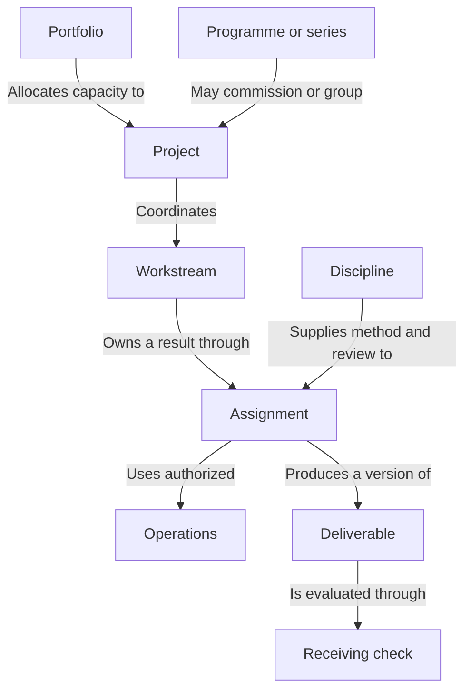
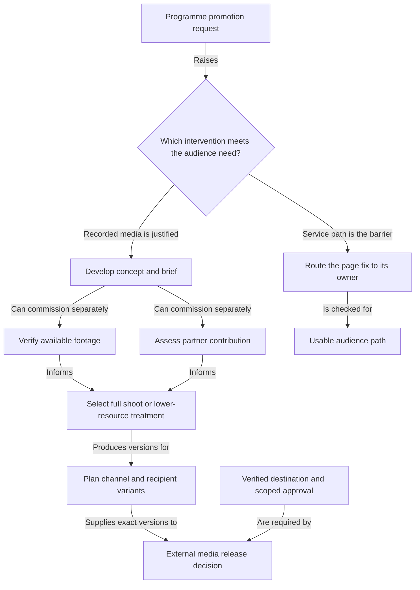

# Work Operating System · Work levels, categories, and forks

Proposed reference model for the Calgary Public Library media production role. The [shared work design](https://github.com/guarani-ux/Work-Operating-System/blob/main/docs/work-design.md) supplies the twelve existing work classes. The [operating model](https://github.com/guarani-ux/Work-Operating-System/blob/main/docs/operating-model-and-build-plan.md) supplies the portfolio, project, discipline, and assignment responsibilities. This map extends their use down to day-to-day planning and handoffs.

## 1. What level are we working at?

Use these levels as needed. A small one-off can go from a request to an assignment. A complex project can have several workstreams and several deliveries. A discipline lends expertise across levels. A deliverable can receive contributions from multiple workstreams.

| Level | What belongs at this level | Decision it supports | Example |
| --- | --- | --- | --- |
| **Portfolio** | The active commitments sharing time, people, equipment, and reviewers | Which outcomes get capacity now? | Balance a feature edit, a Teams event, and YouTube maintenance. |
| **Programme or series** | Related projects or episodes with an ongoing promise and common operating choices | What repeats, at what cadence, and with what success criteria? | A YouTube series or the ongoing Online School Events schedule. |
| **Project or initiative** | A specific outcome, accountable lead, scope, and finish conditions | What are we trying to deliver and who can make the consequential calls? | Family Reading Pick promotion, a staff video edition, or one school broadcast. |
| **Workstream** | A coherent area of responsibility contributing to the outcome or operating on an ongoing queue | Which work can proceed in parallel and where must it coordinate? | Recorded production, companion photography, partner coordination, or recurring catalogue upkeep. |
| **Work package or assignment** | One independently usable result with an owner, current inputs, authority, and receiver | Can someone take this from pickup to a result the next person can use? | Compare three treatments for the concept decision or prepare a review-ready V3 package. |
| **Task or operation** | An action or check inside the assignment | What exact action or evidence is needed next? | Inspect actual footage, check a caption file, or read back an approved link. |

An **episode** can be a project instance with its own deadline and handoff. A **deliverable** is an output linked to the work that produces and receives it. A **workflow** is a repeatable way of doing work, and a **stage** locates an item within that workflow. A **run** records a particular attempt. A **human approval** binds the exact artifact revision, use and scope.

## 2. What kind of work is it?

Use these twelve classes as a routing vocabulary. A job can use multiple classes. Choose a primary class when opening the work, then add others that actually change its method, ownership, or dependencies.

| Existing work class | Representative workflows or results |
| --- | --- |
| **End-to-end recorded video production** | Research and pitch, brief, concept, A/V script, workback, call sheet and shot list, capture, footage selects, edit, finishing, caption QA, review, release and evaluation. |
| **Live and hybrid production** | Audience and format decision, Microsoft Teams or Zoom platform plan, cameras and crew, stage and audio, presenter readiness, rehearsal, cues, fallbacks, live operation, replay and archive. |
| **Photography** | Coverage, shot plan, direction, permissions, capture, selects, retouching, caption/credit, delivery and reuse. |
| **Audio production** | Interview and voiceover preparation, signal routing, session capture, edit and mix, intelligibility and playback checks, transcript and delivery. |
| **Media campaigns and programme promotion** | Diagnose audience and service need, choose media or another response, creative development, channel variants, destination readiness, campaign timing and evaluation. |
| **Series development and operation** | Editorial promise, concept and pilot, repeatable format, cadence, episode commissioning, audience feedback, format revision or retirement. |
| **YouTube and catalogue management** | Commissioning and programming, metadata and packaging, titles, thumbnails, captions, chapters, playlists, publishing prep, catalogue maintenance and analytics. |
| **Partnership development and co-production** | Scouting, mutual fit, outreach draft, joint concept, contributions, permissions and credits, editorial responsibilities, cross-promotion and follow-through. |
| **Research and strategic recommendations** | Audience inquiry, peer comparison, trend monitoring, equipment review, source verification, synthesis, options and recommendations. |
| **Manager engagement and meeting facilitation** | Needs discovery, ideation, pitch and buy-in, kickoff or review prep, meeting facilitation and follow-through on decisions. |
| **Project and portfolio leadership** | Intake, priorities, capacity and scheduling, milestone ownership, conflict routing, workback, review queues and change impact. |
| **Production operations and team support** | Gear, storage and templates, asset access, vendor or technical preparation, automation qualification, training, support and recovery. |

Graphic design, motion graphics, writing, videography, editing, research, accessibility, analytics and technical direction are **disciplines**. They can appear inside several classes. A complex graphics package can have its own workstream, owner and receiving checks. Keep common skills and methods reusable across those workstreams.

### Common families of action

| Action family | What the worker actually does |
| --- | --- |
| **Intake and diagnosis** | Interpret the request, identify the intended change, find the first decision and connect current records. |
| **Research and evidence** | Retrieve, inspect, compare, identify uncertainty and establish what the evidence changes. |
| **Decision and design** | Develop options, develop or select a concept, evaluate fit, route a consequential choice. |
| **Planning and readiness** | Build the workback, assign responsibilities, allocate people and equipment, check permissions, and set contingencies. |
| **Production and operation** | Capture, create, run a live show, edit, retouch, mix or package the work. |
| **Review and verification** | Inspect exact assets, test usable outcomes, resolve feedback and obtain scoped decisions. |
| **Delivery and publishing** | Prepare the applicable destination, hand off exact versions, verify access and receipt, and release when authorized. |
| **Evaluation, maintenance and recovery** | Measure outcomes, reconcile changes, restore interrupted work, maintain evergreen assets, and carry a useful practice forward. |

Use action families at any work level. A partnership can begin with research and pause at a decision. A livestream can move from the show into replay, follow-up and learning. Post-production findings can inform the next concept or capture plan.

## 3. Where can the work fork?

| Fork | When it occurs | How it returns or closes |
| --- | --- | --- |
| **Direction or decision** | Several responses could serve the need, such as a recorded video, a service-page fix, or reusing an existing resource. | Carry evidence, tradeoffs and the decision owner. Record the selected route and what would reopen it. |
| **Parallel workstreams or assignments** | Results can be produced independently, such as a partner shortlist and a footage audit. | Name each independent result and receiving owner. Join only where a decision or delivery actually needs both. Count review capacity. |
| **Conditional route or fallback** | A condition changes, such as a remote Teams presenter losing the connection or a branch offering stills only. | Define the trigger, operator and recovery check. Rejoin the run of show or adopt the alternate treatment. |
| **Audience, channel or deliverable variant** | One source serves different users or destinations, such as staff replay versus public highlights, or landscape versus vertical. | Keep a shared basis where applicable. Give each variant its own receiver, requirements, rights, final version and release check. |
| **Authority, access or hold** | One audience, source, section or use lacks permission or a resolved decision. | Hold the affected use. Route the gap to its owner and keep separate authorized work ready. |
| **Revision or failed operation** | A change invalidates a prior review, or a partial action leaves its effect uncertain. | Recheck only affected materials and recipients. Inspect the actual effect before retrying. Retain earlier evidence with its version. |
| **Method or validation comparison** | The team needs to learn whether a new practice, tool or agent arrangement helps. | Keep a comparison basis and observable criteria. Record helpful, neutral and adverse results before deciding adoption. |
| **Git branch or worktree** | Independent design, research, or software changes need isolated editing and review. | Return a reviewed change to the shared design when warranted. The work-class branches hold reference material. Operational work is tracked through its project, task and receiving records. |

Record the **fork trigger, affected scope, owner, authority, independent work, and rejoin or close condition**. Keep an alternative inside the same assignment while it shares the same owner and receiver. Give it a separate assignment when it can produce a usable independent result, requires a different owner or authority, or must remain independently recoverable.

## 4. How to classify an incoming request

Capture only what changes the work. Link to the existing record wherever possible.

| Field | Question it answers |
| --- | --- |
| Level and parent | Is this a portfolio decision, an initiative, an ongoing workstream, or an assignment? What shares its commitments? |
| Work classes and disciplines | Which professional methods and people does it need? |
| Outcome, audience and receiver | What should happen and who needs the result? |
| Workflow and current stage | Where can work start from the current state? |
| Deliverables and destinations | What is being handed over, in which version, for which use? |
| Roles and authority | Who leads, produces, advises, reviews, operates, approves or receives? Which actions are authorized? |
| Dependencies, capacity and branches | What blocks or informs each path? Who can actually receive the returns this week? |
| Next action and evidence | What concrete move can proceed, and what will establish the result? |

**Work mode and context.** Mark whether the item is a one-off delivery, a recurring episode or event, an ongoing queue, or an exploratory inquiry. This determines whether it has an exit, a cadence, a service window, or a decision checkpoint. Record the role for this assignment, its audience and destination, and whether the next step happens digitally, on site, or across both. Use a tool for deterministic checks, delegate bounded judgment work when useful, and keep physical execution and consequential decisions with the designated people.

Choose the existing [graph view](https://drive.google.com/file/d/1hgyCFe4cNib77_GtV-8lYVXuELJTwfdV/view) that helps. Use the reference process model for the reusable method, the planning decision flow for choosing a route, the dependency graph for a specific plan, and the execution trace for observed work. Keep evidence status separate from relationship type.

## 5. Worked example · One initiative with competing paths

Illustrative Family Reading Pick intake. The request is a programme promotion. The project needs to confirm what parents or caregivers should be able to do and whether the programme page supports that action. If the page is the main barrier, its owner gets a verifiable destination issue and the media direction can be reconsidered. If a video is warranted, develop the concept with evidence and realistic scope. Photography, partner input, or a series connection are useful only if they change the outcome.

**Change check.** If the programme destination remains unverified, hold the affected external release. The concept and internal graphics preparation can continue within their scope. A later Teams rehearsal can still compete with editing for your time. Resolve that at portfolio level, with the actual review and edit capacity visible. If a partner says they opened an unlisted copy, record access to that exact version and check external-use authority separately.

**Second shape.** For one Teams event, use a live-production workstream with distinct technical, presenter, and audience-side checks. If presenter connectivity fails, the producer selects the agreed fallback and the live operation rejoins the run of show. The replay has a separate version, use and receiving check. For a small camera-support assignment, open the call sheet and scope the coverage and resulting files to that assignment.

## Source and scope

[Existing Work Operating System work classes and Git branches](https://github.com/guarani-ux/Work-Operating-System#work-branches) · [Operating model](https://github.com/guarani-ux/Work-Operating-System/blob/main/docs/operating-model-and-build-plan.md) · [Existing graph catalog](https://drive.google.com/file/d/1hgyCFe4cNib77_GtV-8lYVXuELJTwfdV/view)

The levels, action families, and fork types are proposed design vocabulary. The worked examples are illustrative. Keep Asana read-only, keep restricted source records in the authorized systems, and give each consequential action its own authority and receiving check.
